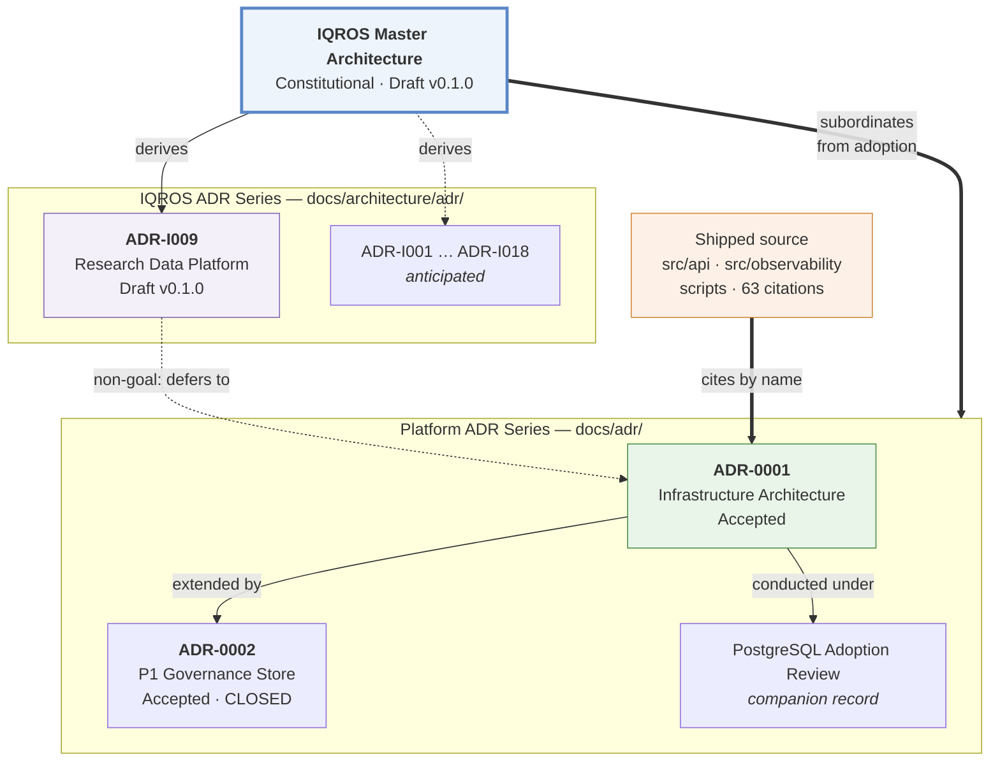

# Architecture Documentation Index

| Field | Value |
|---|---|
| **Purpose** | Authoritative index of all architecture and decision documents; defines naming, numbering, and status conventions |
| **Status** | Active |
| **Version** | 1.0.0 |
| **Last Updated** | 2026-08-04 |
| **Maintained by** | Rohith Suresh |
| **Established by** | Architecture Documentation Governance Audit, 2026-08-04 |

This index is **governance, not architecture.** It defines where documents live, how they are named and numbered, and how they relate. It makes no architectural decisions and overrides no document's content.

---

## 1. Document Series

Three distinct series exist. **Their identifier namespaces are disjoint by construction.**

| Series | Namespace | Location | Governs | Authority |
|---|---|---|---|---|
| **Constitutional** | *(unnumbered)* | `docs/architecture/` | The whole ecosystem | Highest. Amendable only by constitutional session |
| **IQROS ADR** | `ADR-I###` | `docs/architecture/adr/` | Ecosystem-wide decisions deriving from the constitution | Subordinate to constitutional; supersedes platform series on shared subjects from adoption forward |
| **Platform ADR** | `ADR-####` | `docs/adr/` | Bitcoin Research Platform infrastructure and governance | Subordinate to constitutional from adoption forward |

> **Why two ADR series.** The platform series predates the constitutional architecture and is cited **63 times across the repository, including in ~17 shipped source files** (`src/api/*`, `src/observability/`, `src/runtime/`, `scripts/`). Renaming it would invalidate live code comments. The IQROS series therefore uses a disjoint namespace (`ADR-I###`) so the two can coexist without ambiguity, permanently.

---

## 2. Constitutional Architecture

| Document | Status | Version | Scope |
|---|---|---|---|
| [IQROS Master Architecture](iqros_master_architecture.md) | **Draft** | 0.1.0 | Bitcoin Research Platform · StrataTrade · BankNifty Observatory · future asset classes |

Defines 20 Articles: Vision, Design Philosophy (`Ph1`–`Ph8`), Core Principles (`IQROS-P1`–`P15`), Platform Decomposition, Responsibilities (`R1`–`R10`), Data Ownership, Research Asset Taxonomy, Consumer Taxonomy, Cross-Platform Boundaries (Tiers T0–T4), Data Flow, Governance (`G1`–`G7`), Multi-Asset, Shared Infrastructure, CI/CD (`CI1`–`CI7`), Deployment (`D1`–`D6`), API (`API1`–`API6`), Security (`S1`–`S8`), Observability (`O1`–`O8`), AI Platform (`AI1`–`AI8`), Evolution (`E1`–`E8`).

**Every future ADR in any series must be derivable from this document and must cite the Articles it derives from.**

---

## 3. IQROS ADR Series — Written

| ADR | Status | Version | Subject | Derives from |
|---|---|---|---|---|
| [`ADR-I009`](adr/ADR-I009-research-data-platform.md) | **Draft** | 0.1.0 | **Research Data Platform** — storage zones, ownership, lifecycle, operational/research artifact boundary, export contracts, canonical data model, retention, versioning, integrity, multi-asset readiness | `IQROS-P1`, `P2`, `P3`, `P4`, `P5`, `P6`, `P7`, `P12`, `P14`, `P15`; `Ph2`, `Ph6`; Articles 4, 5, 12, 13 |
| [`ADR-I010`](adr/ADR-I010-feature-store-architecture.md) | **Draft** | 0.1.0 | **Feature Store Architecture** — feature registry, value store, contracts, metadata, versioning, lifecycle, compute-on-read vs materialisation, validation, governance, provenance, dataset integration, multi-asset | `IQROS-P1`–`P8`, `P10`, `P12`, `P15`; `Ph2`, `Ph3`, `Ph6`; Articles 4, 7, 12; `ADR-I009` |
| [`ADR-I011`](adr/ADR-I011-label-store-architecture.md) | **Draft** | 0.1.0 | **Label Store Architecture** — label registry, two-tier value store, specifications, metadata, versioning, maturity lifecycle, validation, governance, provenance, dataset integration, multi-horizon, multi-asset | `IQROS-P1`–`P10`, `P12`, `P15`; `Ph2`, `Ph3`, `Ph6`, `Ph7`; Articles 7, 12; `ADR-I009`, `ADR-I010` |
| [`ADR-I012`](adr/ADR-I012-research-dataset-builder.md) | **Draft** | 0.1.0 | **Research Dataset Builder** — dataset registry, bidirectional citation index, specifications, assembly pipeline with six refusal points, metadata, versioning, lifecycle, validation, governance, provenance, Research vs Training Dataset, three-level reproducibility, multi-asset | `IQROS-P1`–`P10`, `P12`, `P14`, `P15`; `Ph2`, `Ph3`, `Ph6`, `Ph7`; Articles 4, 7, 8, 12; `ADR-I009`, `ADR-I010`, `ADR-I011` |
| [`ADR-I013`](adr/ADR-I013-research-experiment-framework.md) | **Draft** | 0.1.0 | **Research Experiment Framework** — experiment registry as multiplicity census, hypothesis specifications, experiment lifecycle, pinned statistical protocols, lockbox integration, Result/Evidence separation, provenance, validation, governance, research reports, promotion readiness, multi-asset | `IQROS-P1`–`P10`, `P12`, `P14`, `P15`; `Ph1`, `Ph2`, `Ph3`, `Ph6`, `Ph7`, `Ph8`; Articles 4, 7, 8, 11, 12; `G1`; `ADR-I009`–`ADR-I012` |
| [`ADR-I014`](adr/ADR-I014-admissibility-framework.md) | **Draft** | 0.1.0 | **Admissibility Framework** — *constitutional governance*: five-dimension product lattice, componentwise ordering, meet/join semantics, artifact · promotion · evidence · dataset · experiment · strategy admissibility, governance, versioning, extensibility | Specifies `IQROS-P4`, `P6`, `Ph6`; conforms `P3`, `P5`, `P7`, `P8`, `P9`, `P15`, `Ph3`, `Ph8`; Articles 7, 8, 12, 19 |
| [`ADR-I015`](adr/ADR-I015-receipt-contract.md) | **Draft** | 0.1.0 | **Receipt Contract** — *constitutional governance*: receipt purpose, lifecycle, ownership, identity, metadata, immutability, provenance, four-layer verification, admissibility relationship, relationships, governance, extensibility. Supports evidence · dataset · experiment · promotion · execution receipt classes | Specifies `IQROS-P10`, `P5`; conforms `P1`, `P2`, `P3`, `P4`, `P8`, `P11`, `P15`, `S5`, `S6`, `Ph3`, `Ph6`, `G1`, `G5`; `ADR-I014` |
---

## 4. IQROS ADR Series — Anticipated

Reserved subjects. **None are written; none are authorised.** Numbers are allocated from this list, so gaps in the written series are expected and correct.

| ADR | Subject | Derives from |
|---|---|---|
| `ADR-I001` | Adoption of IQROS as constitutional architecture — must precede all others *in force* | Article 20 (`E1`) |
| `ADR-I002` | Platform conformance declaration format and CI verification | `IQROS-P1`, Article 9 |
| `ADR-I003` | Reaffirmation or amendment of the Tier 4 prohibition | Article 9 (T4) |
| ~~`ADR-I004`~~ | Admissibility lattice — **written as [`ADR-I014`](adr/ADR-I014-admissibility-framework.md)** by owner direction (2026-08-04). Number retired unused; never reallocated (NS4). | `IQROS-P4`, Article 18 |
| `ADR-I005` | Six-domain health model: aggregator ownership and persistence | Article 18 |
| ~~`ADR-I006`~~ | Research Dataset registry — **written as [`ADR-I012`](adr/ADR-I012-research-dataset-builder.md)** by owner direction (2026-08-04). Number retired unused; never reallocated (NS4). | `IQROS-P5`, Article 7 |
| ~~`ADR-I007`~~ | Feature Store — **written as [`ADR-I010`](adr/ADR-I010-feature-store-architecture.md)** by owner direction (2026-08-04). Number retired unused; never reallocated (NS4). | Article 7, `Ph2` |
| ~~`ADR-I008`~~ | Label Store — **written as [`ADR-I011`](adr/ADR-I011-label-store-architecture.md)** by owner direction (2026-08-04). Number retired unused; never reallocated (NS4). | Article 7 |
| ~~`ADR-I009`~~ | *Written — see §3* | — |
| ~~`ADR-I010`~~ | *Written — Feature Store Architecture, see §3* | — |
| ~~`ADR-I011`~~ | *Written — Label Store Architecture, see §3* | — |
| ~~`ADR-I012`~~ | *Written — Research Dataset Builder, see §3* | — |
| ~~`ADR-I013`~~ | *Written — Research Experiment Framework, see §3* | — |
| ~~`ADR-I014`~~ | *Written — Admissibility Framework, see §3* | — |
| ~~`ADR-I015`~~ | *Written — Receipt Contract, see §3* | — |
| `ADR-I016` | Credential disaster recovery and control-observability requirements | Article 17 (`S5`, `S8`) |
| `ADR-I017` | Agent consumer contract, refusal surface, hash-citation requirement | Article 19 |
| `ADR-I018` | Execution authorisation protocol for the first live-trading platform | `IQROS-P8`, Article 11 |
| `ADR-I019` | Cold archive **activation** and the failure-isolation test — *relocated from `ADR-I010`, 2026-08-04* | Article 13, `IQROS-P13` |
| `ADR-I020` | Cross-platform shadow-consumption contract — *relocated from `ADR-I011`, 2026-08-04* | `IQROS-P11` |
| `ADR-I021` | Non-crypto asset-class dimensions: calendars, sessions, corporate actions — *relocated from `ADR-I012`, 2026-08-04* | Article 12 |
| `ADR-I022` | **Model registry** — models cite Training Datasets by hash; partition split must be reconstructable. *Newly identified by `ADR-I012` §20.2* | Article 7, `IQROS-P5` |
| `ADR-I023` | Platform-vs-domain decision procedure for a new asset class — *relocated from `ADR-I013`, 2026-08-04* | Article 12 §12.3 |
| `ADR-I024` | **Threshold governance protocol** — how a threshold set is versioned, frozen, and revised. *Newly identified by `ADR-I013` §20.2* | `IQROS-P9`, Article 11 |
| `ADR-I025` | Shared CI templates as Tier 2 adopt-by-copy artifacts — *relocated from `ADR-I014`, 2026-08-04* | Article 14 |
| `ADR-I026` | Cross-platform read-only aggregation over published artifacts — *relocated from `ADR-I015`, 2026-08-04* | Article 16 |

---

## 5. Platform ADR Series

| ADR | Status | Subject | Notes |
|---|---|---|---|
| [`ADR-0001`](../adr/0001-infrastructure-architecture.md) | **Accepted** — implementation contract | Infrastructure Architecture | Extended by `ADR-0002`. Cited 63× repo-wide, incl. shipped source. **Do not rename.** |
| [`ADR-0002`](../adr/0002-p1-governance-store-consolidation.md) | **Accepted** — Program P1 CLOSED (2026-07-26) | Program P1 — Governance Store Consolidation | Extends `ADR-0001`; defines `ADR-P1-1`…`ADR-P1-5` |

### 5.1 Companion Records (not ADRs)

Decision and review records conducted *under* an ADR. They are **not** numbered in any ADR series.

| Document | Conducted under | Verdict |
|---|---|---|
| [PostgreSQL Adoption Review](../adr/review-postgresql-adoption-2026-07-18.md) | `ADR-0001` §18, §19 | PostgreSQL not justified |

> **Renamed 2026-08-04.** Formerly `0001-postgresql-adoption-review-2026-07-18.md`. The `0001-` prefix falsely implied it *was* ADR-0001; it is a review conducted under it. Zero references existed, so the rename was risk-free. Content unchanged.

---

## 6. Architecture Reviews

Reviews assess written documents as an integrated system. They **create no architecture and resolve no finding** — they classify and record.

| Review | Status | Scope | Verdict |
|---|---|---|---|
| [Research Platform Review v1](reviews/research-platform-review-v1.md) | Complete | IQROS + `ADR-I009`–`ADR-I013` | **Architecturally coherent.** 0 Critical · 5 Major · 4 Minor · 4 Observations. Qualified yes on founding the Trading Platform series |
| [Constitutional Gap Analysis v1](reviews/constitutional-gap-analysis-v1.md) | Complete | IQROS + `ADR-I014` + `ADR-I015` + Review v1 | **`M4` and `M5` are not the same kind of gap.** Recommends **three vehicles, two document kinds** — not the two options proposed. `M5b` (namespace) is an Index amendment, not an ADR |

**Finding disposition.** Reviews are dated records and are never amended (`RV1`). Resolution is tracked here.

| Finding | Status | Resolved by |
|---|---|---|
| `M1` — admissibility lattice undefined | **Resolved** | [`ADR-I014`](adr/ADR-I014-admissibility-framework.md) §2–§4 |
| `M2` — provenance lane vocabulary undefined | **Resolved** | [`ADR-I014`](adr/ADR-I014-admissibility-framework.md) §2.2 |
| `M3` — receipt contract undefined | **Resolved** | [`ADR-I015`](adr/ADR-I015-receipt-contract.md) |
| `M4` — holdout vs lockbox unreconciled | Open — **structure determined** | Vehicle **V1**: constitutional ADR specifying `IQROS-P7` ([analysis](reviews/constitutional-gap-analysis-v1.md) §3) |
| `M5a` — undeclared upward delegation | Open — **contingent** | Vehicle **V3**: blocked on an Article 4 determination ([analysis](reviews/constitutional-gap-analysis-v1.md) §6.3) |
| `M5b` / `m1` / `m2` — rule namespace | Open — **structure determined** | Vehicle **V2**: **Index amendment, not an ADR**. Highest priority — cost already recurring ([analysis](reviews/constitutional-gap-analysis-v1.md) §7.3) |
| `m3`, `m4`, `O1`–`O4` | Open | — *(`m1`, `m2` folded into `M5b` above)* |

**Naming:** `reviews/<subject>-<kind>-v<N>.md`, where `<kind>` is `review` or `analysis`. Versioned, not dated — re-examining the same subject increments `N`.

**Rule RV1.** A review may not alter any document it reviews. Findings are recorded; resolution is a separate, separately-authorised act.

---

## 7. Supporting Architecture Documents

Not ADRs, but architecturally load-bearing. Cited by the constitutional document's References section.

| Area | Documents |
|---|---|
| **Governance specifications** | `docs/governance/` — contract versioning, data completeness gate, evidence reporting architecture, governance receipts, transition governance, `n_trials` reconciliation, P1 assurance declaration |
| **Governance schema references** | `docs/governance/*_schema_reference.md` — implementation references for shipped governance subsystems |
| **Research program** | `docs/research/` — research program, consolidated roadmap, discretionary evidence framework |
| **Operations** | `docs/ops/` — deployment, off-host backup, restore drill, migration runbooks, readiness reviews |
| **Interfaces** | `docs/api/read-only-api.md`, `docs/docker/` |
| **Runbook** | `docs/runbook.md` |

---

## 8. Naming Conventions

| Series | File pattern | Title pattern |
|---|---|---|
| Constitutional | `<name>_master_architecture.md` | `# <NAME> — <Full Name>` |
| IQROS ADR | `ADR-I###-<kebab-subject>.md` | `# ADR-I###: <Subject>` |
| Platform ADR | `####-<kebab-subject>.md` | `# ADR-#### — <Subject>` |
| Companion record | `review-<subject>-<YYYY-MM-DD>.md` or `<subject>-<YYYY-MM-DD>.md` | Descriptive; **no ADR number prefix** |
| Index | `README.md` | `# Architecture Documentation Index` |

**Rule N1.** A document that is not an ADR must never carry an ADR-number prefix.
**Rule N2.** The platform series retains its existing lowercase pattern; it is not retrofitted.
**Rule N3.** New IQROS documents use the `ADR-I###` uppercase pattern.

---

## 9. Numbering Strategy

| Rule | Statement |
|---|---|
| **NS1** | The two ADR namespaces (`ADR-####`, `ADR-I###`) are **disjoint and permanent**. Neither may issue an identifier in the other's space. |
| **NS2** | IQROS identifiers are **allocated from the anticipated-subject list** (§4). A written ADR keeps the number reserved for its subject. |
| **NS3** | **Gaps are expected and correct.** `ADR-I009` existing before `ADR-I001` is not a defect — ADR numbers are identifiers, not a sequence. |
| **NS4** | Identifiers are **never reused**, even if a document is withdrawn. A withdrawn ADR keeps its number and is marked `Superseded` or `Withdrawn`. |
| **NS5** | If an anticipated subject is written with **broader scope** than reserved, it keeps the reserved number and states the expansion in its header. |
| **NS6** | A subject not on the anticipated list takes the **next unallocated** `ADR-I###` and is added to §4 retrospectively. |
| **NS7** | Platform-series numbering is **frozen** at `0001`/`0002`. New ecosystem decisions go to the IQROS series. |
| **NS8** | The owner may **direct an allocation** that overrides NS2. When this occurs: the displaced anticipated subject is **relocated to a new number** (never silently dropped), the vacated reserved number is **retired unused** and never reallocated (NS4), and both moves are recorded in §13.1. Allocation is an owner prerogative; the *record* of it is not optional. Recorded in §13.1. |

---

## 10. Status Vocabulary

| Status | Meaning | Applies to |
|---|---|---|
| **Draft** | Written, not adopted. No force. | Constitutional, IQROS ADR |
| **Active** | In force as governance, not a decision | Index, standards |
| **Accepted** | Adopted and binding | Platform ADR |
| **Superseded** | Replaced; retained for history | Any |
| **Withdrawn** | Abandoned; number never reused | Any |

**Rule ST1.** A document may not have force greater than the document it depends on. `ADR-I009` is Draft because IQROS is Draft — adoption of IQROS (`ADR-I001`) must precede it in force (IQROS `E1`).

---

## 11. Version Conventions

| Rule | Statement |
|---|---|
| **V1** | New documents use three-part semantic versioning (`MAJOR.MINOR.PATCH`). |
| **V2** | `MAJOR` increments on a change altering a normative rule; `MINOR` on added content; `PATCH` on editorial correction. |
| **V3** | Legacy platform ADRs carry **no version field**. This is **accepted, not corrected** — retrofitting would modify accepted documents to no governance benefit. Their status field is authoritative. |
| **V4** | A document's `Depends On` must name the **exact version** it derives from. |

---

## 12. Dependency Graph

---

## 13. Governance Audit Findings — 2026-08-04

Audit scope: ADR numbering conflicts, naming consistency, cross-references, broken links, duplicate responsibilities, constitutional references, status consistency, version consistency, folder organisation, numbering strategy.

| # | Finding | Severity | Resolution |
|---|---|---|---|
| **F1** | Two documents titled `ADR-0001` — platform Infrastructure vs IQROS Research Data Platform | **High** — 63 citations incl. shipped source could resolve to the wrong document | **Resolved.** New document renumbered `ADR-0001` → `ADR-I009`; disjoint namespace established (NS1). Legacy ADR untouched. |
| **F2** | `0001-postgresql-adoption-review-*.md` carried an ADR-number prefix but is a review, not an ADR — an apparent *third* `0001` in one folder | Medium | **Resolved.** Renamed to `review-postgresql-adoption-2026-07-18.md` (0 references). Rule N1 added. Content unchanged. |
| **F3** | Two naming patterns coexist: `0001-lowercase.md` and `ADR-0001-Uppercase.md` | Low | **Accepted and documented** (§7 N2/N3). Series-specific patterns are now a rule, not drift. |
| **F4** | No index existed; documents discoverable only by directory listing | Medium | **Resolved.** This document. |
| **F5** | Version conventions inconsistent — `0.1.0` vs `0.1`; legacy ADRs have no version field | Low | **Partially resolved.** `ADR-I009` normalised to `0.1.0`. Legacy ADRs left unversioned by rule V3. |
| **F6** | Constitutional `Extends` field said "`ADR-0001` and `ADR-0002`" without naming the series — ambiguous after F1 | Medium | **Resolved.** Field now names the platform series explicitly. |
| **F7** | Broken links | **None found** | All relative links verified to resolve. |
| **F8** | Duplicate architectural responsibilities | **None found** | `ADR-I009` §5 Non-Goals explicitly defers collector design to platform `ADR-0001`; no overlap. |
| **F9** | Constitutional references | **Conforming** | `ADR-I009` §6 references 13 IQROS Articles by identifier and redefines none, per `E1`. |
| **F10** | Folder organisation — governance/research/ops docs sit outside `docs/architecture/` | Low | **Accepted.** They are supporting documents, not architecture decisions. Indexed in §6 rather than moved; moving them would break references for no governance gain. |

### 13.1 Allocation Record — Owner-Directed Allocations (NS8)

Each row is one exercise of NS8: an owner-directed number that displaced a reserved subject. Every displacement is recorded; none is silent.

| Date | Allocated | Retired unused (NS4) | Relocated |
|---|---|---|---|
| 2026-08-04 | Feature Store Architecture → `ADR-I010` | `ADR-I007` → redirects to `ADR-I010` | Cold archive activation: `ADR-I010` → `ADR-I019` |
| 2026-08-04 | Label Store Architecture → `ADR-I011` | `ADR-I008` → redirects to `ADR-I011` | Cross-platform shadow contract: `ADR-I011` → `ADR-I020` |
| 2026-08-04 | Research Dataset Builder → `ADR-I012` | `ADR-I006` → redirects to `ADR-I012` | Non-crypto asset dimensions: `ADR-I012` → `ADR-I021` |
| 2026-08-04 | Research Experiment Framework → `ADR-I013` | *(none — new subject, NS6)* | Platform-vs-domain procedure: `ADR-I013` → `ADR-I023` |
| 2026-08-04 | Admissibility Framework → `ADR-I014` | `ADR-I004` → redirects to `ADR-I014` | Shared CI templates: `ADR-I014` → `ADR-I025` |
| 2026-08-04 | Receipt Contract → `ADR-I015` | *(none — new subject, NS6)* | Cross-platform aggregation: `ADR-I015` → `ADR-I026` |

**Pre-flight in both cases:** the conflict was detected *before writing*, reported to the owner, and resolved by direction rather than by convention. No subject was dropped and no retired number was reallocated.

> **Established pattern.** Owner-directed allocation (NS8) is now the normal path, not an exception: three consecutive ADRs have been allocated by number rather than by reserved subject. NS2's reservation list therefore functions as a **subject backlog**, not a number allocator. This is recorded as fact, not as a finding — the mechanism works and every displacement is traceable.

> **Cross-reference cost, measured.** The `ADR-I012` allocation invalidated **ten** in-document citations of `ADR-I006` across three written ADRs, plus three stale forward-references to retired numbers. All thirteen were updated in the same pass. This cost scales with the number of written ADRs and is the concrete reason NS8 mandates a recorded relocation rather than a silent one.

### 13.2 What Was Deliberately Not Changed

| Item | Reason |
|---|---|
| `docs/adr/0001-infrastructure-architecture.md` filename | 63 citations, ~17 in shipped source. Renaming would invalidate live code comments — unacceptable blast radius for a cosmetic gain. |
| Any document's architectural content | Out of audit scope by instruction. |
| Legacy ADR version fields | Rule V3 — retrofitting accepted documents yields no governance benefit. |
| Platform ADR numbering pattern | Rule N2 — retrofitting would recreate F1. |
| `docs/governance/`, `docs/research/`, `docs/ops/` locations | Rule F10 — indexed, not relocated. |

---

## 14. Adding a New Document

1. Determine the series (§1). Ecosystem-wide decisions → IQROS series.
2. Allocate an identifier per §9. Prefer a reserved anticipated number (NS2).
3. Name per §8.
4. Include a header table: Title, Status, Version, Document Type, Depends On (with exact version), Supersedes, Authors, Last Updated.
5. Cite the IQROS Articles it derives from. **Do not redefine them** (`E1`).
6. Add it to §3 or §5 of this index, and mark any anticipated entry as written.
7. Verify every relative link resolves.

---

*This index records documentation governance only. It makes no architectural decision and alters no document's architectural content.*
