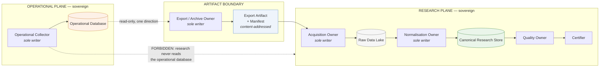
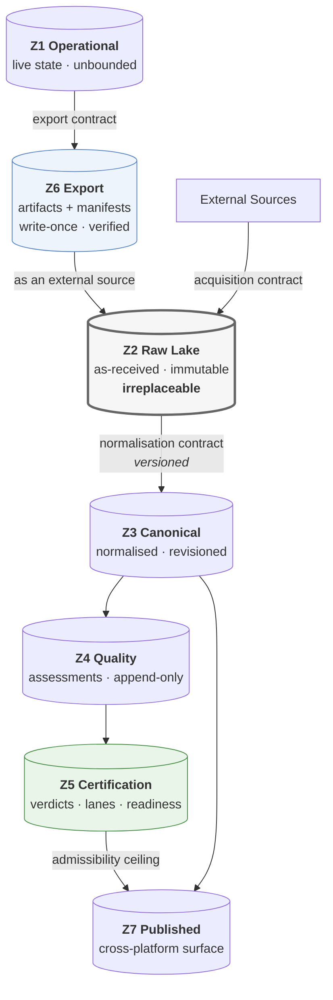
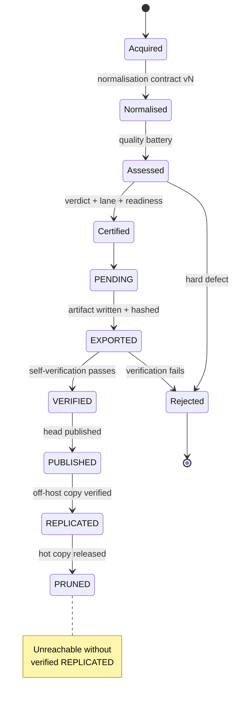
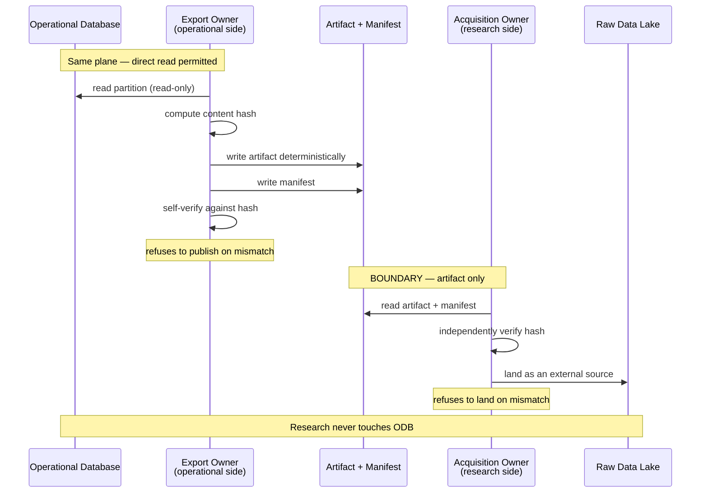

# ADR-I009: Research Data Platform

| Field | Value |
|---|---|
| **Title** | ADR-I009 — Research Data Platform |
| **Status** | **Draft** |
| **Version** | 0.1.0 |
| **Document Type** | Architecture Decision Record (IQROS series) |
| **Depends On** | [IQROS Master Architecture](../iqros_master_architecture.md) v0.1.0 |
| **Supersedes** | None |
| **Authors** | Rohith Suresh — Owner / Architect · Drafted with Claude Opus 5 |
| **Last Updated** | 2026-08-04 |

> **Series note.** This document belongs to the **IQROS series** (`ADR-I###`), housed under `docs/architecture/adr/`, whose decisions derive from the constitutional architecture. It is distinct from the **platform series** (`ADR-####`) under `docs/adr/`, which governs the Bitcoin platform's infrastructure and governance-store decisions. The two namespaces are disjoint by construction — see [Architecture Documentation Index](../README.md) §Numbering Strategy. The identifier `ADR-I009` was allocated from the IQROS anticipated-subject list, where it was reserved for raw/canonical separation and partition revisioning; this document fulfils and exceeds that scope.

---

## 1. Context

The Bitcoin Research Platform — the IQROS reference implementation — has been audited across eleven dimensions at commit `c14ba38`. That audit established a specific and unusual situation: **most of a research data platform already exists, built in pieces, at different times, with one major piece complete and connected to nothing.**

What exists and works:

| Capability | Audited state |
|---|---|
| Operational collection | Single-writer, WAL-mode transactional store; one writer per populated table |
| Partitioned research storage | Hive-partitioned columnar lake, four ingest paths, embedded analytical query engine |
| Partition quality assessment | Severity-tiered check battery, already handling real source pathologies |
| Daily certification | Verdict per collection day, with a policy rule marking non-production data as non-admissible |
| Cold archive writer | **Complete implementation** — content hashing, deterministic artifacts, manifests, a dependency-inversion port |
| Archive lifecycle | **Frozen state machine** (M1.1 v1.0), states beyond self-verification declared future work |
| Backup and restore | Consistent hot backup, hash manifests, generational retention, encrypted off-host path |

What is missing is not components. It is **the connective architecture**: the archive writer has zero consumers and its feature flag is referenced nowhere; the certification verdict gates nothing; normalisation is fused into acquisition so as-received data no longer exists; the operational store has no retention policy and grows unbounded; and no artifact carries the conditioning statement under which its observations exist.

IQROS Article 4 names seven planes in a platform instance. This ADR specifies the **Storage plane** and the boundary at which the **Acquisition** and **Evidence** planes meet it.

---

## 2. Problem Statement

Six problems, each traceable to audited evidence.

| ID | Problem | Consequence |
|---|---|---|
| **PS1** | **As-received data does not survive acquisition.** Normalisation occurs during ingest and produces the stored value. | A normalisation defect is unfixable without re-fetching, and some sources cannot be re-fetched. A silent upstream format change produced empty partitions once already. |
| **PS2** | **Partition identity is a path, not a hash.** A re-ingest overwrites. | Upstream restatement silently changes historical results. Nothing can be reproduced by reference. |
| **PS3** | **The operational store is unbounded.** No retention, no partitioning, no archival path is connected. | Growth is monotonic at roughly one hundred thousand rows per day, with no mechanism to bound it. |
| **PS4** | **The archive writer is unwired.** A complete cold-archive implementation is referenced by nothing. | The only mechanism that could bound PS3 is inert. |
| **PS5** | **Certification gates nothing.** The verdict is produced and consumed by no storage or research path. | Admissibility is advisory. A consumer can build on uncertified data without any refusal occurring. |
| **PS6** | **Conditioning is not carried.** The option corpus is a near-the-money, near-dated sliding window; nothing records that. | A consumer will eventually treat a conditioned sample as a complete record — the highest-consequence silent error available to this platform (IQROS `Ph7`). |

**The unifying problem:** the platform can produce research data but cannot make a *durable, citable, admissibility-carrying statement* about it. Everything downstream — datasets, features, labels, evidence — inherits that gap.

---

## 3. Design Goals

| ID | Goal | Addresses |
|---|---|---|
| **DG1** | Preserve the irreplaceable in as-received form, separately from any derivation | PS1 |
| **DG2** | Give every partition a content-derived identity and revision history | PS2 |
| **DG3** | Make the operational store's growth bounded by an architecture, not by an operator | PS3, PS4 |
| **DG4** | Give the archive writer a defined consumer and lifecycle position | PS4 |
| **DG5** | Make admissibility inheritable and refusable, not advisory | PS5 |
| **DG6** | Carry conditioning as non-erasable metadata | PS6 |
| **DG7** | Preserve compute-on-read; add no new drift surface | IQROS `Ph2` |
| **DG8** | Preserve operational/research separation absolutely | IQROS-P1, Article 9 |
| **DG9** | Keep the boundary crossing verifiable by an outside party | IQROS-P14 |

---

## 4. Scope

**In scope.** The Storage plane of a single IQROS platform instance, and the boundary at which operational data becomes research data:

- The Operational Database as a *source*, not as a design subject
- The Raw Data Lake
- The Canonical Research Store
- The Artifact Boundary and Export Contracts
- Storage zones, ownership, lifecycle, retention, versioning, integrity
- The interface this platform presents *upward* to Evidence and Research

**Applies to.** Every IQROS platform instance. The Bitcoin Research Platform is the first conforming instance; StrataTrade, BankNifty Observatory, and future asset-class platforms conform independently, sharing this specification at IQROS Tier 1 and **never at Tier 4**.

---

## 5. Non-Goals

| Not in scope | Governed by |
|---|---|
| Feature Store design | [`ADR-I010`](ADR-I010-feature-store-architecture.md) |
| Label Store maturation semantics | [`ADR-I011`](ADR-I011-label-store-architecture.md) |
| Research Dataset sealing and registry | A future ADR (`ADR-I012`) |
| Operational collector design | Legacy `docs/adr/0001-infrastructure-architecture.md` |
| Evidence certification *rules* | The Evidence Standard; this ADR consumes verdicts, it does not define checks |
| Cross-platform aggregation | `ADR-I015`; this ADR defines only what may be published |
| Any migration, sequencing, or rollout | Explicitly excluded by instruction |
| Redefinition of any IQROS Article | Prohibited by IQROS `E1` |

---

## 6. Architectural Principles

This ADR **applies** constitutional principles; it does not restate or extend them.

| IQROS reference | Application in this ADR |
|---|---|
| **IQROS-P1** Platform Sovereignty | Each platform owns its own lake, canonical store, archive, and export pipeline. No cross-platform storage. |
| **IQROS-P2** Single Writer | Every storage zone (§9) has exactly one writer, architecturally enforced. |
| **IQROS-P3** Assert, Never Repair | Quality assessment and integrity verification report by name and refuse. Storage never imputes, backfills, or silently drops. |
| **IQROS-P4** Admissibility Lattice | Certification verdict, provenance lane, and readiness compose to an admissibility ceiling carried by every published artifact. |
| **IQROS-P5** Content Addressing | Partition revisions, export artifacts, and manifests are identified by content hash. |
| **IQROS-P6** Provenance Lanes | Lane is assigned at acquisition and is immutable; it caps everything derived. |
| **IQROS-P7** Sealed Regions | Sealed spans are enforced at the storage boundary, not in analysis code. |
| **IQROS-P12** Conditioning Carried | Every artifact states its conditioning; loss of conditioning is a defect, not a formatting choice. |
| **IQROS-P14** Boundary Handoff by Artifact | The operational→research crossing is artifact + manifest only. |
| **IQROS-P15** Negative Records Persist | Failed quality assessments and rejected exports are permanent records. |
| **IQROS `Ph2`** Reproducibility by refusal to persist | Derived values are recomputed. Only the irrecoverable is stored. |
| **IQROS `Ph6`** Absence is not permission | An uncertified span caps admissibility; it does not pass silently. |
| **IQROS Article 4** | This ADR specifies the Storage plane and its two adjacent boundaries. |
| **IQROS Article 13** | The failure-isolation test governs any shared storage infrastructure. |

---

## 7. Platform Responsibilities

Within IQROS Article 5's responsibility set, this ADR discharges **R2 (Preserve)** in full and defines the storage-side obligations of **R1 (Acquire)** and **R3 (Certify)**.

| Responsibility | Storage-plane obligation |
|---|---|
| **R1 Acquire** | Deliver as-received bytes plus acquisition metadata to the Raw Data Lake. Perform **no** normalisation. |
| **R2 Preserve** | Retain raw indefinitely; produce revisioned canonical data under a versioned normalisation contract; assess quality per partition; archive per the frozen lifecycle. |
| **R3 Certify** | Consume quality assessments; publish verdicts. Storage records verdicts; it never issues them. |
| **R7 Observe** | Emit health signals for the Data Collection and Evidence domains of IQROS Article 18. |
| **R10 Refuse** | Refuse writes violating zone invariants; refuse export of unverified artifacts; refuse to answer a query that would cross a sealed region. |

---

## 8. Data Ownership

Per IQROS-P2, every zone has exactly one writer. Ownership is immutable; transfer requires a new zone.

| Zone | Sole writer | Access for all others |
|---|---|---|
| Operational Database | Operational collector | **No research reader, ever** |
| Raw Data Lake | Acquisition owner | Read-only |
| Canonical Research Store | Normalisation owner | Read-only |
| Quality assessment records | Quality owner | Read-only |
| Certification records | Certifier | Read-only |
| Export artifacts | Export/Archive owner | Read-only |
| Export catalog | Export/Archive owner | Read-only |
| Published artifact surface | Publication owner | Read-only, cross-platform as **shadow** (IQROS-P11) |

---

## 9. Storage Zones

Seven zones, distinguished by **mutability class and recoverability** — not by convenience.

| Zone | Contents | Mutability | If lost |
|---|---|---|---|
| **Z1 Operational** | Live collection state | Insert-only in practice; unbounded | Recoverable from backup only |
| **Z2 Raw Lake** | As-received bytes + acquisition metadata | Write-once; revisions only | **Possibly unrecoverable** |
| **Z3 Canonical** | Normalised, partitioned research data | Immutable per revision | Recoverable from Z2 |
| **Z4 Quality** | Per-partition assessments, severity, coverage | Append-only | Historical assessment lost |
| **Z5 Certification** | Verdicts, provenance lane, readiness | Append-only | Historical judgment lost |
| **Z6 Export** | Boundary artifacts + manifests + catalog | Write-once, verified | Recoverable from Z1 while Z1 retains |
| **Z7 Published** | Artifacts offered to other platforms | Write-once | Consumers lose shadow input |

**Zone separation is a policy statement, not a layout.** Z2 and Z5 can never be deleted; Z6 can be regenerated while its source persists. Co-locating zones with different retention obligations makes those obligations inexpressible.

> **Note the topology.** Z6 feeds Z2 **as an external source**. Operationally-originated data enters research through the same front door as Binance or Deribit data — no privileged path.

---

## 10. Data Lifecycle

The lifecycle **adopts the frozen M1.1 v1.0 catalog state machine verbatim.** It is not redesigned, extended, or reinterpreted here (IQROS `E7`).

| Stage | Meaning | Audited status |
|---|---|---|
| Acquired | Raw bytes landed and hashed | Operational |
| Normalised | Canonical revision under a contract version | Operational; **contract currently implicit** (PS1) |
| Assessed | Quality battery run; severity recorded | Operational |
| Certified | Verdict, lane, readiness assigned | Operational; **gates nothing** (PS5) |
| PENDING → VERIFIED | Artifact written, hashed, self-verified | **Implemented, unwired** (PS4) |
| PUBLISHED → REPLICATED | Head published; off-host copy confirmed | Not built |
| PRUNED | Hot copy released | Not built |

**Two lifecycle invariants:**

1. **No stage advances on inference.** A partition is PUBLISHED because publication was *recorded*, never because it looks published (IQROS-P3).
2. **PRUNED requires verified REPLICATED.** Nothing is released from hot storage on the strength of an unverified copy. This is the lifecycle expression of the audited finding that off-host durability is currently **not established** — the state machine already refuses to reach PRUNED without it.

---

## 11. Operational → Research Boundary

The audit verified **zero import coupling in either direction** between the operational and research trees, across 55 and 112 modules respectively. This ADR preserves that absolutely.

### 11.1 The Boundary Rule

> Research code **never** reads the Operational Database. Not read-only, not through a replica, not through a view, not through a shared connection. The only crossing is an immutable artifact plus its manifest (IQROS-P14).

### 11.2 Why the Export Owner Sits on the Operational Side

The exporter must read live operational storage, which only the operational plane may do. It therefore lives on the operational side and **publishes downward**. It imports nothing from research; research imports nothing from it. The audited archive writer already has exactly this shape — including a dependency-inversion port that keeps it free of catalog implementation details.

### 11.3 Bidirectional Verification

The exporter verifies before publishing; the consumer verifies before landing. **Neither trusts the other.** A boundary crossing that is verified only once has a trusted party; this one has none.

---

## 12. Artifact Export Pipeline

### 12.1 Stages

| Stage | Function | Refuses when |
|---|---|---|
| **Selection** | Identify a complete, closed partition eligible for export | Partition is open or still receiving writes |
| **Extraction** | Read the partition read-only from Z1 | Read fails or yields an inconsistent snapshot |
| **Canonicalisation** | Deterministic ordering and encoding | Determinism cannot be guaranteed |
| **Hashing** | Content hash over canonical bytes | — |
| **Artifact write** | Write artifact + manifest to Z6 | Target exists with a different hash |
| **Self-verification** | Re-read and confirm hash | Mismatch → Rejected (IQROS-P15) |
| **Catalog record** | Record state advance | Prior state does not permit the arc |

### 12.2 Determinism Requirement

Any artifact that will be content-hashed **must be written deterministically** — stable ordering, stable encoding, no embedded wall-clock values inside hashed content. Non-determinism makes content addressing meaningless (IQROS-P5). The audited archive writer already satisfies this; the requirement is generalised here to every hashed artifact in every platform.

### 12.3 Export Is Additive Only

Export never deletes from Z1. Release of operational storage occurs only at PRUNED, which requires verified replication (§10). **Export and pruning are separate decisions with separate authorities.**

---

## 13. Canonical Data Model

### 13.1 The Six Definitions

| Term | Definition |
|---|---|
| **Operational Database** | The live transactional store owned solely by the operational collector. Optimised for continuous single-writer ingest and point-in-time reads. It is a **source** to the research platform, never a research surface. It has no research reader and offers no research guarantees. |
| **Raw Data Lake** | The immutable store of **as-received** acquisitions — external-source bytes and boundary-crossed export artifacts — with acquisition metadata and **no normalisation applied**. Source quirks are preserved, not corrected. Write-once; a differing re-fetch produces a new revision. This is the platform's only irreplaceable asset class. |
| **Canonical Research Store** | The queryable, partitioned representation produced from the Raw Data Lake by a **versioned normalisation contract**. Same information content, canonical form. Immutable per revision. The unit of identity, quality, certification, and retention is the **partition revision**. |
| **Artifact Boundary** | The single permitted crossing between the operational and research planes: an immutable, content-addressed artifact plus a self-describing manifest, verified independently on both sides. Not a connection, not a replica, not a shared process. |
| **Immutable Research Data** | Any stored object whose bytes never change after write. Change produces a **new revision with a new identity**; the prior revision remains readable and citable. Applies to Z2, Z3, Z6, and Z7. Append-only zones (Z4, Z5) are immutable per record. |
| **Export Contract** | The versioned agreement governing one boundary crossing: what is exported, at what granularity, with what canonicalisation, hashed how, described by what manifest fields, carrying what conditioning statement, and under what refusal conditions. Versioned because canonicalisation evolves; an artifact records the contract version that produced it. |

### 13.2 Mandatory Artifact Metadata

Every artifact crossing the boundary or landing in Z3 carries:

| Field class | Purpose |
|---|---|
| **Identity** | Content hash; contract version; revision ordinal |
| **Temporal scope** | Covered span; timezone convention; closure statement |
| **Provenance** | Source identity; acquisition method; lane (IQROS-P6) |
| **Conditioning** | The population statement under which observations exist (IQROS-P12) |
| **Admissibility inputs** | Quality severity; certification reference; readiness state |
| **Integrity** | Hash algorithm; verification record |

> **Conditioning is mandatory and non-defaultable.** For the audited option corpus, the artifact must state that observations exist only for near-the-money instruments within the nearest expiries *at sample time* — so no consumer can silently treat a sliding window as a complete record (PS6, IQROS `Ph7`).

### 13.3 Normalisation Contract

Between Z2 and Z3 sits a **versioned normalisation contract** per source, specifying at minimum: timestamp unit and epoch, numeric coercion, column naming, ordering, deduplication rule, and boundary handling.

It is versioned because normalisation logic demonstrably changes — the audited platform has already absorbed one upstream precision change that produced empty partitions when unhandled. A canonical partition records **which contract version produced it**, which is what makes renormalisation a first-class, non-destructive operation (§16).

---

## 14. Storage Technologies

Technology follows from object class, never the reverse.

| Zone | Technology class | Rationale |
|---|---|---|
| Z1 Operational | Embedded transactional store, write-ahead journaling | Continuous single-writer; concurrent readers; established |
| Z2 Raw Lake | Immutable object storage, content-addressed | Write-once, cheap, verifiable, no query requirement |
| Z3 Canonical | Partitioned columnar files | Analytical access; proven fit |
| Query engine | Embedded analytical engine over files | No server to operate; matches the platform's stated no-GPU, single-node constraints |
| Z4 / Z5 | Transactional store | Small, append-heavy, integrity-critical |
| Z6 Export | Deterministic columnar artifacts + manifests | Already implemented |
| Z7 Published | Same as Z6, with access boundary | Consumed as shadow (IQROS-P11) |

**Constraints preserved.** No GPU. No distributed infrastructure. Embedded engines only. A server-based warehouse would add an operational surface the platform has deliberately avoided and would breach IQROS Article 13's failure-isolation test.

---

## 15. Retention Strategy

Retention follows **recoverability**, not age.

| Class | Policy | Rationale |
|---|---|---|
| Z2 Raw acquisitions | **Indefinite** | Irreplaceable; sometimes unre-fetchable |
| Curated source data | **Indefinite, fully versioned** | Human-authored; no upstream to recover from |
| Z3 Canonical | **Indefinite while cited or recent**; superseded revisions eligible for cold tier once uncited | Deterministically recoverable from Z2 |
| Z4 Quality | **Indefinite** | Historical assessment cannot be re-derived once thresholds move |
| Z5 Certification | **Indefinite** | Governance record |
| Z6 Export | Retained until PRUNED preconditions are met | Regenerable while Z1 retains |
| Z7 Published | **Indefinite** | Consumers may hold citations |
| Z1 Operational | Bounded **only** by the completed lifecycle | See below |
| Backups | Tiered generational | Established scheme retained |

### 15.1 The Citation Constraint

> No partition revision cited by a sealed research object may be pruned from a tier where that object's rematerialisation requires it.

This constraint **overrides tier movement**. Its authority is the dataset citation index (`ADR-I012`), not the storage layer.

### 15.2 Operational Growth — Stated, Not Solved

The audited operational store has **no retention policy** and grows monotonically. This ADR does not add one, because a retention policy that operates ahead of verified replication would destroy data (IQROS-P3 forbids storage acting on inference). Growth becomes bounded **only** when PUBLISHED → REPLICATED → PRUNED completes.

**Until then, unbounded growth is the correct state.** This is a deliberate, stated trade-off, not an oversight (§20, R3).

---

## 16. Versioning Strategy

Three levels, composing upward.

| Level | Identity | Changes when |
|---|---|---|
| **Partition revision** | Content hash of one partition's canonical bytes | Source republishes, or normalisation contract version changes |
| **Corpus version** | The set of partition revisions covering a declared scope | Any member revision changes, or scope changes |
| **Artifact identity** | Content hash of the exported artifact | Any input or contract change |

### 16.1 Revisions, Never Overwrites

Upstream sources rewrite history. A re-ingest produces **a new revision alongside the old**. Two consequences, and both are the point:

1. A research object citing revision *r₁* remains rematerialisable after *r₂* lands. Results stay reproducible.
2. The delta between *r₁* and *r₂* is computable, so the blast radius of an upstream correction is **measurable rather than assumed**.

### 16.2 Revision Classification

| Class | Meaning | Downstream implication |
|---|---|---|
| **Extension** | New data appended to a live partition | Prior results unaffected |
| **Correction** | Upstream restated existing values | **Prior results may change** — citing objects must be identified |
| **Renormalisation** | Same raw bytes, new normalisation contract | Prior results may change; Z2 unaffected |

The *correction* / *renormalisation* distinction is only expressible because Z2 and Z3 are separate (DG1). Fused, both look identical and neither is diagnosable.

### 16.3 Curated Data

Human-authored source data cannot be re-fetched. Its **version history is its provenance**, and it is treated as a source, not a derivation.

---

## 17. Data Integrity

| Control | Mechanism | On failure |
|---|---|---|
| **Acquisition integrity** | Content hash at landing | Reject; record (IQROS-P15) |
| **Boundary integrity** | Bidirectional independent verification (§11.3) | Refuse export; refuse landing |
| **Partition integrity** | Content hash per revision; re-verifiable at any time | Report by name; **never auto-repair** |
| **Structural quality** | Severity-tiered battery per partition | CRITICAL blocks certification; WARNING caps admissibility |
| **Temporal integrity** | Ordering, duplication, out-of-partition-bounds checks | CRITICAL |
| **Source-quirk detection** | Explicit checks for known upstream pathologies | Named finding, never silent correction |
| **Archive integrity** | Self-verification before state advance | Rejected state |
| **Restore integrity** | Retrieve-and-verify as a routine operation | Named failure |

### 17.1 Assert, Never Repair — Applied to Storage

Storage-integrity code **reports and refuses**. It never imputes a missing value, backfills a gap, re-sorts a disordered partition in place, or corrects an out-of-band timestamp to a plausible one. The audited precedent is exact: out-of-band timestamps are stored as *null* rather than as a wrong-magnitude number, specifically so a downstream staleness computation is not poisoned by a plausible-looking repair.

### 17.2 Restoration Is a First-Class Path

Archival that has never been restored is an untested control (IQROS `S5`). Retrieve-and-verify is a **routine operation with its own success signal**, not an emergency procedure.

---

## 18. Governance

### 18.1 What Storage Governs

Storage governs **facts**: what was acquired, when, from where, in what form, with what integrity, under what conditioning. It records verdicts; it **never issues them**.

| Concern | Authority | Storage role |
|---|---|---|
| Quality assessment | Quality owner | Produce and retain |
| Certification verdict | Certifier | Record; never infer |
| Provenance lane | Acquisition | Assign at landing; immutable thereafter |
| Admissibility ceiling | Computed meet (IQROS-P4) | Carry on every artifact |
| Retention exception | Human | Refuse silent exception |
| Sealed-region opening | Human (IQROS-P8) | Enforce at query boundary |

### 18.2 Governance Rules

| ID | Rule |
|---|---|
| **GV1** | Classification is assigned at acquisition and is **immutable**. Reclassification produces a new revision. |
| **GV2** | An uncertified span **caps** admissibility (IQROS `Ph6`). |
| **GV3** | Re-certifying under changed thresholds produces a **new verdict**, never an edit — otherwise a sealed object's admissibility would silently change beneath it. |
| **GV4** | Rejected artifacts and failed assessments are **permanent records** (IQROS-P15). |
| **GV5** | Sealed regions are enforced at the storage query boundary (IQROS-P7), not by consumer discipline. |
| **GV6** | Storage emits health for the Data Collection and Evidence domains, and **measures freshness at the source clock** (IQROS `O3`, `O4`). |

### 18.3 The Classification Boundary

The audited platform's rule that non-production venue data is pipeline-validation-only and never research evidence is enforced **here**, as a property of the certification record — not as a restriction on storage. The platform may collect and query such data indefinitely without contaminating anything, because it can never carry a research-admissible verdict.

---

## 19. Multi-Asset Readiness

Per IQROS Article 12, **asset is a dimension, not a system.**

| Concern | Change required |
|---|---|
| Zone model | **None** — zones are asset-agnostic |
| Ownership | **None** — one writer per zone regardless of asset count |
| Partitioning | Asset is already a partition dimension |
| Certification | Per-asset verdicts; a multi-asset corpus inherits the **weakest** (IQROS-P4) |
| Corpus version | Becomes a set spanning assets |
| Export contracts | Per source-and-asset; versioned independently |
| Conditioning | Gains a cross-sectional form; must remain expressible |
| Calendar alignment | Must **not** assume continuous 24/7 trading (IQROS Article 12) |
| Retention | Per-asset — acquisition cost and re-fetchability differ sharply |

> **What must be resisted:** a per-asset storage stack. Single-writer-per-zone must hold **across** assets, or the platform acquires N independent quality regimes and loses the ability to compute a single admissibility meet. Multi-asset widens partitions; it never multiplies zones.

---

## 20. Risks and Trade-offs

| ID | Risk / trade-off | Assessment |
|---|---|---|
| **R1** | **Storage cost roughly doubles** — as-received and canonical both retained | **Accepted.** Storage is cheap; unre-fetchable data is not. Without separation, PS1 is permanent. |
| **R2** | **Revisioning adds real complexity** — consumers must reason about revision sets | **Accepted.** The alternative is silent result mutation on upstream restatement — an integrity failure, not a complexity saving. |
| **R3** | **Operational growth stays unbounded until the lifecycle completes** | **Accepted and stated** (§15.2). Pruning ahead of verified replication would be destruction on inference. The correct response is to complete replication, not to weaken the precondition. |
| **R4** | **Bidirectional verification duplicates hashing work** | **Accepted.** A boundary verified once has a trusted party. Cost is small; the property is the whole point of IQROS-P14. |
| **R5** | **Mandatory conditioning adds friction to every artifact** | **Accepted.** PS6 is the highest-consequence silent error available here. Friction is the mechanism. |
| **R6** | **Determinism constrains writer implementation** | **Accepted.** Non-deterministic writes make content addressing meaningless. Already satisfied by the audited archive writer. |
| **R7** | **Admissibility gating will surface currently-hidden inadmissibility** | **Expected, not a risk.** Making an existing condition visible is the goal. Consumers may find they were building on uncertified spans. |
| **R8** | **The frozen lifecycle limits design freedom** | **Accepted** (IQROS `E7`). A frozen state machine is unfrozen only on demonstrated defect. This ADR asserts none. |
| **R9** | **Export owner sits on the operational side** — the operational plane gains a component | **Accepted.** It is the only placement that preserves the boundary. It imports nothing from research and is failure-isolated from collection. |
| **R10** | ~~Two `ADR-0001` documents exist in the repository~~ | **Resolved** by the Architecture Documentation Governance Audit (2026-08-04). This document was renumbered `ADR-0001` → `ADR-I009` into the disjoint IQROS namespace, because the platform-series `ADR-0001` is cited 63 times including in shipped source. See [Architecture Documentation Index](../README.md). |

---

## Decision Summary

This ADR decides that the Research Data Platform is structured as **seven single-writer zones** spanning two sovereign planes, joined by a **bidirectionally-verified artifact boundary**, with **as-received data separated from canonical data**, **content-addressed partition revisions instead of overwrites**, **mandatory conditioning metadata**, **admissibility carried rather than asserted**, and a **lifecycle that adopts the frozen archive state machine without modification**.

It preserves, without exception: the Single Writer Principle (IQROS-P2), Operational/Research Separation (IQROS-P1, Article 9), immutable historical data (IQROS-P5), the compute-on-read philosophy (IQROS `Ph2`), and evidence-first architecture (IQROS-P4, `Ph6`).

---

## Standing Note

**Status is Draft.** This ADR derives from a constitutional document that is itself Draft and not yet adopted (IQROS `E1`). It has no force until both are adopted.

Two elements require explicit decisions before any work derives from this ADR:

1. **Activating the archive writer**, which the reference platform deliberately left unwired.
2. **The reference platform's stabilisation posture**, which currently gates new infrastructure and which this ADR does not override.

No code, schema, file layout, or migration plan is specified in this document.
