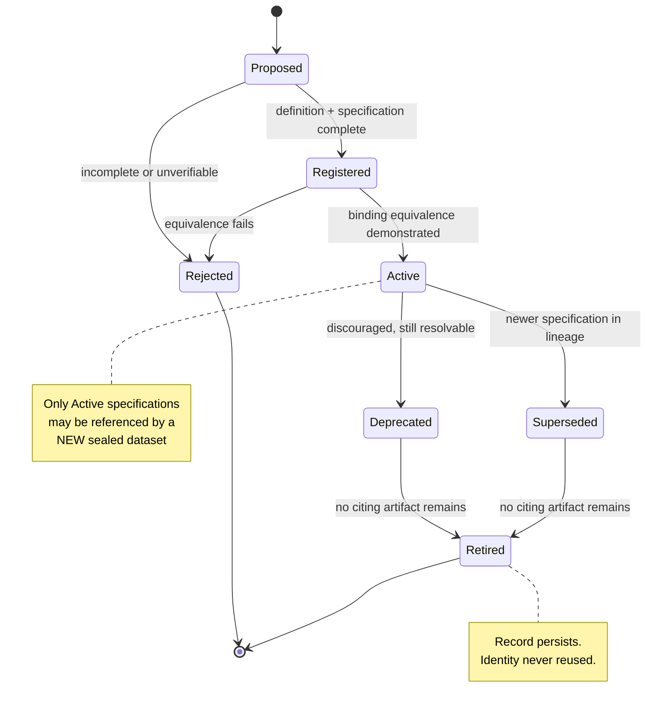
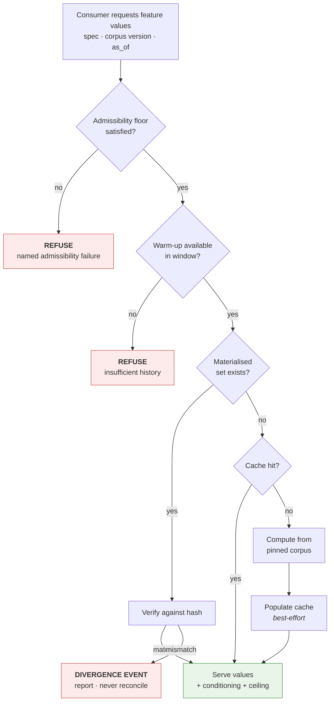
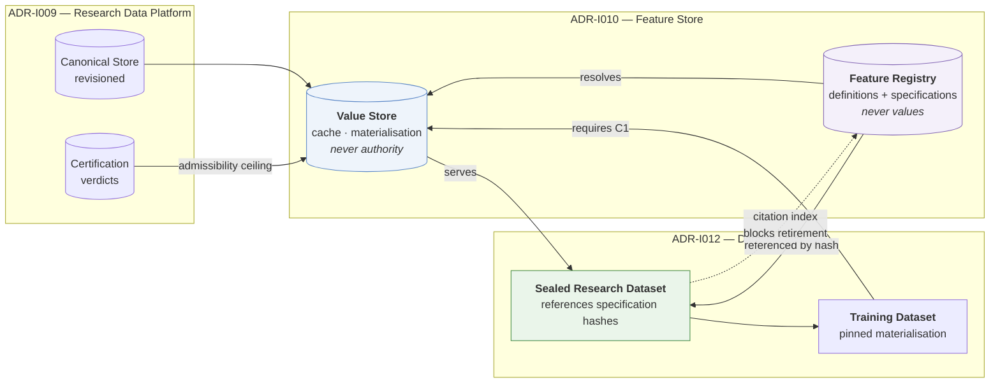

# ADR-I010: Feature Store Architecture

| Field | Value |
|---|---|
| **Title** | ADR-I010 — Feature Store Architecture |
| **Status** | **Draft** |
| **Version** | 0.1.0 |
| **Document Type** | Architecture Decision Record (IQROS series) |
| **Depends On** | [IQROS Master Architecture](../iqros_master_architecture.md) v0.1.0 · [ADR-I009 Research Data Platform](ADR-I009-research-data-platform.md) v0.1.0 |
| **Supersedes** | None |
| **Authors** | Rohith Suresh — Owner / Architect · Drafted with Claude Opus 5 |
| **Last Updated** | 2026-08-04 |

> **Numbering note.** The subject "Feature Store" was originally reserved as `ADR-I007` in the IQROS anticipated-subject list, and `ADR-I010` was reserved for cold-archive activation. This document was allocated `ADR-I010` by owner direction. The index has been reconciled: `ADR-I007` now redirects here, and cold-archive activation moved to `ADR-I019`. See [Architecture Documentation Index](../README.md) §9.

---

## 1. Context

[ADR-I009](ADR-I009-research-data-platform.md) specified the Storage plane: seven single-writer zones producing **immutable, revisioned, certified, conditioning-carrying research data**. This ADR specifies the layer immediately above it — the transformation of that data into the quantities research actually reasons about.

The audited reference platform has **no feature store**. A repository-wide search for `feature_store`, `feature_table`, and `FeatureStore` across all source, schema, and configuration returns **zero matches**. What exists instead is a coherent and deliberate alternative:

| Capability | Audited state |
|---|---|
| Shared derived features | ~20 columns computed in one pass, process-cached, **never persisted** |
| Feature definitions | Declarative objects carrying name, group, rationale, data source, a prose feature definition, an executable function, parameters, sensitivity variants, and hold semantics |
| Definition count | 38 specifications across 8 groups |
| Frozen live features | 5 decision functions, each SHA-256 hash-pinned and verified before every run |
| Warm-up discipline | Minimum-period floors on every rolling window, preventing partially-warmed emission |
| Reproducibility | Achieved by **recomputation**, not storage |

This is not an absence to be filled. It is a working design whose reproducibility property — *a run from months ago replays identically because no derived value was ever stored to drift* — must survive whatever is built above it (IQROS `Ph2`).

Two audited facts define the real problem space. First, the platform maintains **two parallel implementations** of each live feature — a research implementation and a frozen forward implementation — with equivalence tested in exactly one documented case. Second, the platform's highest-dimensionality collected data (Greeks, implied volatilities, open interest) has **zero feature surface**: no feature anywhere consumes it.

---

## 2. Problem Statement

| ID | Problem | Consequence |
|---|---|---|
| **PS1** | **Dual implementation without an equivalence guarantee.** Each live feature exists twice — once for research, once frozen for forward collection. | The two can silently diverge. A research conclusion and the forward evidence meant to confirm it may not describe the same computation. |
| **PS2** | **Feature definitions are prose inside code objects.** Rationale and definition are string fields on a code artifact, not governed, versioned, addressable records. | A definition can change with a code edit, leaving historical results attributed to a definition that no longer exists. |
| **PS3** | **No addressable feature identity.** There is no way to say "this feature, at this version, with these parameters." | A sealed dataset (`ADR-I012`) cannot reference a feature. Nothing downstream can be pinned. |
| **PS4** | **Warm-up requirements are implicit.** Minimum-period floors live inside implementations. | A caller cannot know, before computing, whether its window is long enough. Insufficient warm-up degrades silently into fewer valid rows rather than a refusal. |
| **PS5** | **No path to exact-bytes recoverability.** Nothing can be materialised. | A Training Dataset (IQROS Article 7) cannot guarantee the bytes a model saw are recoverable — its defining property. |
| **PS6** | **Input requirements are undeclared.** A feature's data dependencies are implicit in its implementation. | Availability and admissibility cannot be checked *before* compute, so a feature can be computed on uncertified or inadmissible data without any refusal occurring (IQROS-P4). |
| **PS7** | **Conditioning does not propagate.** `ADR-I009` mandates conditioning on data; nothing carries it through a transformation. | A feature computed from a conditioned corpus produces an unconditioned-looking number (IQROS `Ph7`). |

**The unifying problem:** the platform can *compute* features but cannot make a **durable, addressable, admissibility-carrying statement** about one. Datasets, labels, evidence, and models all need to reference features, and none can.

---

## 3. Design Goals

| ID | Goal | Addresses |
|---|---|---|
| **DG1** | Give every feature an addressable, versioned identity | PS2, PS3 |
| **DG2** | Guarantee exactly one authoritative implementation per specification | PS1 |
| **DG3** | Declare inputs, warm-up, and conditioning so they are checkable before compute | PS4, PS6, PS7 |
| **DG4** | Preserve compute-on-read as the default; add no new drift surface | IQROS `Ph2` |
| **DG5** | Permit exact-bytes recoverability where — and only where — it is required | PS5 |
| **DG6** | Propagate admissibility and conditioning through transformation | IQROS-P4, P12 |
| **DG7** | Make features asset-parameterised rather than asset-specific | IQROS Article 12 |
| **DG8** | Preserve the operational/research boundary absolutely | IQROS-P1, `ADR-I009` §11 |

---

## 4. Scope

**In scope.** The Feature layer of the Research plane (IQROS Article 4):

- The Feature Registry — definitions and specifications
- The Feature Value Store — cache and materialisation tiers
- Feature contracts, metadata, versioning, lifecycle
- The compute-on-read versus materialisation decision rule
- Validation, governance, provenance
- Integration with sealed datasets (`ADR-I012`) and multi-asset design

**Applies to** every IQROS platform instance. Platforms share this specification at IQROS **Tier 1** and never at Tier 4.

---

## 5. Non-Goals

| Not in scope | Governed by |
|---|---|
| Storage zones, partitioning, retention of *source* data | `ADR-I009` |
| Label maturation semantics | [`ADR-I011`](ADR-I011-label-store-architecture.md) |
| Dataset sealing, citation index, rematerialisation | `ADR-I012` |
| Which features *should* exist; any specific feature's economics | Research programme, not architecture |
| Model training, serving, or registry | A future ADR |
| Statistical gate thresholds | Frozen by governance session (IQROS-P9) |
| Redefinition of any IQROS Article | Prohibited (IQROS `E1`) |
| Any migration, sequencing, or rollout | Excluded by instruction |

---

## 6. Feature Registry

The Registry is the **authority on what a feature is**. It holds definitions and specifications. **It never holds values.**

### 6.1 Two Registry Records

| Record | Answers | Mutability |
|---|---|---|
| **Feature Definition** | *What is this feature, and why does it exist?* | Versioned; immutable per version |
| **Feature Specification** | *Exactly what computation, on what inputs, under what parameters?* | Immutable; content-addressed |

A Definition may have many Specifications — the same semantic idea at different parameterisations. A Specification belongs to exactly one Definition version.

### 6.2 Registry Properties

| Property | Rule |
|---|---|
| Addressing | Content hash (IQROS-P5) |
| Mutability | Append-only; a change produces a new record |
| Lifecycle | Phase-tracked (§11) |
| Integrity | Storage-level immutability enforcement, not application discipline (IQROS `S6`) |
| Resolution | By hash alone, with no filesystem or environment dependency |
| Ownership | Single writer (IQROS-P2) |

This reuses the pattern already proven in the audited platform for versioned, hash-addressed, phase-lifecycled contracts with tamper guards. **No new governance mechanism is introduced.**

### 6.3 What the Registry Refuses

- A Specification whose Definition version does not exist
- A Specification without declared inputs, warm-up, or conditioning propagation
- A Specification with more than one executable binding (§8.3)
- Mutation of any sealed record

---

## 7. Feature Value Store

The Value Store holds **numbers**. It holds no authority.

### 7.1 Two Tiers, Distinguished by Authority — Not Content

| Tier | Purpose | Retention | Authority | On loss |
|---|---|---|---|---|
| **Cache** | Speed | Evictable at any moment | **None** | Nothing lost |
| **Materialisation** | Exact-bytes recoverability | Declared; bound to a citing artifact | **None** — verifiable, not authoritative | The citing artifact loses its byte guarantee |

**Both tiers are derived state.** Neither is the artifact of record. The distinction is *obligation*: a cache entry may vanish without consequence; a materialisation must persist as long as something cites it.

### 7.2 Addressing

Every value set — cached or materialised — is addressed by the triple:

> **(Specification hash · Corpus version · `as_of`)**

Corpus version is the set of partition revisions from `ADR-I009` §16. This makes a value set reproducible by construction: the same triple always yields the same numbers, or the platform has a defect.

### 7.3 The Verification Rule

> A stored value that disagrees with a recomputation is **wrong by definition**. The disagreement is a **divergence event** — reported, never silently reconciled (IQROS-P3).

The store never "repairs" a value to match a recomputation, and never trusts a stored value over the specification. This is what allows values to be stored at all without reintroducing drift.

---

## 8. Feature Contracts

### 8.1 The Five Distinctions

| Term | Definition | Mutability | Lives in |
|---|---|---|---|
| **Feature Definition** | The **semantic statement**: what quantity this is, the reasoning for its existence, its economic or structural interpretation, and its intended role. Human-readable and human-authored. Carries no parameters and no executable binding. | Versioned; immutable per version | Registry |
| **Feature Specification** | The **executable contract**: a Definition version, a complete parameter set, declared input requirements, a declared warm-up requirement, a conditioning-propagation rule, and exactly one executable binding identified by engine version. Content-addressed. **This is the artifact datasets reference.** | Immutable | Registry |
| **Feature Values** | The **numbers** produced by resolving one Specification against one corpus version at one `as_of`. Ephemeral by default. | Recomputable | Value Store (optional) |
| **Materialised Features** | Feature Values **deliberately persisted** with a declared retention obligation and an integrity guarantee, because a citing artifact requires exact-bytes recoverability. | Immutable once written | Materialisation tier |
| **Cached Features** | Feature Values **opportunistically persisted** for speed, carrying no retention obligation and no authority. Evictable at any moment, for any reason, with zero information loss. | Evictable | Cache tier |

> **The distinction that matters most.** *Materialised* and *Cached* features may be byte-identical. They differ in **obligation**, not content. Conflating them makes it impossible to express "this may be deleted freely" and "this must survive as long as that model exists" as separate policies — and a store that cannot express both will eventually violate one.

### 8.2 Mandatory Specification Content

| Field class | Purpose |
|---|---|
| **Identity** | Content hash; Definition version reference |
| **Parameters** | Complete parameter set; no defaults resolved at compute time |
| **Input requirements** | Named sources, required fields, required admissibility floor, required lane |
| **Warm-up requirement** | Minimum history the computation needs before emitting a valid value |
| **Conditioning propagation** | How the input's conditioning statement transforms into the output's |
| **Executable binding** | Exactly one implementation identity + engine version |
| **Validity rule** | The condition under which an output is valid versus absent |
| **Sensitivity variants** | The perturbation set used by robustness assessment |

**No field is defaultable.** A missing declaration is a rejected Specification (IQROS `Ph6`).

### 8.3 One Authoritative Binding — Resolution of PS1

> A Feature Specification has **exactly one** executable binding. Research and forward consumers resolve the *same* Specification.

Where two implementations exist for legitimate operational reasons — for example, a frozen implementation with a different execution profile — one is **authoritative** and the other is a **conformant binding** that must demonstrate equivalence against the authoritative one as a condition of registration. A binding that cannot demonstrate equivalence is not registered; it is a different Specification.

This converts the audited dual-implementation risk from a testing question into a registration precondition.

### 8.4 Warm-Up as a Contract Term — Resolution of PS4

Warm-up is declared, and therefore checkable **before** compute:

- A resolution whose available history is shorter than the declared warm-up is **refused**, not silently truncated.
- A dataset window must include warm-up **before** its analysis window; the two are distinct spans.
- Warm-up is a property of the Specification, not of the caller's discipline.

---

## 9. Feature Metadata

Metadata attaches at three levels.

| Level | Carries |
|---|---|
| **Definition** | Semantic statement; rationale; intended role; authorship; version history |
| **Specification** | Everything in §8.2; registration receipt; lifecycle phase |
| **Value set** | Corpus version; `as_of`; admissibility ceiling (inherited); conditioning statement (propagated); validity statistics; computation provenance |

### 9.1 Conditioning Propagation — Resolution of PS7

Every value set carries a conditioning statement **derived from its inputs by the Specification's declared rule** (IQROS-P12). Three cases:

| Case | Output conditioning |
|---|---|
| **Preserving** | Unchanged from input |
| **Narrowing** | Input conditioning plus the feature's own restriction |
| **Cross-sectional** | A universe statement replacing per-instrument conditioning |

**Conditioning is never dropped.** A Specification that cannot state its propagation rule cannot be registered.

### 9.2 Admissibility Inheritance

A value set's admissibility ceiling is the **meet** over its inputs' ceilings (IQROS-P4). A feature computed on an uncertified span inherits that cap; it does not become admissible by being computed.

---

## 10. Feature Versioning

Three levels, composing upward.

| Level | Identity | Changes when |
|---|---|---|
| **Definition version** | Version ordinal within a Definition lineage | The semantic statement changes |
| **Specification hash** | Content hash | Definition version, parameters, inputs, warm-up, conditioning rule, or binding changes |
| **Value set identity** | (Spec hash · Corpus version · `as_of`) | Any component changes |

### 10.1 Change Classification

| Class | Meaning | Consumer implication |
|---|---|---|
| **Reparameterisation** | Same Definition, different parameters | A **different** Specification. Results not comparable without acknowledgment |
| **Rebinding** | Same Specification semantics, new engine version | Requires equivalence demonstration (§8.3); results should be identical |
| **Redefinition** | The semantic statement changed | New Definition version. Prior Specifications remain valid and remain citable |
| **Recomputation** | Same Specification, corrected corpus revision | Values change. Citing artifacts must be identified via the citation index |

### 10.2 Supersession Never Invalidates

A superseded Specification remains fully resolvable and citable. Every historical run that referenced it must remain reconstructable — the same discipline `ADR-I009` §16.1 applies to partition revisions.

---

## 11. Feature Lifecycle

| Phase | Meaning | May be referenced by a new dataset? |
|---|---|---|
| **Proposed** | Draft; not registered | No |
| **Registered** | Complete and stored; binding not yet demonstrated equivalent | No |
| **Active** | Fully valid | **Yes** |
| **Deprecated** | Discouraged; still resolvable for existing citations | No |
| **Superseded** | A newer Specification exists in the lineage | No |
| **Retired** | Withdrawn; no citing artifact remains | No |
| **Rejected** | Failed registration; **permanent negative record** (IQROS-P15) | No |

**Retirement requires zero citations.** A Specification cited by any sealed artifact cannot be retired — the citation index (`ADR-I012`) is the authority, exactly as it is for partition revisions in `ADR-I009` §15.1.

---

## 12. Compute-on-Read vs Materialisation

### 12.1 The Default

> **Compute-on-read is the default and requires no justification. Materialisation is the exception and requires one.**

This preserves IQROS `Ph2`. The audited platform's reproducibility derives from having no stored derived value that *can* drift; that property is retained by making storage exceptional rather than routine.

### 12.2 The Decision Rule

Materialisation is permitted in exactly two cases:

| Case | Justification |
|---|---|
| **C1 — Byte recoverability required** | A Training Dataset (IQROS Article 7) must guarantee the exact bytes a model saw are recoverable. This is its defining property and cannot be satisfied by recomputation alone. |
| **C2 — Recomputation is not cheap-deterministic** | Where recomputation is prohibitively expensive or depends on a non-reproducible external resource. **Must be demonstrated, not asserted.** |

Anything else uses the cache, or nothing.

### 12.3 Materialisation Obligations

A materialised value set must carry: the addressing triple, an integrity hash, the citing artifact identity, a retention obligation bound to that citation, and a verification record. It is **write-once**.

### 12.4 What Materialisation Does Not Confer

Materialisation does **not** make a value set authoritative. The Specification plus corpus remains the authority; the materialised bytes are a *convenience with a guarantee*. Recomputation always wins a disagreement (§7.3).

---

## 13. Validation

Four tiers. Hard failures block registration or resolution; warnings cap admissibility.

**Tier A — Specification completeness.** Every mandatory field present (§8.2); Definition version resolvable; parameters complete with nothing left to compute-time defaulting; exactly one binding.

**Tier B — Binding equivalence.** The binding reproduces the authoritative implementation across the declared sensitivity variants. Failure is Rejected, permanently recorded.

**Tier C — Resolution-time integrity.** Inputs available at the declared admissibility floor and lane; warm-up satisfied; corpus version pinned; `as_of` closure honoured — no input resolves to anything that did not exist at `as_of`.

**Tier D — Output hygiene.** Validity fraction; degenerate-output detection; warm-up boundary correctness — the first valid index must match the declared warm-up exactly, neither early nor late. These cap admissibility rather than blocking.

> **Assert, never repair** (IQROS-P3). Validation reports by name and refuses. It never imputes a missing value, extends a window to satisfy warm-up, relaxes an admissibility floor, or substitutes a default parameter.

---

## 14. Governance

### 14.1 What the Feature Store Governs

It governs **computations**: what a feature is, which implementation is authoritative, what it requires, and what it produced under a given specification and corpus.

It does **not** govern whether a feature is economically meaningful. That is a research judgment evaluated by gates outside this layer.

| Concern | Authority | Feature Store role |
|---|---|---|
| Semantic definition | Human author | Record and version |
| Binding equivalence | Computation | Demonstrate; refuse on failure |
| Registration | Human | Emit receipt |
| Admissibility ceiling | Computed meet (IQROS-P4) | Carry, never assert |
| Retirement | Human + citation index | Refuse while cited |
| Statistical merit | Research gates | **None** |

### 14.2 Governance Rules

| ID | Rule |
|---|---|
| **FG1** | Registration is a **human act** and emits a receipt (IQROS-P8, P10). |
| **FG2** | Binding equivalence is a **computation** and replays (IQROS `Ph3`). |
| **FG3** | Rejected Specifications and failed equivalence demonstrations are **permanent records** (IQROS-P15). |
| **FG4** | A Specification is never edited. Change produces a new Specification. |
| **FG5** | A Specification cited by a sealed artifact can never be retired or made unresolvable. |
| **FG6** | The Registry **never computes values**; the Value Store **never issues judgments**. |
| **FG7** | Sensitivity variants are declared at registration, not chosen at evaluation time — preventing post-hoc selection of a favourable robustness set. |

---

## 15. Provenance

A value set's provenance is the transitive closure of everything determining its numbers:

| Element | Purpose |
|---|---|
| Specification hash | The exact computation |
| Definition version | The semantic claim |
| Binding + engine version | The exact implementation |
| Corpus version | The exact partition revision set (`ADR-I009` §16) |
| `as_of` | Point-in-time closure |
| Admissibility inputs | Certification, lane, readiness of every input |
| Conditioning statement | Propagated population statement |
| Computation record | When resolved, by whom, cache or materialisation or fresh |

**Provenance is what makes a value set rematerialisable years later without any other lookup** — the same completeness obligation `ADR-I009` places on export artifacts.

---

## 16. Dataset Integration

**The contract with the dataset layer:**

1. A dataset references **Specification hashes**, never values. This is what makes a sealed dataset a *specification* rather than a materialised table.
2. Resolution is closed at the dataset's `as_of` — a Specification registered later is invisible to it.
3. Only **Active** Specifications may be referenced by a **new** dataset; existing citations of Deprecated or Superseded Specifications remain valid.
4. Admissibility flows dataset-ward: the dataset's ceiling is the meet across its features' ceilings and its evidence's.
5. A Training Dataset triggers materialisation case **C1**; a Research Dataset does not.
6. The citation index is bidirectional — the Feature Store must be able to answer *"what cites this Specification?"* before permitting retirement or assessing a recomputation's blast radius.

---

## 17. Multi-Asset Design

Per IQROS Article 12, **asset is a resolution parameter, not a Specification property.**

| Concern | Design |
|---|---|
| Specification | Asset-agnostic. A twenty-one-day realised-volatility computation is the same computation on any instrument |
| Resolution | Asset supplied at resolution time, alongside corpus version and `as_of` |
| Input requirements | Declared by *role* (a close series, a volatility index), not by concrete source |
| Value addressing | Triple extends to include the asset domain |
| Admissibility | Per-asset; a multi-asset value set inherits the **weakest** (IQROS-P4) |
| Cross-sectional features | Declare a **universe** as part of conditioning; the universe is part of the Specification |
| Warm-up | Expressed in observation counts, not calendar days — the two diverge for non-continuous markets |
| Calendar | Specifications must not assume continuous trading (IQROS Article 12) |

> **What must be resisted:** per-asset Specifications for the same computation. That would multiply the registry by the asset count, make cross-asset comparison ill-defined, and destroy the single-authoritative-binding property (§8.3). **Multi-asset widens resolution; it never multiplies specifications.**

---

## 18. Risks and Trade-offs

| ID | Risk / trade-off | Assessment |
|---|---|---|
| **R1** | **Registration friction.** Every feature now needs a complete Specification before use. | **Accepted.** The friction *is* the mechanism. PS2/PS3/PS4 all stem from features being cheap to create and impossible to reference. |
| **R2** | **Equivalence demonstration may be hard** for a frozen binding whose execution profile differs from the authoritative one. | **Accepted.** If equivalence cannot be shown, they are different computations and must be different Specifications. Discovering that is the point. |
| **R3** | **Two value tiers add conceptual weight** — consumers must understand cache versus materialisation. | **Accepted.** The alternative — one tier — forces either "everything is disposable" (breaking Training Datasets) or "everything persists" (breaking `Ph2`). |
| **R4** | **Divergence events will occur** and demand human attention rather than automatic reconciliation. | **Expected, not a risk.** A divergence is a real defect. Auto-reconciliation would hide it. |
| **R5** | **Mandatory conditioning propagation** adds a required field with no obvious answer for some features. | **Accepted.** A feature whose author cannot state how conditioning propagates does not understand its own population. |
| **R6** | **Registry growth** — reparameterisation creates new Specifications rather than editing. | **Accepted.** Registry records are small; identity stability is worth far more than compactness. |
| **R7** | **Retirement blocked by citations** may retain Specifications indefinitely. | **Accepted and intended.** A cited Specification must stay resolvable or historical results become unreconstructable. |
| **R8** | **Warm-up refusal will surface currently-silent degradation** — callers that were quietly getting fewer valid rows now get an error. | **Expected, not a risk.** Making an existing condition visible is a goal (DG3). |
| **R9** | **The unexploited-data gap is not closed by this ADR.** Greeks, IV, and OI still have no feature surface. | **Correctly out of scope.** This ADR makes such features *expressible*; whether they should exist is a research judgment. |

---

## 19. IQROS Conformance

| IQROS reference | Conformance in this ADR |
|---|---|
| **IQROS-P1** Platform Sovereignty | Registry and Value Store are per-platform. No cross-platform feature sharing. |
| **IQROS-P2** Single Writer | Registry and each Value Store tier have one writer (§6.2). |
| **IQROS-P3** Assert, Never Repair | Validation refuses; divergences are reported, never reconciled (§7.3, §13). |
| **IQROS-P4** Admissibility Lattice | Value sets inherit the meet over inputs; computing confers no admissibility (§9.2). |
| **IQROS-P5** Content Addressing | Specifications and value sets are content-addressed (§6.2, §7.2). |
| **IQROS-P6** Provenance Lanes | Lane is a declared input requirement and is carried through (§8.2, §15). |
| **IQROS-P7** Sealed Regions | Resolution honours `as_of` closure and dataset-level sealing (§13 Tier C). |
| **IQROS-P8** Human-Gated Irreversibility | Registration and retirement are human acts (FG1). |
| **IQROS-P10** Receipt Completeness | Registration emits a receipt; equivalence replays (FG1, FG2). |
| **IQROS-P12** Conditioning Carried | Propagation rule is mandatory and non-defaultable (§9.1). |
| **IQROS-P15** Negative Records Persist | Rejections and failed equivalence are permanent (FG3). |
| **IQROS `Ph2`** Reproducibility by refusal to persist | Compute-on-read is the default; materialisation is exceptional and justified (§12). |
| **IQROS `Ph3`** Judgments vs computations | Equivalence is a computation; registration is a judgment (FG1, FG2). |
| **IQROS `Ph6`** Absence is not permission | Missing declarations reject; missing warm-up refuses (§8.2, §13). |
| **IQROS Article 4** | Specifies the Feature layer of the Research plane. |
| **IQROS Article 7** | Honours the Feature Values / Materialised distinction; supplies the Training Dataset byte guarantee. |
| **IQROS Article 12** | Asset is a resolution parameter (§17). |
| **`ADR-I009`** | Consumes revisioned corpus versions, certification verdicts, and conditioning statements; adds no storage zone and reads no operational data. |

---

## 20. Decision Summary

This ADR decides that the Feature Store is a **registry of definitions and specifications, plus a value store holding no authority**.

Specifically:

1. **Five object classes are distinguished** — Definition (semantic), Specification (executable contract, content-addressed, dataset-referenceable), Values (numbers), Materialised (persisted with obligation), Cached (persisted without obligation).
2. **A Specification has exactly one authoritative binding**, with any additional binding required to demonstrate equivalence as a registration precondition — resolving the dual-implementation risk structurally rather than by testing convention.
3. **Inputs, warm-up, and conditioning propagation are mandatory, non-defaultable contract terms**, checkable before compute, so insufficient history and inadmissible inputs produce **refusals rather than silent degradation**.
4. **Compute-on-read is the default.** Materialisation is exceptional, permitted only for Training-Dataset byte recoverability or demonstrated non-cheap recomputation, and never authoritative.
5. **A stored value disagreeing with recomputation is wrong by definition** — a reported divergence, never a silent reconciliation.
6. **Datasets reference Specification hashes, never values**, preserving the sealed-dataset-as-specification model.
7. **Asset is a resolution parameter**, not a Specification property.

It preserves, without exception: compute-on-read reproducibility (IQROS `Ph2`), the Single Writer Principle (IQROS-P2), immutability of historical artifacts (IQROS-P5), evidence-first admissibility (IQROS-P4), assert-never-repair (IQROS-P3), and the operational/research boundary (IQROS-P1, `ADR-I009` §11).

---

## Standing Note

**Status is Draft.** This ADR depends on two Draft documents — the IQROS Master Architecture and `ADR-I009` — and has no force until all three are adopted (IQROS `E1`, Index rule `ST1`).

One element requires an explicit decision before any work derives from this ADR: **the reference platform's stabilisation posture**, which currently gates new infrastructure and which this ADR does not override.

No code, schema, file layout, or migration plan is specified in this document.
