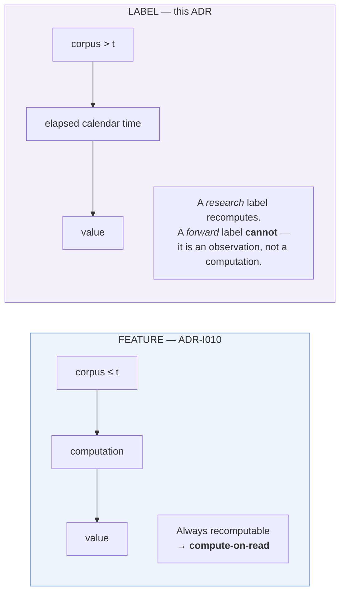
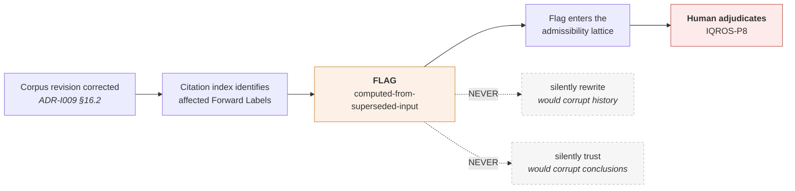
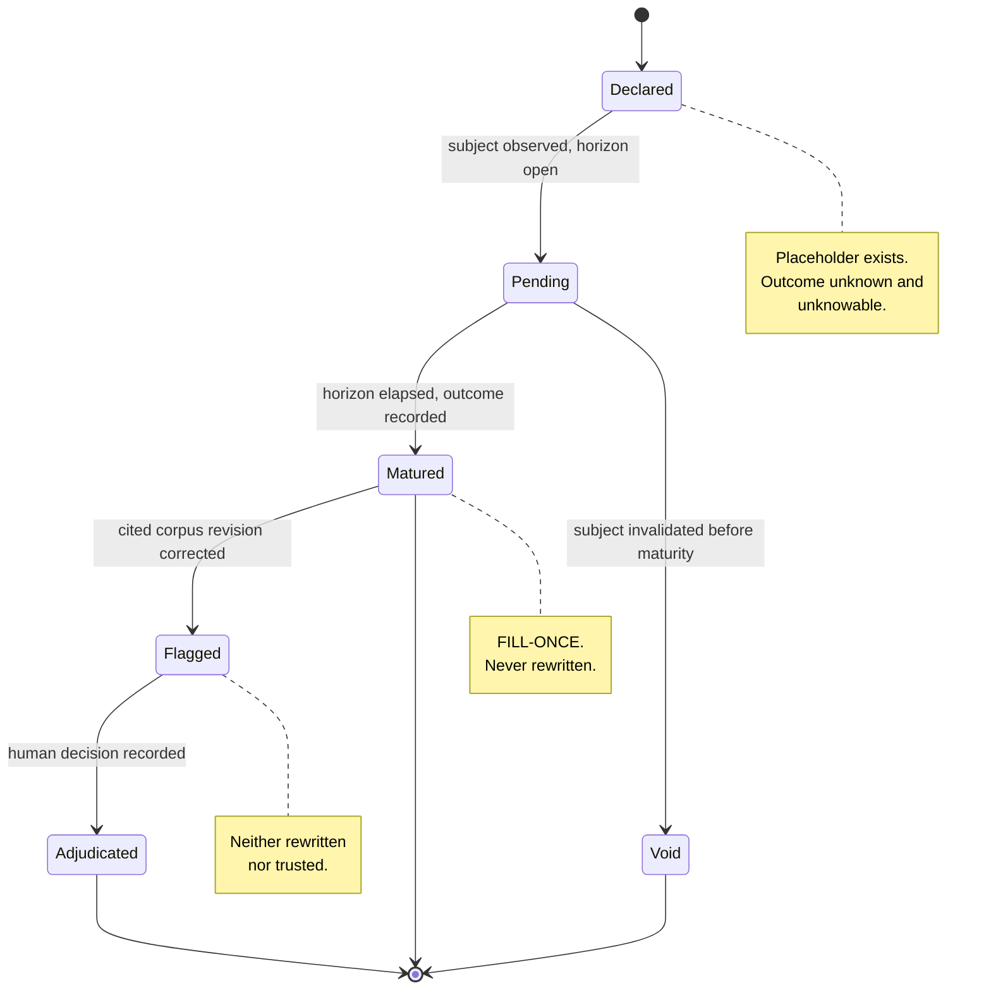
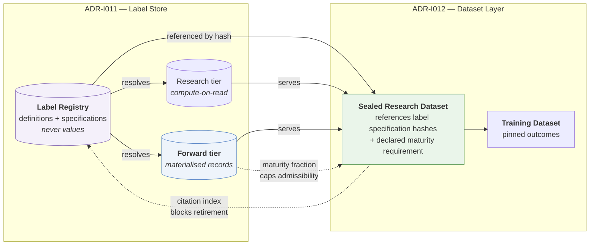

# ADR-I011: Label Store Architecture

| Field | Value |
|---|---|
| **Title** | ADR-I011 — Label Store Architecture |
| **Status** | **Draft** |
| **Version** | 0.1.0 |
| **Document Type** | Architecture Decision Record (IQROS series) |
| **Depends On** | [IQROS Master Architecture](../iqros_master_architecture.md) v0.1.0 · [ADR-I009 Research Data Platform](ADR-I009-research-data-platform.md) v0.1.0 · [ADR-I010 Feature Store](ADR-I010-feature-store-architecture.md) v0.1.0 |
| **Supersedes** | None |
| **Authors** | Rohith Suresh — Owner / Architect · Drafted with Claude Opus 5 |
| **Last Updated** | 2026-08-04 |

> **Numbering note.** The subject "Label Store" was originally reserved as `ADR-I008`, and `ADR-I011` was reserved for the cross-platform shadow-consumption contract. This document was allocated `ADR-I011` by owner direction under rule **NS8**. The index is reconciled: `ADR-I008` retires unused and redirects here; shadow-consumption relocates to `ADR-I020`. See [Architecture Documentation Index](../README.md) §9, §13.1.

---

## 1. Context

[ADR-I009](ADR-I009-research-data-platform.md) specified immutable, revisioned, certified research data. [ADR-I010](ADR-I010-feature-store-architecture.md) specified features as **pure functions of the past**, computed on read, materialised only by exception.

This ADR specifies the counterpart layer — and it is **not symmetric with the Feature Store**. That asymmetry is the whole design problem.

The audited reference platform has two label systems with sharply different maturity:

| System | Audited state |
|---|---|
| **Research label** | A single scalar — one-day forward return — computed in memory from the corpus, **never persisted**, underpinning all 70 ledger evaluation runs |
| **H6 forward labels** | A genuine multi-horizon maturation system: four horizons, placeholder rows written at trade entry, filled as each horizon day arrives, with a fill-once guard. Local state: **148 labels across 37 trades, 100% matured**, plus 222 intra-hold path rows and 37 attribution records over a 1,987-day corpus |
| **Multi-signal collector** | **No label table at all.** Raw prices only; returns derived at query time by a view. Path labels deliberately omitted — *"deferred until a specific intra-trade research question requires it"* |

Three further audited facts define the problem space:

1. **Three divergent fill conventions coexist** across three pipelines — next-open with per-side slippage, implicit close-to-close with turnover cost, and same-day close with a flat cost — with nothing reconciling them.
2. **A pre-registration boundary already partitions labels** by evidentiary standing: trades before it are *"stored for regime context but excluded from evidence snapshots and promotion-criteria evaluation."*
3. **Whether a corpus correction propagates to already-filled labels is Unknown.** The audit could not determine it, and no mechanism addresses it.

---

### 1.1 The Central Asymmetry

A feature is a deterministic function of data that already exists. A label is a function of data that **does not yet exist at the moment the label is declared**.

This splits labels into two kinds with genuinely different storage semantics:

| | Research Label | Forward Label |
|---|---|---|
| Corpus at computation | Complete history | Accruing in real time |
| Maturity at computation | **Fully mature immediately** | **Pending until calendar time elapses** |
| Recomputable? | **Yes** — deterministic over a fixed corpus | **No** — recomputing loses the fact of *when* it was declared |
| Storage | Compute-on-read (IQROS `Ph2`) | **Materialised by necessity** |
| If lost | Nothing lost | **Irreplaceable** |

> **This resolves "preserve compute-on-read while allowing governed materialisation" without compromise.** It is not a trade-off between the two — it is a **type distinction**. Research labels compute. Forward labels are *records*, and a record cannot be recomputed into existence.

---

## 2. Problem Statement

| ID | Problem | Consequence |
|---|---|---|
| **PS1** | **Three fill conventions coexist unreconciled.** Next-open + slippage, close-to-close + turnover, same-day close + flat cost. | Two results computed under different conventions are silently incomparable. Nothing records which convention produced a number. |
| **PS2** | **Labels have no addressable identity.** There is no way to say "this outcome, at this horizon, under these conventions." | A sealed dataset (`ADR-I012`) cannot reference a label; nothing downstream can be pinned. |
| **PS3** | **Maturity is implicit.** A fill flag exists but maturity is not a queryable property of a label *set*. | A consumer cannot state "I require fully-matured 30-day labels" and be refused if unavailable. |
| **PS4** | **Corpus-correction propagation is Unknown.** A filled label records no input revision. | A corrected partition may invalidate a label with no mechanism to detect it — the label is neither rewritten nor flagged. |
| **PS5** | **The active collector persists no labels.** Returns are view-derived. | The programme actively accruing forward evidence stores nothing that survives a schema or view change; the richest label machinery belongs to a programme whose lockbox is spent. |
| **PS6** | **Evidentiary standing is a date comparison.** The pre-registration boundary partitions labels by a timestamp constant. | Standing is not a property of the label; it is re-derived by every consumer, and can be re-derived differently. |
| **PS7** | **Conditioning does not propagate through labels.** A label computed over a conditioned corpus produces an unconditioned-looking outcome. | IQROS `Ph7` — the highest-consequence silent error available. |

**The unifying problem:** the platform can *observe* outcomes but cannot make a **durable, addressable, maturity-carrying, convention-explicit statement** about one.

---

## 3. Design Goals

| ID | Goal | Addresses |
|---|---|---|
| **DG1** | Give every label an addressable, versioned identity carrying its conventions | PS1, PS2 |
| **DG2** | Make maturity a first-class, queryable, refusable property | PS3 |
| **DG3** | Make corpus-correction impact detectable without rewriting history | PS4 |
| **DG4** | Preserve compute-on-read for research labels; materialise forward labels as records | IQROS `Ph2` |
| **DG5** | Make evidentiary standing a property of the label, not a consumer's date arithmetic | PS6 |
| **DG6** | Propagate conditioning and admissibility through outcome measurement | IQROS-P4, P12 |
| **DG7** | Support multi-horizon labels without duplicating definitions | §16 |
| **DG8** | Preserve the operational/research boundary and single-writer discipline | IQROS-P1, P2 |

---

## 4. Scope

**In scope.** The Label layer of the Research plane (IQROS Article 4): registry, value store, specifications, metadata, versioning, lifecycle, validation, governance, provenance, dataset integration, multi-horizon and multi-asset design.

**Applies to** every IQROS platform instance, shared at Tier 1 and never at Tier 4.

---

## 5. Non-Goals

| Not in scope | Governed by |
|---|---|
| Storage zones, partition revisioning | `ADR-I009` |
| Feature registry and value store | `ADR-I010` |
| Dataset sealing, citation index | `ADR-I012` |
| Which outcomes *should* be measured; any label's economic merit | Research programme |
| Promotion gate thresholds | Frozen by governance session (IQROS-P9) |
| Trade lifecycle, position management, execution | Out of platform scope until Layer 6 |
| Model training or evaluation | A future ADR |
| Redefinition of any IQROS Article | Prohibited (IQROS `E1`) |
| Any migration or rollout | Excluded by instruction |

---

## 6. Label Registry

The Registry is the authority on **what an outcome is and how it is measured**. It holds Definitions and Specifications. **It never holds values.**

| Record | Answers | Mutability |
|---|---|---|
| **Label Definition** | *What outcome is this, and why is it the right thing to measure?* | Versioned; immutable per version |
| **Label Specification** | *Exactly what horizon, conventions, maturity rule, and validity condition?* | Immutable; content-addressed |

Registry properties mirror `ADR-I010` §6.2 exactly — content addressing (IQROS-P5), append-only, phase-tracked, storage-level immutability (IQROS `S6`), hash-only resolution, single writer (IQROS-P2). **No new governance mechanism is introduced.**

### 7.1 What the Registry Refuses

- A Specification without a declared horizon, fill convention, cost convention, direction convention, or maturity rule
- A Specification whose Definition version does not exist
- A Specification without a conditioning-propagation rule
- Mutation of any sealed record

---

## 7. Label Value Store

Two tiers, split by the §1.1 asymmetry — **not by convenience**.

| Tier | Holds | Retention | Authority | If lost |
|---|---|---|---|---|
| **Research tier** | Research Labels | Evictable cache | None | Nothing lost |
| **Forward tier** | Forward Labels, incl. Promotion Labels | **Indefinite** | None — verifiable, not authoritative | **Irreplaceable** |

### 9.1 Addressing

| Kind | Address |
|---|---|
| Research Label set | (Specification hash · Corpus version · `as_of`) — identical to `ADR-I010` §7.2 |
| Forward Label | (Specification hash · Subject identity · Declaration instant) |

A forward label's identity includes **when it was declared**, because that is the fact being recorded.

### 9.2 The Fill-Once Rule

> A matured Forward Label is **never rewritten**.

This generalises the audited fill-once guard. A matured value is a record of an observation; overwriting it is falsification, not correction. Corrections are handled by §10.3, not by mutation.

### 9.3 The Verification Rule

For Research Labels, `ADR-I010` §7.3 applies verbatim: a stored value disagreeing with recomputation is wrong by definition, and the disagreement is a reported divergence.

For Forward Labels, **there is nothing to verify against** — that is precisely why they are materialised. Their integrity guarantee is instead: content hash at write, immutability enforcement at the storage layer, and the append-only maturation record.

---

## 8. Label Specifications

### 8.1 The Six Distinctions

| Term | Definition | Recomputable | Storage |
|---|---|---|---|
| **Label Definition** | The **semantic statement**: what outcome is measured, why it is the right outcome for the claim being tested, and its interpretation. Human-authored. No horizon, no conventions, no binding. | — | Registry |
| **Label Specification** | The **executable contract**: a Definition version, a horizon, a fill convention, a cost convention, a direction convention, a maturity rule, a validity condition, a conditioning-propagation rule, and one binding. Content-addressed. **This is what datasets reference.** | — | Registry |
| **Label Values** | The **outcome numbers** produced by resolving one Specification, each carrying a **maturity state**. | Depends on kind ↓ | Value Store |
| **Research Labels** | Label Values computed **retrospectively over a fixed historical corpus**. Fully mature at computation. Deterministic. | **Yes** | Compute-on-read |
| **Forward Labels** | Label Values **accrued in real calendar time** as a horizon elapses. Each is a record of an observation made at a moment. | **No** | Materialised ledger |
| **Promotion Labels** | The **subset of Forward Labels admitted as evidence** for a promotion decision: past the pre-registration boundary, matured, in an admissible lane, and **use-counted**. Standing is recorded, not re-derived. | **No** | Materialised, sealed |

> **The distinction that matters most.** *Research* and *Forward* labels can be numerically identical and are still different objects. A research label is an **answer**; a forward label is a **record of having asked at a particular time without knowing the answer**. Recomputing a forward label destroys exactly the property that makes it evidence.

### 8.2 Mandatory Specification Content

| Field class | Purpose |
|---|---|
| **Identity** | Content hash; Definition version reference |
| **Horizon** | The forward span over which the outcome is measured |
| **Fill convention** | Which price, at which point, is taken as entry and exit — resolves PS1 |
| **Cost convention** | Transaction cost and slippage treatment |
| **Direction convention** | How position sign maps to outcome sign |
| **Maturity rule** | The condition under which a value transitions from pending to matured |
| **Validity condition** | When an outcome is valid versus absent |
| **Conditioning propagation** | How input conditioning transforms into outcome conditioning |
| **Binding** | Exactly one implementation identity + engine version |

**No field is defaultable.** A missing declaration is a rejected Specification (IQROS `Ph6`).

### 8.3 Conventions Become Identity — Resolution of PS1

The three audited fill conventions become **three distinct, named Specifications**, not an unrecorded inconsistency. A consumer comparing results across conventions must do so explicitly, because the Specification hashes differ.

This is the same mechanism `ADR-I010` §8.3 uses for feature bindings: **make the difference part of identity, and silent incomparability becomes impossible.**

---

## 9. Label Metadata

| Level | Carries |
|---|---|
| **Definition** | Semantic statement; rationale; intended claim; authorship; version history |
| **Specification** | Everything in §8.2; registration receipt; lifecycle phase |
| **Value set** | Corpus version; maturity state and fraction; admissibility ceiling (inherited); conditioning statement (propagated); evidentiary standing; input revision set; provenance |

### 10.1 Evidentiary Standing — Resolution of PS6

Standing is **recorded on the label**, never re-derived by a consumer:

| Standing | Meaning |
|---|---|
| **Context** | Retained for regime and background analysis; **excluded from promotion evidence** |
| **Forward evidence** | Declared after the pre-registration boundary; admissible as forward evidence |
| **Promotion evidence** | Forward evidence, matured, in an admissible lane, and **use-counted** against a sealed decision |

This converts the audited date-comparison into a property, so two consumers cannot reach different conclusions about the same label's standing.

### 10.2 Conditioning and Admissibility

Conditioning propagates by the Specification's declared rule (IQROS-P12); admissibility is the **meet** over inputs (IQROS-P4). A label computed on an uncertified span inherits that cap — observing an outcome confers no admissibility.

---

## 10. Label Versioning

Three levels, composing upward — identical in shape to `ADR-I010` §10.

| Level | Identity | Changes when |
|---|---|---|
| **Definition version** | Ordinal within a lineage | The semantic statement changes |
| **Specification hash** | Content hash | Horizon, any convention, maturity rule, validity condition, propagation rule, or binding changes |
| **Value set identity** | Per §7.1 | Any component changes |

### 11.1 Change Classification

| Class | Meaning | Consumer implication |
|---|---|---|
| **Reconvention** | Same outcome, different fill/cost/direction convention | A **different** Specification. Results not comparable |
| **Rehorizon** | Same outcome, different horizon | A **different** Specification (§16) |
| **Redefinition** | The semantic claim changed | New Definition version; prior Specifications remain citable |
| **Input correction** | A cited corpus revision was corrected | See §10.3 |

### 11.2 Maturation Is Not a Version Change

A Specification declaring "labels at maturity ≥ X" is **stable**. Labels maturing further do not alter it. Requiring higher maturity is a **new declaration**, not a new version. This generalises the audited fill-once discipline to the specification level.

### 11.3 Superseded-Input Flagging — Resolution of PS4

Every Forward Label records **the corpus revision set it was computed from** (`ADR-I009` §16).

When a cited revision is corrected:

The label is **neither rewritten nor trusted**. The flag propagates into admissibility, and the operator decides. This makes the audit's *Unknown* **decidable** — which is the entirety of the storage layer's obligation here (IQROS-P3).

---

## 11. Label Lifecycle

Two lifecycles operate at different levels.

### 12.1 Specification Lifecycle

Identical to `ADR-I010` §11: Proposed → Registered → Active → {Deprecated, Superseded} → Retired, with Rejected as a permanent negative record (IQROS-P15). Only **Active** Specifications may be referenced by a **new** sealed dataset. Retirement requires zero citations.

### 12.2 Value Maturity Lifecycle

This has no analogue in the Feature Store.

| State | Meaning | Admissible as evidence? |
|---|---|---|
| **Declared** | Placeholder written; horizon not begun or outcome unknowable | No |
| **Pending** | Horizon open; awaiting elapsed calendar time | No |
| **Matured** | Horizon elapsed; outcome recorded; **immutable** | Yes, subject to standing |
| **Flagged** | A cited input revision was corrected | **No** until adjudicated |
| **Adjudicated** | Human decision recorded against a flag | Per the decision |
| **Void** | Subject invalidated before maturity | No; **permanent record** (IQROS-P15) |

**Declaring the placeholder before the outcome is known is the point.** It records that the question was asked without knowledge of the answer — the property that distinguishes forward evidence from retrospective fitting.

---

## 12. Label Validation

**Tier A — Specification completeness.** All mandatory fields (§8.2); Definition version resolvable; exactly one binding; conventions fully specified.

**Tier B — Declaration integrity.** A placeholder is written **before** its horizon opens; declaration instant recorded; subject identity resolvable; standing assigned at declaration, not later.

**Tier C — Maturation integrity.** A value matures only when its declared maturity rule is satisfied; the fill-once rule is enforced at the storage layer; input revision set recorded; maturity transition is append-only.

**Tier D — Set hygiene.** Maturity fraction; horizon coverage; outcome-distribution disclosure including class imbalance; standing composition. These **cap admissibility** rather than blocking.

> **Assert, never repair** (IQROS-P3). Validation reports by name and refuses. It never imputes an outcome, extends a horizon to force maturity, back-dates a declaration, or reassigns standing.

---

## 13. Label Governance

### 14.1 What the Label Store Governs

It governs **outcome measurement**: what outcome, at what horizon, under what conventions, matured when, from which inputs, with what standing.

It does **not** govern whether an outcome is favourable, or whether a promotion should be granted. Those are research and human judgments respectively.

| Concern | Authority | Label Store role |
|---|---|---|
| Semantic definition | Human author | Record and version |
| Convention selection | Human, at registration | Record as identity |
| Maturation | Elapsed calendar time | Observe and record |
| Standing assignment | Pre-registration boundary | Record at declaration |
| Superseded-input adjudication | Human (IQROS-P8) | Flag; refuse silent resolution |
| Promotion decision | Human (IQROS-P8) | Supply use-counted evidence; **never decide** |

### 14.2 Governance Rules

| ID | Rule |
|---|---|
| **LG1** | Registration is a **human act** emitting a receipt (IQROS-P8, P10). |
| **LG2** | A matured Forward Label is **never rewritten** (§7.2). |
| **LG3** | Standing is assigned **at declaration** and is immutable thereafter. |
| **LG4** | Void labels and rejected Specifications are **permanent records** (IQROS-P15). |
| **LG5** | A Specification cited by a sealed artifact can never be retired or made unresolvable. |
| **LG6** | The Registry **never holds values**; the Value Store **never issues judgments**. |
| **LG7** | **Promotion Labels are use-counted.** A label set consumed by a sealed promotion decision records that consumption — generalising lockbox discipline to outcome evidence. |
| **LG8** | Horizons are declared **at registration**, never selected at evaluation time — preventing post-hoc choice of a favourable horizon. |

> **LG8 is the multiple-comparisons defence at the label layer.** Choosing a horizon after seeing outcomes is selection bias with extra steps. The platform already freezes its trial denominator by governance session (IQROS-P9); LG8 is the same discipline applied to outcome definition.

---

## 14. Provenance

| Element | Purpose |
|---|---|
| Specification hash | Horizon and all conventions |
| Definition version | The semantic claim |
| Binding + engine version | The exact implementation |
| Corpus revision set | Every input revision (`ADR-I009` §16) |
| Declaration instant | When the question was asked |
| Maturation instant | When the outcome became known |
| Standing | Evidentiary class at declaration |
| Admissibility inputs | Certification, lane, readiness per input |
| Conditioning statement | Propagated population statement |
| Flag history | Any superseded-input events and adjudications |

**Declaration instant and maturation instant are both required and are never equal for a Forward Label.** Their separation *is* the forward-evidence property.

---

## 15. Dataset Integration

The contract with the dataset layer, mirroring `ADR-I010` §16 and diverging only where maturity requires:

| # | Rule |
|---|---|
| **DI1** | A dataset references **Label Specification hashes**, never values — preserving the sealed-dataset-as-specification model. |
| **DI2** | A dataset declares a **maturity requirement** alongside each label reference. This has no analogue in the Feature Store and is the defining difference (§7). |
| **DI3** | Resolution is closed at the dataset's `as_of`. A Specification registered later is invisible to it; a label matured later does **not** retroactively enter it. |
| **DI4** | Only **Active** Specifications may be referenced by a **new** dataset; existing citations of Deprecated or Superseded Specifications remain valid (§11.1). |
| **DI5** | Admissibility flows dataset-ward as the **meet** across evidence, features, and labels (IQROS-P4). A `Flagged` label (§10.3) caps the dataset until adjudicated. |
| **DI6** | A **Training Dataset** requires matured labels and pins them, satisfying its exact-bytes obligation (IQROS Article 7). A Research Dataset may admit partial maturity if it declares so explicitly (§16.3). |
| **DI7** | The citation index is **bidirectional**. The Label Store must answer *"what cites this Specification?"* before permitting retirement, and *"what cites this input revision?"* when propagating a superseded-input flag (§10.3). |
| **DI8** | **Promotion Labels are use-counted against the sealed decision that consumed them** (LG7). A dataset citing Promotion Labels records that consumption, so the same forward evidence cannot silently support repeated promotion attempts. |

> **DI2 and DI8 are the whole reason the label layer cannot simply reuse `ADR-I010`'s dataset contract.** A feature reference is satisfied or unsatisfiable at resolution time. A label reference can be *partially* satisfied and can become more satisfied later — and if that is not declared, a dataset silently changes meaning as time passes.

---

## 16. Multi-Horizon Labels

Grounded in the audited four-horizon system.

### 16.1 Horizon Is Identity, Not a Parameter

> A five-day and a thirty-day outcome under the same Definition are **two Specifications**, not one Specification with a parameter.

Consequences, all intended:

| Property | Effect |
|---|---|
| Independent maturation | Each horizon matures on its own calendar |
| Independent addressing | A dataset references exactly the horizons it needs |
| Independent standing | A short horizon may be matured and admissible while a long one is still pending |
| Explicit multiplicity | Evaluating four horizons is visibly four Specifications — the multiple-comparisons cost is legible, not hidden |

### 16.2 Declaration Fan-Out

A single subject observation declares **one placeholder per horizon Specification**, each maturing independently. This is exactly the audited placeholder-then-fill pattern, generalised.

### 16.3 Partial Maturity Is Expressible

A label set reports its maturity fraction per horizon. A consumer declaring "fully matured 30-day" is **refused** when only shorter horizons have matured. A consumer explicitly admitting partial maturity receives it with the fraction recorded (§12 Tier D). Silent partial maturity is impossible — resolving PS3.

### 16.4 Path Labels

Intra-horizon path measurements — cumulative excursion, worst and best adverse movement — are **Specifications in their own right**, with their own maturity. They are not attributes of a terminal outcome. The audited platform's decision to omit them from a newer collector was correct precisely because they are separable; this architecture keeps them separable.

---

## 17. Multi-Asset Readiness

Per IQROS Article 12 and `ADR-I010` §17.

| Concern | Design |
|---|---|
| Specification | Asset-agnostic. A thirty-day forward outcome is the same measurement on any instrument |
| Resolution | Asset supplied at resolution alongside corpus version |
| Horizon expression | In **observation counts and calendar span both** — they diverge for non-continuous markets, and the Specification must state which governs |
| Maturity | Determined by the venue's own calendar, not a universal clock |
| Admissibility | Per-asset; a multi-asset label set inherits the **weakest** (IQROS-P4) |
| Cross-sectional outcomes | Declare a **universe** as part of conditioning |
| Conventions | Fill and cost conventions are venue-dependent and therefore part of Specification identity |

> **The calendar trap.** Maturity is elapsed *market* time, not elapsed wall time. A seven-day horizon on a continuously-traded instrument and on a session-traded instrument mature differently. A Specification that does not state which governs cannot be registered (§6.1).

---

## 18. Risks and Trade-offs

| ID | Risk / trade-off | Assessment |
|---|---|---|
| **R1** | **Horizon-as-identity multiplies Specifications** — four horizons means four registry records | **Accepted and intended.** It makes multiplicity legible. Hiding four comparisons inside one parameterised label is how multiple-testing burden goes unrecorded. |
| **R2** | **Forward labels must be materialised**, contradicting the compute-on-read default | **Not a contradiction.** §1.1 establishes these are records, not computations. `Ph2` says store what cannot be recomputed; a forward label is exactly that. |
| **R3** | **Flagging rather than repairing** leaves labels in an unresolved state requiring human attention | **Expected, not a risk.** The alternatives — silent rewrite or silent trust — corrupt history or conclusions respectively. |
| **R4** | **Standing assigned at declaration** cannot be corrected if assigned wrongly | **Accepted.** Mutable standing is retroactive evidence reclassification, the exact failure pre-registration exists to prevent. An error produces a Void record and a new declaration. |
| **R5** | **Use-counting promotion labels** adds bookkeeping to every promotion | **Accepted.** Without it, the same forward evidence can support repeated promotion attempts — undisclosed multiple testing. |
| **R6** | **Convention-as-identity** means historically-comparable results may become formally incomparable | **Accepted and clarifying.** They were already incomparable; the platform simply could not see it (PS1). |
| **R7** | **Declaration-before-outcome discipline** requires infrastructure to exist before evidence accrues | **Accepted.** Retrofitting forward labels is impossible by construction — a label declared after the outcome is known is not forward evidence. |
| **R8** | **The active collector persists no labels today** (PS5); this ADR does not change that | **Correctly out of scope.** This ADR specifies the architecture; whether and when a collector adopts it is a separate, gated decision. |

---

## 19. IQROS Conformance

| IQROS reference | Conformance |
|---|---|
| **IQROS-P1** Platform Sovereignty | Registry and Value Store are per-platform; no cross-platform label sharing |
| **IQROS-P2** Single Writer | Registry and each Value Store tier have one writer (§6, §7) |
| **IQROS-P3** Assert, Never Repair | Flagging, never rewriting or imputing (§10.3, §13) |
| **IQROS-P4** Admissibility Lattice | Label sets inherit the meet; observing confers no admissibility (§9.2) |
| **IQROS-P5** Content Addressing | Specifications and value sets are content-addressed (§7, §7.1) |
| **IQROS-P6** Provenance Lanes | Lane is required for Promotion Label standing (§9.1) |
| **IQROS-P7** Sealed Regions | Promotion Labels are use-counted and sealed-region-aware (LG7) |
| **IQROS-P8** Human-Gated Irreversibility | Registration, adjudication, promotion are human acts (LG1, §13.1) |
| **IQROS-P9** Frozen Constants | Horizons declared at registration, never selected at evaluation (LG8) |
| **IQROS-P10** Receipt Completeness | Registration and adjudication emit receipts |
| **IQROS-P12** Conditioning Carried | Propagation rule mandatory and non-defaultable (§8.2, §9.2) |
| **IQROS-P15** Negative Records Persist | Void labels and rejected Specifications persist (LG4) |
| **IQROS `Ph2`** Reproducibility by refusal to persist | Research labels compute; only the non-recomputable is stored (§1.1) |
| **IQROS `Ph3`** Judgments vs computations | Maturation is observation; promotion is judgment (§13.1) |
| **IQROS `Ph6`** Absence is not permission | Missing declarations reject; insufficient maturity refuses (§6.1, §16.3) |
| **IQROS `Ph7`** Conditioning travels | Propagated through outcome measurement (§9.2) |
| **IQROS Article 7** | Honours the Label Values class; supplies Training Dataset outcome provenance |
| **IQROS Article 12** | Asset is a resolution parameter; calendar assumptions forbidden (§17) |
| **`ADR-I009`** | Consumes revisioned corpus versions and verdicts; adds no storage zone; reads no operational data |
| **`ADR-I010`** | Reuses registry pattern, addressing, and verification rule; **diverges only where §2's asymmetry requires** |

---

## 20. Decision Summary

This ADR decides that the Label Store is a **registry of definitions and specifications, plus a two-tier value store split by recomputability rather than convenience**.

1. **Six object classes are distinguished** — Definition (semantic), Specification (executable contract carrying horizon and conventions, content-addressed, dataset-referenceable), Values (outcomes with maturity state), Research Labels (recomputable, compute-on-read), Forward Labels (records, materialised by necessity), Promotion Labels (use-counted evidence with recorded standing).
2. **Research labels compute; forward labels are recorded.** This is a type distinction, not a compromise of `Ph2`.
3. **Conventions and horizon are part of Specification identity**, so silently incomparable results become structurally impossible.
4. **Maturity is a first-class, queryable, refusable property.** A consumer requiring full maturity is refused rather than silently served partial data.
5. **A matured forward label is never rewritten.** Corrections flag; they do not mutate.
6. **Superseded inputs are flagged, neither rewritten nor trusted** — making the audit's *Unknown* decidable and routing it to human adjudication.
7. **Evidentiary standing is recorded at declaration**, not re-derived by consumers.
8. **Horizons are declared at registration, never selected at evaluation** — the multiple-comparisons defence at the label layer.

It preserves, without exception: compute-on-read where recomputation is possible (IQROS `Ph2`), the Single Writer Principle (IQROS-P2), immutability of historical artifacts (IQROS-P5), evidence-first admissibility (IQROS-P4), assert-never-repair (IQROS-P3), and the operational/research boundary (IQROS-P1, `ADR-I009` §11).

---

## Standing Note

**Status is Draft.** This ADR depends on three Draft documents and has no force until all are adopted (IQROS `E1`, Index rule `ST1`).

One property deserves explicit notice: **forward-label infrastructure cannot be retrofitted.** A label declared after its outcome is known is not forward evidence, whatever it is called. Whenever forward evidence accrual begins under this architecture, the architecture must already exist. That is an ordering constraint, not a schedule — and it is the one thing in this ADR that time can foreclose.

No code, schema, file layout, or migration plan is specified in this document.
