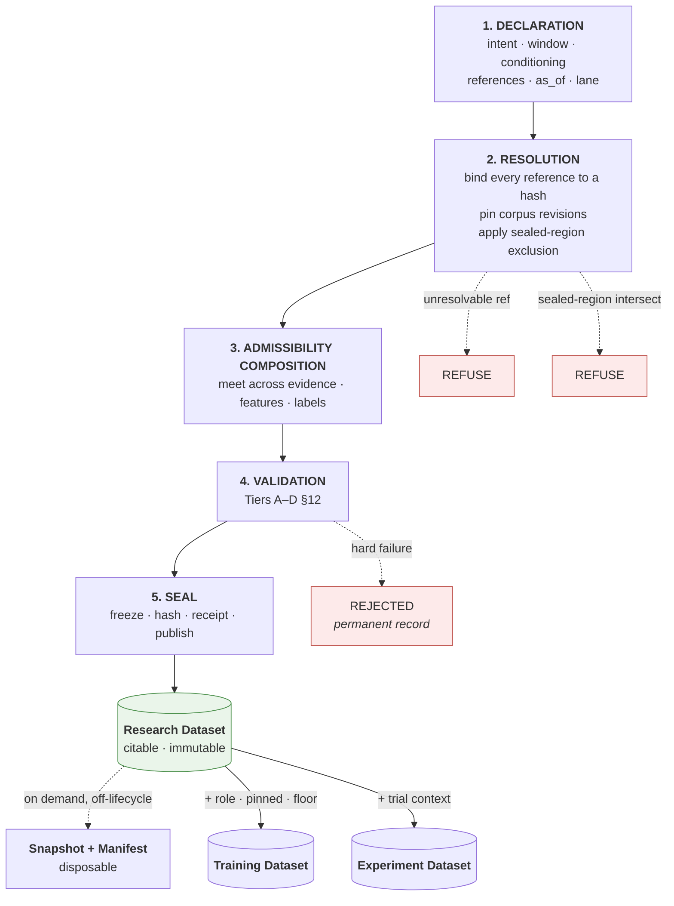
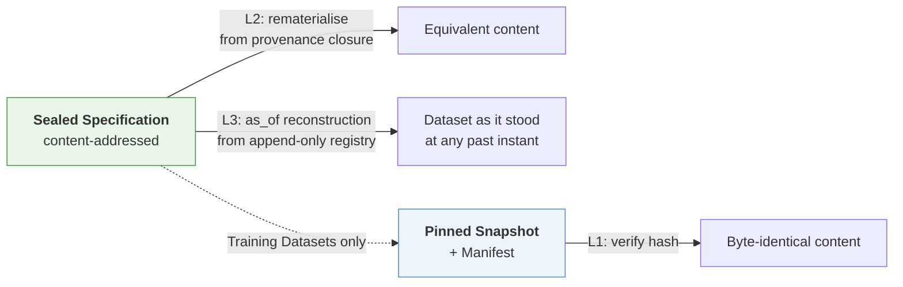

# ADR-I012: Research Dataset Builder Architecture

| Field | Value |
|---|---|
| **Title** | ADR-I012 — Research Dataset Builder Architecture |
| **Status** | **Draft** |
| **Version** | 0.1.0 |
| **Document Type** | Architecture Decision Record (IQROS series) |
| **Depends On** | [IQROS Master Architecture](../iqros_master_architecture.md) v0.1.0 · [ADR-I009 Research Data Platform](ADR-I009-research-data-platform.md) v0.1.0 · [ADR-I010 Feature Store](ADR-I010-feature-store-architecture.md) v0.1.0 · [ADR-I011 Label Store](ADR-I011-label-store-architecture.md) v0.1.0 |
| **Supersedes** | None |
| **Authors** | Rohith Suresh — Owner / Architect · Drafted with Claude Opus 5 |
| **Last Updated** | 2026-08-04 |

> **Numbering note.** The subject "Research Dataset registry" was originally reserved as `ADR-I006`, and `ADR-I012` was reserved for non-crypto asset-class dimensions. This document was allocated `ADR-I012` by owner direction under rule **NS8**. The index is reconciled: `ADR-I006` retires unused and redirects here; non-crypto asset dimensions relocate to `ADR-I021`. All ten prior in-document citations of `ADR-I006` across `ADR-I009`/`I010`/`I011` were updated to `ADR-I012`. See [Architecture Documentation Index](../README.md) §9, §13.1.

---

## 1. Context

Three ADRs have specified the substrate:

| ADR | Provides |
|---|---|
| [`ADR-I009`](ADR-I009-research-data-platform.md) | Immutable, revisioned, certified research data with carried conditioning and provenance lanes |
| [`ADR-I010`](ADR-I010-feature-store-architecture.md) | Content-addressed Feature Specifications with declared inputs, warm-up, and conditioning propagation |
| [`ADR-I011`](ADR-I011-label-store-architecture.md) | Content-addressed Label Specifications carrying horizon, conventions, and maturity |

**Nothing assembles them.** Each layer produces addressable, governed artifacts, and there is no object that binds a corpus version, a set of feature specifications, a set of label specifications, a window, a conditioning statement, and an `as_of` into one citable thing.

The audited reference platform shows precisely what that absence costs. Its 70 ledger evaluation runs record a commendable amount: a source revision, a function hash, an evaluation window, an engine version, and a frozen trial denominator. What they do **not** record is which corpus revisions, which feature definitions, or which label conventions produced the numbers. Those exist as prose in a specification object and as implicit consequences of whatever code was current.

The result is a ledger of **results whose inputs are described**, rather than **results whose inputs are reconstructable**.

This ADR specifies the object that closes that gap, and the builder that produces it.

---

## 2. Problem Statement

| ID | Problem | Consequence |
|---|---|---|
| **PS1** | **Evaluation runs cite no dataset.** Inputs are prose plus implicit code state. | A run cannot be reconstructed by reference. Reproduction requires archaeology, and the archaeology may be wrong. |
| **PS2** | **There is no admissibility composition point.** Evidence, feature, and label ceilings each exist and never combine. | A consumer can assemble admissible parts into an inadmissible whole with nothing objecting (IQROS-P4 unenforced in practice). |
| **PS3** | **Sealed regions are enforced inside analysis code.** The audited lockbox is sliced out by the script that would otherwise read it. | Enforcement depends on every future script repeating the discipline. One omission spends the lockbox silently. |
| **PS4** | **Lane disjointness is convention.** Nothing structurally prevents a confirmatory evaluation from resolving discovery-lane inputs. | The confirmatory lane can be contaminated by the thing it exists to confirm. |
| **PS5** | **No partition-role concept exists.** There is no train / validation / holdout distinction anywhere. | Leakage is a code-review question rather than a structural impossibility. |
| **PS6** | **Trial context is not carried.** The trial denominator is frozen and correct, but a dataset reused across trials records nothing about that reuse. | Multiple-comparisons burden is tracked at the family level and invisible at the substrate level. |
| **PS7** | **No citation index exists.** Nothing answers *"what depends on this input?"* | The blast radius of a corpus correction is unmeasurable, so corrections are either over-applied or ignored. |

**The unifying problem:** the platform can *produce* governed research assets but cannot *bind* them into a citable, admissibility-carrying, reproducible unit — so every downstream consumer re-derives the binding, and each may re-derive it differently.

---

## 3. Design Goals

| ID | Goal | Addresses |
|---|---|---|
| **DG1** | Produce a single citable object binding all governed inputs at an `as_of` | PS1 |
| **DG2** | Make the builder the one place admissibility composes | PS2 |
| **DG3** | Enforce sealed regions at the data boundary, not in analysis code | PS3 |
| **DG4** | Make lane disjointness structural | PS4 |
| **DG5** | Make train/validation/holdout separation a property of distinct sealed objects | PS5 |
| **DG6** | Carry trial context and use-count on the dataset | PS6 |
| **DG7** | Maintain a bidirectional citation index | PS7 |
| **DG8** | Preserve compute-on-read; a dataset is a specification, not a table | IQROS `Ph2` |
| **DG9** | Never read operational data | IQROS-P1, `ADR-I009` §11 |

---

## 4. Scope

**In scope.** The Dataset layer of the Research plane (IQROS Article 4): the dataset registry, dataset specifications, the assembly pipeline, metadata, versioning, lifecycle, validation, governance, provenance, the Research-versus-Training distinction, reproducibility guarantees, and multi-asset design.

**Applies to** every IQROS platform instance, shared at Tier 1 and never at Tier 4.

---

## 5. Non-Goals

| Not in scope | Governed by |
|---|---|
| Storage zones, partition revisioning, archival | `ADR-I009` |
| Feature registry, feature value store | `ADR-I010` |
| Label registry, label maturation | `ADR-I011` |
| Which datasets *should* exist; any dataset's research merit | Research programme |
| Statistical gates, trial denominators, promotion thresholds | Frozen by governance session (IQROS-P9) |
| Model training, evaluation, serving, or registry | `ADR-I022` (§20.2) |
| Operational collector or execution design | Platform-series ADRs; out of IQROS storage scope |
| Redefinition of any IQROS Article | Prohibited (IQROS `E1`) |
| Any migration, sequencing, or rollout | Excluded by instruction |

---

## 6. Dataset Registry

The Registry is the authority on **what datasets exist and what they bind**. It holds specifications and their lifecycle state. **It never holds dataset content.**

| Property | Rule |
|---|---|
| Addressing | Content hash of the declaration (IQROS-P5) |
| Mutability | Append-only; a sealed specification is never edited |
| Lifecycle | Phase-tracked (§11) |
| Integrity | Storage-level immutability enforcement (IQROS `S6`) |
| Resolution | By hash alone; no filesystem or environment dependency |
| Ownership | Single writer (IQROS-P2) |

### 6.1 The Citation Index — Resolution of PS7

The Registry maintains a **bidirectional** index, and this is its most consequential function:

| Direction | Question answered | Used for |
|---|---|---|
| **Forward** | *What does this dataset cite?* | Rematerialisation, provenance closure |
| **Reverse** | *What cites this input?* | Corpus-correction blast radius; retirement refusal; superseded-input propagation |

The reverse edge is what makes `ADR-I009` §15.1's citation constraint, `ADR-I010` §11's retirement refusal, and `ADR-I011` §10.3's superseded-input flagging **enforceable rather than aspirational**. Those three ADRs each assert an obligation that only a citation index can discharge; this is where it lives.

### 6.2 What the Registry Refuses

- A declaration referencing an unresolvable or non-Active specification
- A declaration whose window intersects a sealed region without explicit exclusion
- A declaration lacking a conditioning statement, `as_of`, or lane
- Mutation of any sealed record
- Retirement of any specification with a live citation

---

## 7. Dataset Specifications

### 7.1 The Six Distinctions

| Term | Definition | Materialised? | Mutability |
|---|---|---|---|
| **Dataset Specification** | The **declaration**: window, conditioning statement, evidence references, feature specification references, label specification references with maturity requirements, `as_of`, lane, sealed-region exclusions, and declared admissibility floor. Content-addressed. **The unit of identity.** | No | Immutable once sealed |
| **Research Dataset** | A **sealed** Dataset Specification. The citable substrate for statistics, strategy research, and validation. Complete and fully governed **without any bytes existing**. | Optional | Immutable |
| **Training Dataset** | A Research Dataset **plus** a partition role, a **pinned** snapshot, an admissibility floor at or above the forward lane, and use-count semantics. Its defining property is exact-bytes recoverability. | **Required** | Immutable; holdout single-use |
| **Dataset Snapshot** | A **materialisation** of one Dataset Specification: the actual assembled bytes, verifiable against the specification hash. Disposable for a Research Dataset; pinned for a Training Dataset. | — | Write-once |
| **Dataset Manifest** | The **self-describing record** accompanying a Snapshot: contents, content hashes, full provenance closure, verification record. A Snapshot plus its Manifest is interpretable **without registry access**. | — | Write-once |
| **Experiment Dataset** | A Research Dataset **bound to a trial context**: the trial registration it serves, its position within the frozen trial denominator, and a use-count. **This is what an evaluation run cites.** | Inherits | Immutable; use-counted |

> **The distinction that carries the design.** A *Research Dataset* is a **specification**; a *Snapshot* is **bytes**. Deleting every Snapshot loses nothing — the dataset remains complete, citable, and rematerialisable. This is how the dataset layer gains addressability without abandoning compute-on-read (IQROS `Ph2`).
>
> **The distinction that carries the statistics.** A *Research Dataset* is a substrate; an *Experiment Dataset* is a substrate **plus the fact of having been used for a particular trial**. Without that separation, reusing one substrate across ten trials is indistinguishable from ten independent experiments — which is the multiple-comparisons failure the platform's frozen trial denominator exists to prevent.

### 7.2 Mandatory Declaration Content

| Field class | Purpose |
|---|---|
| **Intent** | Research question; declaring actor; rationale |
| **Temporal scope** | Window start and end; `as_of`; timezone and calendar convention |
| **Conditioning** | The explicit population statement (IQROS-P12) |
| **Evidence references** | Sources, partition revision sets, required certification verdict, required lane |
| **Feature references** | Feature Specification hashes (`ADR-I010` §8) |
| **Label references** | Label Specification hashes **plus maturity requirement** (`ADR-I011` §15 DI2) |
| **Sealed-region exclusions** | Explicit declaration of every excluded span |
| **Admissibility floor** | The minimum the consumer requires |
| **Lane** | The provenance lane this dataset serves (IQROS-P6) |

**No field is defaultable.** A missing declaration is a rejected specification (IQROS `Ph6`).

---

## 8. Dataset Assembly Pipeline

Five stages. Each has a defined refusal condition; none degrades silently.

| Stage | Function | Refuses when |
|---|---|---|
| **1 Declaration** | Capture intent and all references | Declaration incomplete or ambiguous |
| **2 Resolution** | Bind every reference to a concrete hash at `as_of`; pin corpus revisions; apply sealed-region exclusion | Any reference unresolvable or non-Active; a sealed region intersects the window without explicit exclusion; lane conflict |
| **3 Admissibility composition** | Compute the meet across all inputs | — (computes; the result is the ceiling) |
| **4 Validation** | Run the §12 battery | Any hard check fails → **Rejected**, permanently recorded |
| **5 Seal** | Freeze, hash, emit receipt, publish | Validation not clean |

### 8.1 The Six Refusal Points

| # | Refusal | Enforces |
|---|---|---|
| **RF1** | Unresolvable or non-Active specification reference | `ADR-I010` §11, `ADR-I011` §11.1 |
| **RF2** | Sealed-region intersection without explicit exclusion | IQROS-P7 — **resolves PS3** |
| **RF3** | Lane conflict — a confirmatory dataset resolving discovery-lane inputs | IQROS-P6 — **resolves PS4** |
| **RF4** | Declared admissibility floor exceeds the computed meet | IQROS-P4 — **resolves PS2** |
| **RF5** | Label maturity requirement unsatisfiable | `ADR-I011` §16.3 |
| **RF6** | Warm-up unavailable within the resolved corpus window | `ADR-I010` §8.4 |

> **RF2 is the structural relocation of lockbox discipline.** The audited platform enforces its lockbox inside the script that would otherwise read it. Here, exclusion is applied at resolution: a consumer **cannot** read a sealed region from a dataset that excludes it, regardless of what the consumer's code does. Enforcement stops depending on every future script remembering.

### 8.2 Materialisation Is Off-Lifecycle

Given a sealed hash, the materialiser resolves the provenance closure, obtains feature values (`ADR-I010` §12) and label values (`ADR-I011` §7), assembles a **Snapshot**, and writes a **Manifest**. It is idempotent and verifiable.

A materialisation that does not reproduce the expected content is a **divergence event** — reported, never silently reconciled (IQROS-P3, consistent with `ADR-I010` §7.3).

### 8.3 The Builder Never Reads Operational Data

The builder consumes **only** the Feature Store, the Label Store, and `ADR-I009`'s certified research zones. It holds no connection, replica, view, or import path to any operational database. Operational data reaches research solely through `ADR-I009` §11's artifact boundary, entering as an ordinary external source with no privileged path.

---

## 9. Dataset Metadata

| Level | Carries |
|---|---|
| **Specification** | Everything in §7.2; sealing receipt; lifecycle phase; declaration hash |
| **Sealed dataset** | Computed admissibility ceiling; resolved provenance closure; resolution timestamp; resolving engine version |
| **Snapshot** | Content hashes; row and column inventory; verification record; materialisation timestamp |
| **Manifest** | Everything needed to interpret the Snapshot **without registry access** |
| **Training Dataset** | Partition role; sibling partition hashes; pinned snapshot reference; use-count |
| **Experiment Dataset** | Trial registration; denominator position; use-count; consuming run references |

### 9.1 Conditioning and Admissibility

Conditioning is composed from evidence, feature, and label conditioning statements by declared propagation rules (IQROS-P12). Admissibility is the **meet** across all inputs (IQROS-P4). A dataset built entirely on offline-corpus evidence seals successfully and is **labelled** offline-corpus — it simply cannot serve a consumer whose declared floor is higher.

---

## 10. Dataset Versioning

| Level | Identity | Changes when |
|---|---|---|
| **Declaration hash** | Content hash | Any declared field changes |
| **Lineage** | A named research line | — (grouping only) |
| **Version ordinal** | Position within a lineage | A successor is sealed |

### 10.1 Change Classification

| Class | Example | Consumer implication |
|---|---|---|
| **Extension** | Window lengthened; a feature reference added | Prior results remain valid on their own window |
| **Refinement** | A cited corpus revision corrected; a specification version bumped | **Prior results may change.** Comparison across this boundary requires explicit acknowledgment |
| **Redefinition** | Conditioning changed; a label convention swapped | **Not comparable.** A new lineage, not a new version |

> **The refinement/redefinition boundary is the one that protects research integrity.** A silently-renamed redefinition is how a research programme accumulates conclusions that no longer share a basis.

### 10.2 Supersession Never Invalidates

A superseded dataset remains fully resolvable and citable. Every evaluation run that referenced it must remain reconstructable — the same discipline `ADR-I009` §16.1 applies to partition revisions and `ADR-I010` §10.2 to feature specifications.

### 10.3 Label Maturation Is Not a Version Change

A sealed dataset declaring "labels at maturity ≥ X" is stable. Labels maturing further do **not** alter it (`ADR-I011` §11.2). Requiring higher maturity is a new declaration.

---

## 11. Dataset Lifecycle

```mermaid
stateDiagram-v2
    [*] --> Declared
    Declared --> Resolved: all references bound at as_of
    Resolved --> Validated: §12 battery passes
    Validated --> Sealed: hash published, receipt emitted
    Sealed --> Superseded: successor sealed in lineage
    Sealed --> Retired: withdrawn; no live citation

    Declared --> Rejected: incomplete
    Resolved --> Rejected: refusal RF1-RF6
    Validated --> Rejected: hard validation failure

    Rejected --> [*]
    Superseded --> [*]
    Retired --> [*]

    note right of Sealed
        CITABLE from here.
        Nothing may reference
        a dataset before seal.
    end note

    note right of Rejected
        Permanent negative
        record (IQROS-P15)
    end note
```

| Phase | Meaning | Citable? |
|---|---|---|
| **Declared** | Intent captured; references not yet bound | No |
| **Resolved** | Every reference bound to a hash; corpus pinned | No |
| **Validated** | §12 battery passed; admissibility computed | No |
| **Sealed** | Frozen, hashed, published | **Yes** |
| **Superseded** | A successor exists; remains resolvable | Existing citations only |
| **Retired** | Withdrawn; zero live citations | No |
| **Rejected** | Failed; **permanent record** (IQROS-P15) | No |

**Sealing is what makes a dataset citable.** Materialisation is orthogonal — a sealed dataset is complete whether or not any bytes exist.

---

## 12. Dataset Validation

**Tier A — Structural.** All references resolvable and Active at `as_of`; window non-empty and within corpus coverage; conditioning present; lane declared; no duplicate reference.

**Tier B — Temporal integrity.** No feature reference depends on data after its own timestamp; every label horizon terminates within the declared maturity; sealed regions do not intersect the window unless explicitly excluded; no partition outside the declared window is bound; `as_of` closure honoured throughout.

**Tier C — Admissibility.** Certification verdict present for every partition; lane recorded per source; readiness resolved; the computed meet **stated explicitly** on the dataset, never implied; declared floor ≤ computed meet.

**Tier D — Statistical hygiene.** Coverage sufficiency; regime and calendar-year span; degenerate-column detection; label balance and maturity fraction; class-imbalance disclosure. These **cap admissibility**; they do not block.

> **Assert, never repair** (IQROS-P3). Validation reports by name and refuses. It never imputes, backfills, downsamples to fix imbalance, extends a window to satisfy warm-up, or relaxes a declared floor.

**A Rejected dataset is a permanent negative record** — consistent with `ADR-I010` §11 and `ADR-I011` §12.

---

## 13. Dataset Governance

### 13.1 Separated Authorities

| Concern | Authority | Builder role |
|---|---|---|
| What to assemble | Human researcher | Record intent |
| Reference resolution | Computation | Resolve deterministically; refuse on failure |
| Admissibility ceiling | Computed meet (IQROS-P4) | Compute and state; **never assert** |
| Sealing | Human (IQROS-P8) | Emit receipt |
| Sealed-region opening | Human (IQROS-P8) | **Refuse** at resolution; never grant |
| Retirement | Human + citation index | Refuse while cited |
| Statistical merit | Research gates | **None** |
| Promotion | Human (IQROS-P8) | Supply use-counted evidence; never decide |

### 13.2 Governance Rules

| ID | Rule |
|---|---|
| **DG-1** | Sealing is a **human act** emitting a receipt (IQROS-P8, P10). |
| **DG-2** | Resolution and validation are **computations** and replay (IQROS `Ph3`). |
| **DG-3** | A sealed specification is **never edited**. Change produces a new dataset. |
| **DG-4** | Rejected datasets are **permanent records** (IQROS-P15). |
| **DG-5** | A dataset cited by any run, model, or decision can never be retired or made unresolvable. |
| **DG-6** | The Registry **never holds content**; the Snapshot store **never issues judgments**. |
| **DG-7** | **Holdout partitions are single-use.** Consumption is recorded against the consuming decision (§15). |
| **DG-8** | **Experiment Datasets are use-counted.** Reuse of one substrate across trials is visible, not inferred (**resolves PS6**). |

> **DG-8 is the multiple-comparisons defence at the substrate layer.** The platform already freezes its trial denominator by governance session. DG-8 makes substrate reuse legible so the denominator can be *checked* rather than merely declared.

---

## 14. Provenance

A sealed dataset's provenance is the transitive closure of everything determining its content:

| Element | Source |
|---|---|
| Declaration hash | This dataset |
| Corpus revision set | `ADR-I009` §16 |
| Certification verdicts and lanes | `ADR-I009` §18 |
| Feature Specification hashes, bindings, engine versions | `ADR-I010` §15 |
| Label Specification hashes, maturity states, input revisions | `ADR-I011` §14 |
| Conditioning composition | This dataset |
| Admissibility meet and its inputs | This dataset |
| Sealing actor, timestamp, receipt | This dataset |
| Resolving engine version | This dataset |

**Provenance completeness is the rematerialisation guarantee:** a sealed dataset plus its provenance closure is sufficient to reproduce it years later with **no other lookup** — the same obligation `ADR-I009` places on export artifacts and `ADR-I010` on value sets.

---

## 15. Research vs Training Dataset

The distinction is not degree. It is a difference in **obligation**.

| Property | Research Dataset | Training Dataset |
|---|---|---|
| Purpose | Citable substrate for analysis | Substrate a model actually consumed |
| Materialisation | **Optional** — may never exist | **Required and pinned** |
| Byte guarantee | None | **Exact bytes recoverable** |
| Partition role | None | **train / validation / holdout** |
| Admissibility floor | Declared, any level | **≥ forward lane** |
| Use semantics | Freely re-citable | **Holdout is single-use** |
| Sibling relationship | None | Knows its sibling partitions by hash |

### 15.1 Partition Roles — Resolution of PS5

> Train, validation, and holdout are **three separate sealed datasets**, not three slices of one.

Consequences, all intended:

| Property | Effect |
|---|---|
| Non-overlapping windows | Verified at seal across siblings; leakage becomes **structurally impossible**, not a review finding |
| Independent admissibility | Each partition carries its own ceiling |
| Independent citation | A model cites all three by hash; the split is reconstructable |
| Single-use holdout | Consumption recorded against the consuming decision (DG-7) |

### 15.2 Why the Forward-Lane Floor

A Training Dataset materialises `ADR-I011`'s Forward Labels — records that cannot be recomputed. Building a model on offline-corpus outcomes and calling the result forward evidence would invert the platform's entire lane discipline. The floor makes that inversion a refusal (RF4) rather than a convention.

### 15.3 Experiment Dataset Sits Between

An **Experiment Dataset** is a Research Dataset bound to trial context. It is what an evaluation run cites, and it is where the run's multiple-comparisons position is recorded. A Training Dataset may also be an Experiment Dataset; the roles are orthogonal.

---

## 16. Dataset Reproducibility

Three distinct guarantees. Conflating them is how reproducibility claims become unfalsifiable.

| Level | Guarantee | Requires | Applies to |
|---|---|---|---|
| **L1 — Bit-reproducible** | Re-materialisation produces byte-identical content | Pinned snapshot + deterministic assembly | Training Datasets |
| **L2 — Semantically reproducible** | Re-materialisation produces equivalent content from the specification | Provenance closure + available inputs | All sealed datasets |
| **L3 — Historically reconstructable** | The dataset as it stood at any past instant can be reconstructed | Append-only registry + `as_of` derivation | All sealed datasets |

**L2 degrades honestly.** If an input revision was corrected, rematerialisation yields *different* content — and that is the **correct** outcome, surfaced as a divergence rather than hidden. L1 exists precisely for the cases where different-but-correct is unacceptable: a model's training data.

**L3 is what makes governance auditable.** Because the registry is append-only and `as_of` is a first-class field, the question *"what did we believe this dataset contained on the day we promoted?"* is answerable.

---

## 17. Multi-Asset Design

Per IQROS Article 12, `ADR-I010` §17, and `ADR-I011` §17.

| Concern | Design |
|---|---|
| Asset scope | A **declared field** of the specification, not a property of the builder |
| Single-asset dataset | Declares one asset domain |
| Cross-asset dataset | Declares a **universe**; conditioning becomes cross-sectional |
| Corpus version | A set spanning assets |
| Admissibility | The meet across assets — a mixed dataset inherits the **weakest** |
| Calendar | Declared explicitly; the builder assumes no session model (IQROS Article 12) |
| Window alignment | Stated in the declaration; misalignment across assets is a **declaration**, never an inference |
| Feature and label references | Asset-agnostic specifications resolved per asset |

> **The alignment trap.** Two assets with different session calendars do not share a natural window. A cross-asset dataset must **declare** its alignment rule — union, intersection, or a named calendar. A builder that silently picks one has made a research decision on the researcher's behalf.

---

## 18. Risks and Trade-offs

| ID | Risk / trade-off | Assessment |
|---|---|---|
| **R1** | **Declaration friction.** Every analysis now requires a complete, sealed specification. | **Accepted.** The friction is the mechanism. PS1–PS7 all stem from bindings being cheap to make implicitly and impossible to cite. |
| **R2** | **Registry growth.** Every refinement creates a new dataset rather than editing. | **Accepted.** Declarations are small; identity stability is worth far more than compactness. |
| **R3** | **Refusals will surface currently-hidden inadmissibility.** Researchers will find they were building on uncertified spans or contaminated lanes. | **Expected, not a risk.** Making an existing condition visible is DG2's goal. |
| **R4** | **Three-partition Training Datasets triple the sealing work** for any modelling exercise. | **Accepted.** The alternative is leakage as a review question (PS5). |
| **R5** | **Single-use holdout may feel wasteful** when an experiment fails for unrelated reasons. | **Accepted.** A re-used holdout is not a holdout. The audited platform has already spent one lockbox exactly once, correctly. |
| **R6** | **L2 reproducibility can yield different content** after an input correction. | **Correct behaviour, not a defect.** Silent identical output after a correction would mean the correction was ignored. |
| **R7** | **The citation index becomes load-bearing** for three other ADRs' obligations. | **Accepted and deliberate.** Those obligations were unenforceable without it; concentrating them makes the dependency explicit rather than diffuse. |
| **R8** | **Cross-asset alignment must be declared**, adding a decision researchers may not want to make. | **Accepted.** It is a research decision. A default would be the builder making it silently. |
| **R9** | **Nothing in the audited platform cites a dataset today**; adopting this changes what an evaluation run records. | **Out of scope here.** This ADR specifies the object; wiring it into evaluation is gated and separate. |

---

## 19. IQROS Conformance

### 19.1 Conformance Checklist

| Article | Requirement | Conformance | Where |
|---|---|---|---|
| **IQROS-P1** | Platform sovereignty; no cross-platform runtime dependency | ✅ | Registry is per-platform; §8.3 |
| **IQROS-P2** | Single writer per zone | ✅ | §6 registry; §8.2 snapshot store |
| **IQROS-P3** | Assert, never repair | ✅ | §12; §8.2 divergence events |
| **IQROS-P4** | Admissibility lattice; meet over inputs | ✅ | §8 stage 3; RF4; §9.1 |
| **IQROS-P5** | Content addressing | ✅ | §6, §7.1, §10 |
| **IQROS-P6** | Provenance lanes non-interchangeable | ✅ | RF3; §7.2 |
| **IQROS-P7** | Sealed regions enforced at the data boundary | ✅ | RF2 — **relocated from analysis code** |
| **IQROS-P8** | Human-gated irreversibility | ✅ | DG-1, DG-7; §13.1 |
| **IQROS-P9** | Frozen constants | ✅ | §5 non-goal; DG-8 supports checking |
| **IQROS-P10** | Receipt completeness | ✅ | DG-1, DG-2 |
| **IQROS-P11** | Shadow, never canonical | ➖ | Not applicable — no cross-platform consumption in this layer |
| **IQROS-P12** | Conditioning carried | ✅ | §7.2, §9.1, §17 |
| **IQROS-P13** | Failure isolation | ➖ | Not applicable — builder is not an observability component |
| **IQROS-P14** | Boundary handoff by artifact | ✅ | §8.3 — builder reads no operational data |
| **IQROS-P15** | Negative records persist | ✅ | DG-4; §11, §12 |
| **`Ph2`** | Reproducibility by refusal to persist | ✅ | §7.1 — dataset is a specification; §16 L2 |
| **`Ph3`** | Judgments vs computations | ✅ | DG-1 vs DG-2 |
| **`Ph6`** | Absence is not permission | ✅ | §7.2 non-defaultable; RF1–RF6 |
| **`Ph7`** | Conditioning travels | ✅ | §9.1, §17 |
| **Article 4** | Plane decomposition | ✅ | Specifies the Dataset layer of the Research plane |
| **Article 7** | Research asset taxonomy | ✅ | §7.1 honours Research vs Training Dataset |
| **Article 8** | Consumer taxonomy | ✅ | §13.1; consumers declare, builder enforces |
| **Article 12** | Multi-asset; no calendar assumptions | ✅ | §17 |
| **`E1`** | No Article redefined | ✅ | All references cite; none redefine |

**Legend:** ✅ conforms · ➖ not applicable to this layer

### 19.2 Dependency Conformance

| ADR | Consumed | Extended | Contradicted |
|---|---|---|---|
| `ADR-I009` | Corpus revisions, verdicts, lanes, conditioning | §6.1 supplies the citation index its §15.1 requires | None |
| `ADR-I010` | Feature Specification hashes, warm-up, propagation | §6.1 supplies the citation index its §11 retirement rule requires | None |
| `ADR-I011` | Label Specification hashes, maturity, standing | §6.1 supplies the reverse index its §10.3 flagging requires | None |

---

## 20. Decision Summary

### 20.1 Decisions

This ADR decides that the Research Dataset Builder **assembles specifications, not tables**.

1. **Six object classes are distinguished** — Specification (declaration, content-addressed), Research Dataset (sealed specification, citable, unmaterialised), Training Dataset (+ role, pinned snapshot, forward-lane floor, single-use holdout), Snapshot (bytes), Manifest (self-describing record), Experiment Dataset (+ trial context and use-count).
2. **A sealed dataset is complete without bytes.** Snapshots are disposable except where a Training Dataset requires exact-bytes recoverability.
3. **Assembly has six explicit refusal points.** Sealed-region enforcement moves from analysis code to the data boundary; lane disjointness becomes structural.
4. **The builder is the single admissibility composition point** — the meet is computed once, stated explicitly, and never asserted by a consumer.
5. **Train, validation, and holdout are three separate sealed datasets**, making leakage structurally impossible rather than a review finding.
6. **Reproducibility is three distinct guarantees** (L1 bit / L2 semantic / L3 historical), never conflated.
7. **The registry maintains a bidirectional citation index**, discharging obligations that `ADR-I009`, `I010`, and `I011` each assert but none can enforce alone.
8. **The builder never reads operational data.**

It preserves, without exception: compute-on-read (IQROS `Ph2`), immutable historical assets (IQROS-P5, §10.2), the Single Writer Principle (IQROS-P2), and evidence-first architecture (IQROS-P4, `Ph6`).

### 20.2 Future ADR Dependencies

**This ADR requires from unwritten ADRs:**

| Needed from | For |
|---|---|
| `ADR-I001` — IQROS adoption | Force. This ADR has none until the constitution is adopted (`E1`) |
| [`ADR-I014`](ADR-I014-admissibility-framework.md) — Admissibility Framework | The concrete lattice this ADR composes over — **now written** |
| `ADR-I022` — Model registry *(new; see below)* | The consumer that Training Datasets exist to serve |

**Unwritten ADRs that will require this one:**

| Will require | For |
|---|---|
| `ADR-I002` — Platform conformance | Dataset conformance is part of platform conformance |
| `ADR-I005` — Six-domain health model | Dataset staleness and refusal rates are Research-domain signals |
| `ADR-I017` — Agent consumer contract | Agents cite datasets by hash (`AI5`) and receive named refusals (`AI3`) |
| `ADR-I019` — Cold archive activation | Retention is bounded by this ADR's citation index (`ADR-I009` §15.1) |
| `ADR-I021` — Non-crypto asset dimensions | Calendar and alignment declarations (§17) |
| `ADR-I022` — Model registry *(newly identified)* | Models cite Training Datasets by hash; the split must be reconstructable |

> **`ADR-I022` is newly identified by this ADR.** §15 defines Training Datasets and their single-use holdout semantics, but nothing yet specifies the consumer that gives them purpose. Added to the anticipated list.

---

## Standing Note

**Status is Draft.** This ADR depends on four Draft documents and has no force until all are adopted (IQROS `E1`, Index rule `ST1`).

One ordering property deserves notice, complementing `ADR-I011`'s: **an Experiment Dataset's trial context cannot be reconstructed after the fact.** Use-count and denominator position are facts about *when and why* a substrate was consumed. Like forward labels, they can only be recorded as they happen — not inferred later from a ledger.

No code, schema, file layout, or migration plan is specified in this document.
