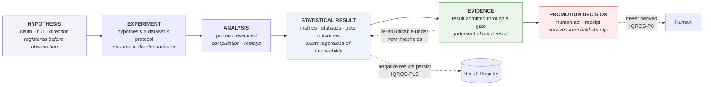
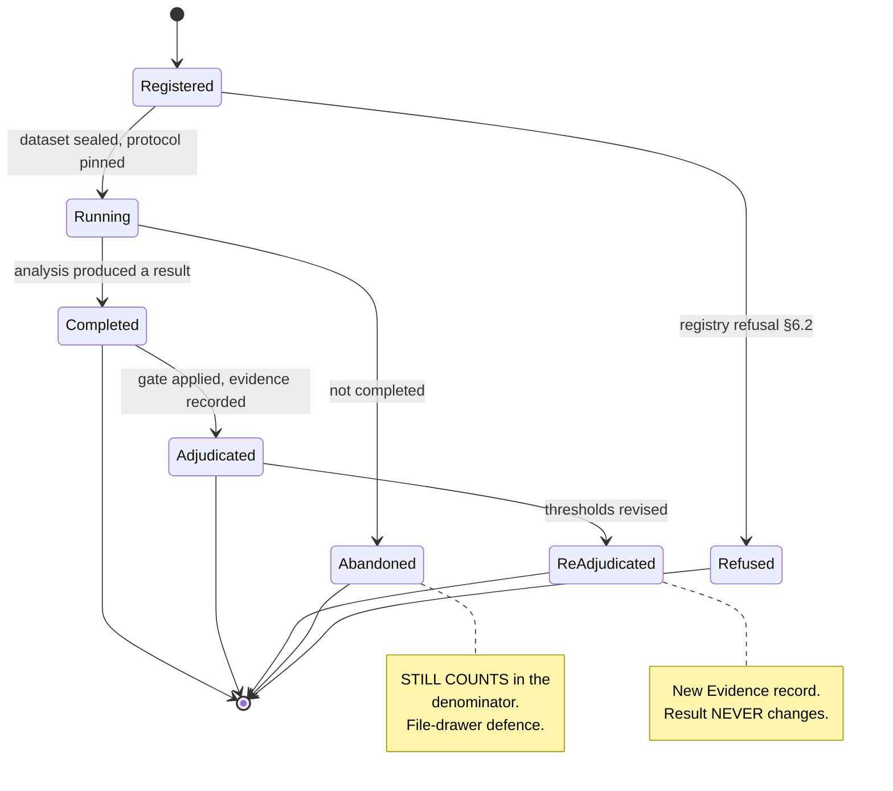
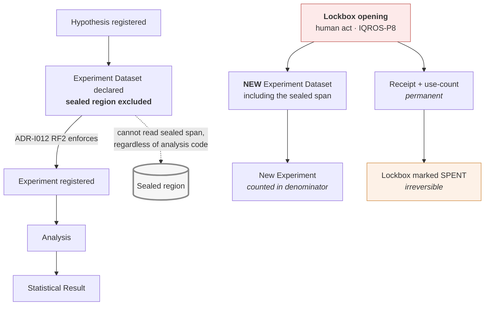

# ADR-I013: Research Experiment Framework

| Field | Value |
|---|---|
| **Title** | ADR-I013 — Research Experiment Framework |
| **Status** | **Draft** |
| **Version** | 0.1.0 |
| **Document Type** | Architecture Decision Record (IQROS series) |
| **Depends On** | [IQROS Master Architecture](../iqros_master_architecture.md) v0.1.0 · [ADR-I009 Research Data Platform](ADR-I009-research-data-platform.md) v0.1.0 · [ADR-I010 Feature Store](ADR-I010-feature-store-architecture.md) v0.1.0 · [ADR-I011 Label Store](ADR-I011-label-store-architecture.md) v0.1.0 · [ADR-I012 Research Dataset Builder](ADR-I012-research-dataset-builder.md) v0.1.0 |
| **Supersedes** | None |
| **Authors** | Rohith Suresh — Owner / Architect · Drafted with Claude Opus 5 |
| **Last Updated** | 2026-08-04 |

> **Numbering note.** "Research Experiment Framework" was **not** on the IQROS anticipated-subject list — it is a new subject under rule **NS6**. `ADR-I013` was reserved for the platform-vs-domain decision procedure; this document was allocated that number by owner direction under **NS8**. The index is reconciled: platform-vs-domain relocates to `ADR-I023`. No in-document citation repair was required — no written ADR referenced `ADR-I013`. See [Architecture Documentation Index](../README.md) §9, §13.1.

---

## 1. Context

Four ADRs have specified the substrate. This one specifies what is done **with** it.

| ADR | Provides |
|---|---|
| [`ADR-I009`](ADR-I009-research-data-platform.md) | Certified, revisioned data with lanes and conditioning |
| [`ADR-I010`](ADR-I010-feature-store-architecture.md) | Content-addressed Feature Specifications |
| [`ADR-I011`](ADR-I011-label-store-architecture.md) | Content-addressed Label Specifications with maturity |
| [`ADR-I012`](ADR-I012-research-dataset-builder.md) | Sealed, citable Research and Experiment Datasets |

**Unlike the four ADRs before it, this one does not fill a void.** The audited reference platform already operates a research experiment framework, and it is the strongest subsystem in the repository:

| Capability | Audited state |
|---|---|
| Governed families | 35 — 9 candidate, 22 discovery, 4 disqualified |
| Evaluation runs | 70, each pinning a source revision, function hash, window, and engine version |
| Gate results | 142 |
| Governed transitions | 13, arc-validated, hash-chained |
| Decision receipts | 26 |
| Frozen thresholds | v1.0, governance-session frozen, YAML-authoritative with no code fallbacks |
| Statistical library | Deflated Sharpe, Benjamini–Hochberg, probabilistic Sharpe, VIF, pairwise correlation |
| Phase discipline | Prohibitions encoded *in the runners themselves* — "NO ML, NO tuning, NO new alpha"; "ONE-TIME, frozen rules only"; "No ML work may begin until this audit is complete" |
| Lockbox | Sliced out of the corpus **before** any evaluation; opened once, verdict recorded |
| Falsification | 4 of 13 decided families **disqualified**, one at a positive Sharpe |
| Reporting | Five machine-generated surfaces including a per-family *blocked-on worklist* |

And it currently reports **zero validated families**, blocked by three simultaneous, precisely-named conditions: every run carries offline-corpus provenance; 68 of 70 runs lack a computed Deflated Sharpe and BH-adjusted p-value; and the pairwise-independence table is empty.

> **That is the framework working, not failing.** A research system whose gates never bind is a system with no gates. This ADR formalises what already works and closes the specific structural gaps that prevent it from binding *provably* rather than *by construction*.

---

## 2. Problem Statement

| ID | Problem | Consequence |
|---|---|---|
| **PS1** | **The trial denominator is asserted, not countable.** A frozen denominator is recorded on every run, but nothing enumerates the trials it counts. | The multiple-testing correction is only as sound as an unverifiable constant. Nobody can answer *"which 34 trials?"* |
| **PS2** | **Hypotheses are not first-class artifacts.** Pre-registration exists for a handful of forward signals as documents; the systematic battery carries rationale as prose on a code object, with no registered null or direction. | A hypothesis can be reinterpreted after seeing results. The distinction between *predicted* and *observed* is not structurally held. |
| **PS3** | **Statistical protocol is implicit in whichever runner executed.** Which correction, which robustness battery, which denominator — all implied by code path. | Two runs are comparable only if the same code ran them. Protocol drift is invisible. |
| **PS4** | **Results and evidence are conflated.** A run record carries raw metrics *and* an admission verdict in the same row. | "What was measured" and "what it was admitted as" cannot be separated, so re-adjudication under new thresholds looks like new measurement. |
| **PS5** | **Lockbox discipline lives in analysis scripts.** The sealed span is excluded by the very script that would otherwise read it; single-use is convention. | One omission spends the lockbox silently. Nothing structurally counts uses. |
| **PS6** | **Analysis is not independently replayable.** An engine version is recorded, but no protocol identity is. | Replay reproduces whatever the engine does *today*, not what the protocol specified *then*. |
| **PS7** | **Runs cite no dataset.** Inputs are prose plus implicit code state. | Inherited from `ADR-I012` PS1 — now resolvable, and this framework is where the resolution is consumed. |

**The unifying problem:** the platform performs rigorous experiments but cannot **enumerate** them, **pin** their protocols, or **separate** what was measured from what it was admitted as. Rigor that cannot be counted cannot be audited.

---

## 3. Design Goals

| ID | Goal | Addresses |
|---|---|---|
| **DG1** | Make the trial denominator a **census**, not a constant | PS1 |
| **DG2** | Make hypotheses registered artifacts with a stated null and direction, fixed before observation | PS2 |
| **DG3** | Make statistical protocol a versioned, hash-addressed contract | PS3, PS6 |
| **DG4** | Separate Statistical Results from Evidence | PS4 |
| **DG5** | Move lockbox enforcement to the dataset boundary and make single-use structural | PS5 |
| **DG6** | Bind every experiment to a sealed Experiment Dataset by hash | PS7 |
| **DG7** | Preserve promotion as a human judgment that survives threshold change | IQROS `Ph3`, `G1` |
| **DG8** | Consume **only** Research Datasets | Stated requirement; IQROS-P14 |

---

## 4. Scope

**In scope.** The Experiment layer of the Research plane (IQROS Article 4): the experiment registry, hypothesis specifications, experiment lifecycle, statistical protocols, lockbox integration, the result registry, provenance, validation, governance, research reports, promotion readiness, and multi-asset design.

**Applies to** every IQROS platform instance, shared at Tier 1 and never at Tier 4.

---

## 5. Non-Goals

| Not in scope | Governed by |
|---|---|
| Storage, features, labels, dataset assembly | `ADR-I009`–`ADR-I012` |
| **Threshold values** — any specific gate number | Frozen by governance session (IQROS-P9). This ADR specifies *where* thresholds bind, never *what* they are |
| Which hypotheses are worth testing | Research programme |
| Model training, evaluation, serving | `ADR-I022` |
| Execution or capital deployment | `ADR-I018` |
| The lifecycle state machine of a signal family | Pre-existing platform governance; this ADR consumes it |
| Redefinition of any IQROS Article | Prohibited (IQROS `E1`) |
| Any migration, sequencing, or rollout | Excluded by instruction |

---

## 6. Experiment Registry

The Registry is the authority on **what has been tried**. This is its defining function, and it is what makes the denominator countable.

| Property | Rule |
|---|---|
| Addressing | Content hash of the experiment declaration (IQROS-P5) |
| Mutability | Append-only; a registered experiment is never edited or withdrawn |
| Completeness | **Every experiment is registered before it runs**, including those never completed |
| Ownership | Single writer (IQROS-P2) |
| Integrity | Storage-level immutability (IQROS `S6`) |

### 6.1 The Registry Is the Denominator — Resolution of PS1

> The multiple-testing denominator for a family of experiments is the **count of registered experiments in that family**, not a constant recorded on each run.

This is the single most consequential decision in this ADR. A frozen constant is a *claim* about how many trials were run; a registry is a *census* of them. The two agree only if nothing goes unregistered — and only a registry can demonstrate that.

Three properties follow, all intended:

| Property | Effect |
|---|---|
| **Abandoned experiments still count** | An experiment registered and then not completed remains in the denominator. This is the file-drawer defence: abandoning a disappointing trial cannot shrink the correction. |
| **The denominator is auditable** | *"Which trials?"* has an answer that can be listed, not merely asserted. |
| **Registration precedes observation** | An experiment cannot be added to the denominator retroactively, nor omitted from it after the fact. |

> **Relationship to the platform's frozen constant.** IQROS-P9 freezes statistical constants by governance session, and this ADR does **not** unfreeze anything (§5). The registry makes the frozen value *checkable*: if the census disagrees with the frozen constant, that is a governance finding requiring a session — exactly the reconciliation the audited platform already performed once, in writing, when two candidate denominators were in circulation.

### 6.2 What the Registry Refuses

- An experiment whose hypothesis is not registered **before** it
- An experiment referencing an unsealed or non-Active Experiment Dataset
- An experiment without a pinned protocol
- An experiment whose dataset lane conflicts with its declared role
- Mutation or withdrawal of any registered experiment

---

## 7. Hypothesis Specification

### 7.1 The Six Distinctions

| Term | Definition | Kind | Mutability |
|---|---|---|---|
| **Hypothesis** | A **falsifiable claim** registered before observation: the asserted effect, the **null**, the **predicted direction**, the population it concerns, and the conditions under which it would be considered refuted. Carries no dataset and no protocol. | Human assertion | Versioned; immutable per version |
| **Experiment** | A Hypothesis bound to **one Experiment Dataset** and **one Protocol**. The unit of trial and the unit counted in the denominator. | Declaration | Immutable once registered |
| **Analysis** | The **execution** of a Protocol against a Dataset. Deterministic; replays bit-for-bit given the same pinned inputs. | Computation | Reproducible |
| **Statistical Result** | The **immutable output** of an Analysis: effect estimates, test statistics, robustness measures, and gate outcomes. Exists **regardless of whether it is favourable or admissible**. | Fact | Immutable; content-addressed |
| **Evidence** | A Statistical Result **admitted through a gate**, carrying its lane, admissibility ceiling, and the threshold set it was adjudicated against. **A judgment *about* a Result, not a copy of one.** | Judgment (derived) | Append-only |
| **Promotion Decision** | A **human act** consuming Evidence and changing a family's governed state. Never derived; survives a later threshold change; emits a receipt. | Judgment (discretionary) | Append-only |

> **The distinction that carries the design.** A *Statistical Result* is what was measured. *Evidence* is what it was admitted as. The audited platform records both in one row, so re-adjudicating a family under revised thresholds is indistinguishable from re-measuring it. Separating them makes re-adjudication cheap, honest, and non-destructive: the Result never changes; a new Evidence record is appended.
>
> **The distinction that carries the statistics.** A *Hypothesis* is a claim; an *Experiment* is one test of it. One hypothesis tested three ways is three experiments and three denominator entries — visible, not inferred.

### 7.2 Mandatory Hypothesis Content

| Field class | Purpose |
|---|---|
| **Claim** | The asserted effect, stated so it can be wrong |
| **Null** | The explicit null hypothesis |
| **Direction** | The predicted sign; a two-sided claim states so |
| **Population** | The conditions under which the claim is asserted, consistent with dataset conditioning (IQROS-P12) |
| **Refutation condition** | What observation would count as refuting it |
| **Family** | The hypothesis family for multiplicity accounting |
| **Registration** | Actor, instant, receipt |

**No field is defaultable.** A hypothesis whose author cannot state its null or its refutation condition is not registrable (IQROS `Ph6`).

> **Direction is the pre-registration teeth.** The audited platform's Candidate gate already requires that a sign match a *pre-stated* direction. This ADR makes the pre-statement an artifact rather than a document, so the requirement is checkable rather than attested.

---

## 8. Experiment Lifecycle

| Phase | Meaning | In denominator? |
|---|---|---|
| **Registered** | Declared; hypothesis, dataset, protocol all pinned | **Yes** |
| **Running** | Analysis executing | **Yes** |
| **Completed** | A Statistical Result exists | **Yes** |
| **Abandoned** | Not completed, for any reason | **Yes — deliberately** |
| **Adjudicated** | A gate has been applied; Evidence recorded | **Yes** |
| **Re-adjudicated** | Evaluated again under a revised threshold set; **new Evidence, same Result** | **Yes — counted once** |
| **Refused** | Failed registration; permanent record (IQROS-P15) | No — it never entered |

**Abandonment does not remove an experiment from the denominator.** This is the entire point of registering before running.

---

## 9. Statistical Protocols

### 9.1 Protocol as a Pinned Contract — Resolution of PS3 and PS6

A **Protocol** is a versioned, content-addressed contract declaring how a Statistical Result is produced, in the same way a Feature Specification declares how a value is produced (`ADR-I010` §8).

| Field class | Purpose |
|---|---|
| **Test family** | The statistical tests and estimators applied |
| **Multiplicity treatment** | The correction method and the **denominator source** — a registry query, not a literal |
| **Robustness battery** | Walk-forward, leave-one-out, sensitivity grid, structural-event exclusion |
| **Sensitivity grid** | Declared at registration, **never selected at analysis time** |
| **Validity conditions** | Minimum observations, coverage, span requirements |
| **Binding** | Exactly one implementation identity + engine version |

**Frozen at experiment registration.** An Analysis resolves the protocol version pinned by its Experiment, never "whatever the engine does now" — so replay reproduces the historical protocol (PS6).

### 9.2 Protocol Rules

| ID | Rule |
|---|---|
| **SP1** | The sensitivity grid and robustness battery are declared **at registration**, preventing post-hoc selection of a favourable robustness set. |
| **SP2** | The multiplicity denominator is **sourced from the Experiment Registry** (§6.1), not embedded as a constant. |
| **SP3** | A Protocol change produces a **new Protocol version**; an Experiment pinned to the old version is unaffected. |
| **SP4** | Threshold values are **not** part of the Protocol. Protocols produce Results; thresholds adjudicate them into Evidence (§7.1). This separation is what makes re-adjudication non-destructive. |

> **SP4 is the mechanism behind the Result/Evidence split.** Because a Protocol never encodes a threshold, revising a threshold cannot invalidate a Result — it can only produce new Evidence about the same Result.

---

## 10. Lockbox Integration

### 10.1 Sealed Regions Live at the Dataset Boundary — Resolution of PS5

> This framework **never slices a lockbox**. It declares an Experiment Dataset that excludes the sealed region, and `ADR-I012` refusal point **RF2** enforces the exclusion at resolution.

The audited platform excludes its lockbox inside the analysis script — correct, and dependent on every future script repeating it. Here the exclusion is a property of the dataset, so a consumer **cannot** read a sealed region regardless of what its analysis code does (IQROS-P7).

### 10.2 Lockbox Rules

| ID | Rule |
|---|---|
| **LB1** | Opening a lockbox is a **human act** emitting a receipt (IQROS-P8). |
| **LB2** | Opening produces a **new Experiment Dataset**, never a modification of an existing one. |
| **LB3** | An experiment consuming a lockbox is registered like any other and **counts in the denominator**. |
| **LB4** | Use is **counted structurally** (`ADR-I012` DG-7). A spent lockbox is permanently marked. |
| **LB5** | A spent lockbox's verdict is a **permanent record**, favourable or not (IQROS-P15). |
| **LB6** | Re-opening a spent lockbox requires a governance session — it is not a routine act. |

> **The audited precedent is exactly right.** The platform opened its lockbox once, recorded a rejecting verdict, and marked it spent. This ADR makes that discipline structural rather than exemplary.

---

## 11. Result Registry

The Result Registry holds **Statistical Results**. A separate Evidence record holds adjudications. This separation resolves PS4.

| Registry | Holds | Mutability | Depends on thresholds? |
|---|---|---|---|
| **Result Registry** | Effect estimates, test statistics, robustness measures, validity flags | Immutable, content-addressed | **No** |
| **Evidence Record** | Gate outcome, threshold-set version, lane, admissibility ceiling, adjudicating actor | Append-only | **Yes** |

### 11.1 Consequences

| Property | Effect |
|---|---|
| **Negative results persist** | A Result exists whether or not it clears any gate (IQROS-P15). Disqualifications are first-class. |
| **Re-adjudication is non-destructive** | Revising thresholds appends new Evidence; the Result is untouched. |
| **Threshold provenance is explicit** | Every Evidence record names the threshold-set version it was adjudicated against. |
| **Results are comparable across gates** | Because a Result carries no verdict, two Results are comparable even if adjudicated differently. |

### 11.2 A Result Is Not Evidence

An unadjudicated Result may be examined, reported, and cited — but it may **not** support a Promotion Decision. Only Evidence can, and Evidence carries the lane and admissibility ceiling that make it eligible (IQROS-P4, P6).

---

## 12. Experiment Provenance

The transitive closure determining a Statistical Result:

| Element | Source |
|---|---|
| Hypothesis version and registration receipt | This ADR |
| Experiment declaration hash | This ADR |
| Protocol version and binding | §9 |
| Experiment Dataset hash | `ADR-I012` §7.1 |
| Dataset provenance closure | `ADR-I012` §14 (transitively: corpus revisions, feature specs, label specs) |
| Denominator census at analysis time | §6.1 |
| Sealed-region exclusions | §10 |
| Analysis actor, instant, engine version | This ADR |
| Adjudicating threshold-set version | §11 |

**A Statistical Result plus its provenance closure is sufficient to reproduce the analysis and re-derive the adjudication independently** — the same completeness obligation the preceding four ADRs impose on their own artifacts.

---

## 13. Validation Rules

**Tier A — Registration integrity.** Hypothesis registered before experiment; null and direction present; dataset sealed and Active; protocol pinned; family declared.

**Tier B — Pre-observation integrity.** No registration instant later than its analysis instant; sensitivity grid and robustness battery declared at registration, not at analysis; no dataset resolved after the experiment's own `as_of`.

**Tier C — Analysis integrity.** Protocol resolved at its pinned version; denominator sourced from the registry census; sealed-region exclusions honoured; validity conditions met or the Result marked invalid rather than absent.

**Tier D — Adjudication integrity.** Threshold-set version recorded; lane recorded; admissibility ceiling inherited from the dataset (IQROS-P4); direction compared against the **pre-registered** direction, never a post-hoc one.

> **Assert, never repair** (IQROS-P3). Validation reports by name and refuses. It never re-runs an analysis to obtain a better Result, substitutes a different protocol, widens a sensitivity grid, or reinterprets a direction.

---

## 14. Governance

### 14.1 Separated Authorities

| Concern | Authority | Framework role |
|---|---|---|
| Hypothesis formulation | Human researcher | Record and version |
| Experiment registration | Human | Emit receipt; add to census |
| Analysis | Computation | Execute deterministically; replay |
| Result production | Computation | Record immutably |
| Adjudication into Evidence | Computation against frozen thresholds | Compute; record threshold version |
| **Promotion Decision** | **Human (IQROS-P8)** | Supply Evidence; **never decide** |
| Threshold values | Governance session (IQROS-P9) | Consume; **never set** |
| Lockbox opening | Human (IQROS-P8) | Refuse without receipt |

### 14.2 Governance Rules

| ID | Rule |
|---|---|
| **EG1** | Registration, lockbox opening, and promotion are **human acts** emitting receipts (IQROS-P8, P10). |
| **EG2** | Analysis and adjudication are **computations** and replay (IQROS `Ph3`). |
| **EG3** | **Promotion is verified, never derived.** A granted promotion survives a later threshold change; replay stays valid even when today's gate would refuse. |
| **EG4** | **A service actor is refused promotion.** The platform must not promote itself (IQROS `Ph8`). |
| **EG5** | Registered experiments are **never withdrawn**; abandoned ones remain in the census (§6.1). |
| **EG6** | Refused registrations, invalid Results, and negative adjudications are **permanent records** (IQROS-P15). |
| **EG7** | The Registry **never adjudicates**; the Evidence record **never re-measures**. |
| **EG8** | An Experiment Dataset consumed by a promotion is **use-counted** (`ADR-I012` DG-8). |

> **EG3 is the audited platform's most subtle correct behaviour, preserved verbatim.** A promotion tested adversarially against a tightened threshold remained valid on replay, because *evidence admissibility is a computation and promotion is a judgment*. Nothing in this ADR weakens that.

---

## 15. Research Reports

Reports are **projections**, never authorities. They compute nothing a consumer could not compute from the registries.

| Report | Answers | Derived from |
|---|---|---|
| **Experiment census** | *What has been tried, and how many trials are in this family?* | Experiment Registry (§6.1) |
| **Result board** | *What was measured, per family, per lane?* | Result Registry |
| **Evidence board** | *What was each result admitted as, under which thresholds?* | Evidence records |
| **Blocked-on worklist** | *What is missing before each candidate can advance?* | Evidence + frozen thresholds |
| **Experiment timeline** | *In what order did this family's evidence accrue?* | Registries, append-only |
| **Lockbox ledger** | *Which sealed regions exist, which are spent, with what verdict?* | §10 |

### 15.1 Report Rules

| ID | Rule |
|---|---|
| **RR1** | Reports are **generated, never hand-maintained**. |
| **RR2** | A report states **why** a value is absent — no evidence, insufficient sample, not computed, or not applicable — and never renders a bare placeholder. |
| **RR3** | Reports support **as-of reconstruction**, so *"what did we believe on the day we promoted?"* is answerable (`ADR-I012` §16 L3). |
| **RR4** | Decision anchors and current measurements are rendered **separately**. What a state rests on is not what is currently measured. |

> **RR2 and RR4 are lifted directly from the audited reporting layer**, which already distinguishes four kinds of absence and separates decision anchors from live evidence. They are constitutionalised here because they are correct, not because they are missing.

---

## 16. Promotion Readiness

Promotion readiness is a **computed, machine-generated statement of what is missing** — never a recommendation.

### 16.1 The Blocked-On Contract

| ID | Rule |
|---|---|
| **PR1** | For every family not at a target state, the framework emits a **named list of unmet conditions**, each citing the threshold key that governs it. |
| **PR2** | The statement names **all** unmet conditions, not the first — a family blocked three ways must show three blockers. |
| **PR3** | A satisfied readiness statement is **not** a promotion recommendation. It states that gates would pass; the decision remains human (IQROS-P8). |
| **PR4** | Readiness is recomputed from current Evidence and current thresholds; it is **never stored as a state**. |

> **PR2 is grounded in audited behaviour.** The platform's readiness report names, per family, that provenance is offline-corpus *and* that the Deflated Sharpe is absent *and* that the BH-adjusted p-value is absent — three simultaneous blockers, each citing its governing threshold key. A first-blocker-only report would have hidden two of them.

### 16.2 Readiness Is Not Promotion

The framework's terminal output is Evidence plus a readiness statement. **The Promotion Decision is outside it.** This is the boundary IQROS `Ph8` draws, and it is why no auto-promotion path may exist (EG4).

---

## 17. Multi-Asset Design

Per IQROS Article 12 and the multi-asset sections of `ADR-I010`–`I012`.

| Concern | Design |
|---|---|
| Hypothesis | May be **asset-specific** or **cross-asset**; the population field states which |
| Experiment | Always bound to one Experiment Dataset, whose asset scope is declared (`ADR-I012` §17) |
| **Denominator** | Scoped to the **hypothesis family**, which may span assets. Testing one hypothesis on five assets is **five experiments** |
| Protocol | Asset-agnostic; resolved per experiment |
| Admissibility | Inherited from the dataset — the meet across assets (IQROS-P4) |
| Adjudication | Per-experiment; a cross-asset claim is adjudicated on a cross-asset dataset, not by pooling single-asset verdicts |

> **The multiplicity trap.** Testing one hypothesis across five assets and reporting the best is five trials, not one. Because the denominator is a registry census (§6.1) rather than a per-family constant, this is **counted automatically** — the researcher cannot under-report it by choosing what to mention.

---

## 18. Risks and Trade-offs

| ID | Risk / trade-off | Assessment |
|---|---|---|
| **R1** | **Registration friction.** Every exploratory analysis must register a hypothesis and an experiment first. | **Accepted, with a boundary.** Exploration on an unsealed dataset produces no Result and enters no census. The friction applies at the point a claim is *tested*, not while it is *formed*. |
| **R2** | **The census may disagree with the frozen constant.** | **Expected, and the point.** A disagreement is a governance finding requiring a session (§6.1) — the platform has already performed exactly such a reconciliation once. |
| **R3** | **Counting abandoned experiments will raise the denominator** and weaken existing results. | **Accepted.** A denominator that shrinks when trials disappoint is not a correction. |
| **R4** | **Result/Evidence separation doubles the record count.** | **Accepted.** It is what makes re-adjudication non-destructive and threshold provenance explicit. |
| **R5** | **Protocol pinning constrains engine evolution** — improving an implementation requires a new Protocol version. | **Accepted.** Silently improving an engine changes what historical experiments replay to. |
| **R6** | **Lockbox use-counting may block a re-run** the researcher believes is warranted. | **Accepted.** A re-usable lockbox is not a lockbox. Re-opening requires a governance session (LB6). |
| **R7** | **Cross-asset multiplicity will surface previously-uncounted trials.** | **Expected, not a risk.** Making an existing condition visible is DG1's goal. |
| **R8** | **This ADR formalises a working system**, so adoption changes established practice rather than filling a void. | **Acknowledged.** Every rule here either matches audited behaviour or closes a named gap; none contradicts current practice. |

---

## 19. IQROS Conformance

### 19.1 Conformance Checklist

| Article | Requirement | Conformance | Where |
|---|---|---|---|
| **IQROS-P1** | Platform sovereignty | ✅ | Registries are per-platform |
| **IQROS-P2** | Single writer | ✅ | §6, §11 |
| **IQROS-P3** | Assert, never repair | ✅ | §13 |
| **IQROS-P4** | Admissibility lattice | ✅ | §11.2, §13 Tier D; inherited from dataset |
| **IQROS-P5** | Content addressing | ✅ | §6, §7.1, §9, §11 |
| **IQROS-P6** | Provenance lanes | ✅ | §11 Evidence carries lane; §6.2 refusal |
| **IQROS-P7** | Sealed regions at the data boundary | ✅ | §10.1 — enforcement delegated to `ADR-I012` RF2 |
| **IQROS-P8** | Human-gated irreversibility | ✅ | EG1, EG4, LB1, PR3, §16.2 |
| **IQROS-P9** | Frozen constants | ✅ | §5 non-goal; §6.1 makes them checkable without unfreezing |
| **IQROS-P10** | Receipt completeness | ✅ | EG1, EG2 |
| **IQROS-P11** | Shadow, never canonical | ➖ | Not applicable — no cross-platform consumption |
| **IQROS-P12** | Conditioning carried | ✅ | §7.2 population field; inherited from dataset |
| **IQROS-P13** | Failure isolation | ➖ | Not applicable — not an observability component |
| **IQROS-P14** | Boundary handoff by artifact | ✅ | §19.3 — consumes sealed datasets only |
| **IQROS-P15** | Negative records persist | ✅ | EG6, §11.1, LB5 |
| **`Ph1`** | Restraint is the product | ✅ | §16.2 — readiness is not promotion |
| **`Ph2`** | Reproducibility by refusal to persist | ✅ | Results are computed from pinned inputs; no derived state cached |
| **`Ph3`** | Judgments vs computations | ✅ | EG2 vs EG3; §7.1 taxonomy |
| **`Ph6`** | Absence is not permission | ✅ | §7.2 non-defaultable; §6.2 refusals |
| **`Ph7`** | Conditioning travels | ✅ | §7.2, §17 |
| **`Ph8`** | Platform never acts on itself | ✅ | EG4 — service actor refused |
| **Article 4** | Plane decomposition | ✅ | Specifies the Experiment layer of the Research plane |
| **Article 7** | Research asset taxonomy | ✅ | §7.1 extends it with Hypothesis, Experiment, Result, Evidence |
| **Article 8** | Consumer taxonomy | ✅ | §14.1; Validation and Statistics consumers served |
| **Article 11** | Governance model — four separated authorities | ✅ | §14.1 maps directly |
| **Article 12** | Multi-asset | ✅ | §17 |
| **`G1`** | Promotion verified, never derived | ✅ | EG3 |
| **`E1`** | No Article redefined | ✅ | All references cite; none redefine |

**Legend:** ✅ conforms · ➖ not applicable to this layer

### 19.2 Dependency Conformance

| ADR | Consumed | Extended | Contradicted |
|---|---|---|---|
| `ADR-I009` | — (transitively, via dataset provenance) | — | None |
| `ADR-I010` | — (transitively) | — | None |
| `ADR-I011` | — (transitively) | — | None |
| `ADR-I012` | Sealed Experiment Datasets; RF2 sealed-region enforcement; DG-7 holdout use-count; DG-8 substrate use-count | §6.1 supplies the trial census its Experiment Dataset trial-context field records | None |

### 19.3 The Consumption Boundary

> The framework consumes **Research Datasets and Experiment Datasets only**.

| May read | May **not** read |
|---|---|
| Sealed Research Datasets | Operational databases — **ever, by any path** |
| Sealed Experiment Datasets | Feature Store directly |
| Its own registries | Label Store directly |
| Frozen threshold sets | Raw or canonical storage directly |

Feature and label content reaches an experiment **only** through a sealed dataset. This is deliberate: a framework that could reach into the Feature Store directly could assemble an unsealed, uncited, unadmissible input set and produce a Result indistinguishable from a governed one.

---

## 20. Decision Summary

### 20.1 Decisions

This ADR decides that the Research Experiment Framework is **a census of trials, a registry of results, and a separate record of what those results were admitted as**.

1. **Six object classes are distinguished** — Hypothesis (claim, null, direction, registered before observation), Experiment (hypothesis × dataset × protocol; the unit of trial), Analysis (computation), Statistical Result (immutable fact, favourable or not), Evidence (judgment about a result, threshold-versioned), Promotion Decision (human act, never derived).
2. **The Experiment Registry is the multiplicity denominator.** A census, not a constant. Abandoned experiments still count.
3. **Hypotheses are registered before observation**, with an explicit null and predicted direction.
4. **Statistical Protocols are pinned, versioned contracts** that carry no thresholds — so revising a threshold cannot invalidate a Result.
5. **Results and Evidence are separate registries.** Re-adjudication appends Evidence; the Result never changes.
6. **Lockbox exclusion is a dataset property**, enforced at resolution; opening is a human act producing a new dataset and a permanent use-count.
7. **Promotion is verified, never derived**, survives threshold change, and refuses service actors.
8. **Readiness is a named list of all unmet conditions** — never a recommendation.
9. **The framework consumes sealed datasets only**, never operational stores, Feature Stores, or Label Stores directly.

It preserves, without exception: restraint as the product (`Ph1`), judgment/computation separation (`Ph3`), absence-is-not-permission (`Ph6`), the platform never acting on itself (`Ph8`), human-gated irreversibility (IQROS-P8), frozen constants (IQROS-P9), and negative-record persistence (IQROS-P15).

### 20.2 Future ADR Dependencies

**This ADR requires from unwritten ADRs:**

| Needed from | For |
|---|---|
| `ADR-I001` — IQROS adoption | Force. None until the constitution is adopted (`E1`) |
| [`ADR-I014`](ADR-I014-admissibility-framework.md) — Admissibility Framework | The lattice Evidence inherits — **now written** |
| `ADR-I024` — Threshold governance protocol *(new; see below)* | How a threshold set is versioned, frozen, and revised — this ADR consumes threshold sets but deliberately does not define their governance |

**Unwritten ADRs that will require this one:**

| Will require | For |
|---|---|
| `ADR-I005` — Six-domain health model | Experiment staleness, refusal rates, and census growth are Research-domain signals |
| `ADR-I017` — Agent consumer contract | Agents may register hypotheses and experiments but never promote (`AI4`, EG4) |
| `ADR-I018` — Execution authorisation | Consumes promotion decisions produced under EG3 |
| `ADR-I022` — Model registry | A model is an Analysis binding; its results enter the same Result Registry |
| `ADR-I023` — Platform-vs-domain procedure | Cross-asset hypothesis families (§17) inform the platform/domain boundary |

> **`ADR-I024` is newly identified by this ADR.** §11 requires every Evidence record to name the **threshold-set version** it was adjudicated against, and §9 SP4 removes thresholds from Protocols entirely. Nothing yet specifies how a threshold set is versioned, frozen, or revised — the audited platform freezes thresholds by governance session, which is correct practice but not yet an architectural contract. Added to the anticipated list.

---

## Standing Note

**Status is Draft.** This ADR depends on five Draft documents and has no force until all are adopted (IQROS `E1`, Index rule `ST1`).

One ordering property completes the set begun by `ADR-I011` and `ADR-I012`: **a trial census cannot be reconstructed retroactively.** An experiment not registered before it ran cannot be added afterwards without destroying the property that makes the denominator trustworthy. Like forward labels and trial context, the census can only be built forward — and every unregistered experiment run before adoption is permanently outside it.

No code, schema, file layout, or migration plan is specified in this document.
