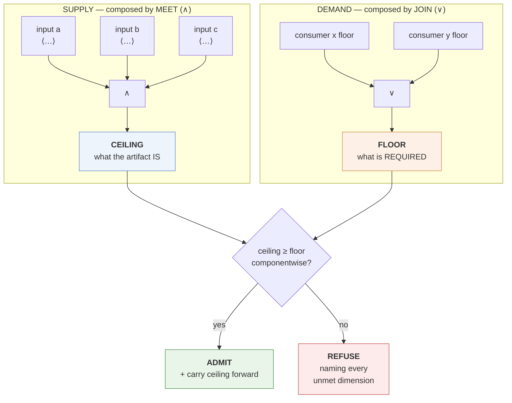

# ADR-I014: Admissibility Framework

| Field | Value |
|---|---|
| **Title** | ADR-I014 — Admissibility Framework |
| **Status** | **Draft** |
| **Version** | 0.1.0 |
| **Document Type** | Architecture Decision Record (IQROS series) — **Constitutional Governance** |
| **Extends** | [IQROS Master Architecture](../iqros_master_architecture.md) v0.1.0 — `IQROS-P4`, `IQROS-P6`, `Ph6` |
| **Depends On** | IQROS v0.1.0 |
| **Consumed By** | `ADR-I009`, `ADR-I010`, `ADR-I011`, `ADR-I012`, `ADR-I013` — and every future ADR that composes admissibility |
| **Supersedes** | None |
| **Resolves** | Research Platform Review v1 findings **`M1`** (lattice undefined) and **`M2`** (lane vocabulary undefined) |
| **Authors** | Rohith Suresh — Owner / Architect · Drafted with Claude Opus 5 |
| **Last Updated** | 2026-08-04 |

> **Numbering note.** This subject was reserved as `ADR-I004`; `ADR-I014` was reserved for shared CI templates. Allocated `ADR-I014` by owner direction under rule **NS8**. The index is reconciled: `ADR-I004` retires unused and redirects here; CI templates relocate to `ADR-I025`. Two in-document citations of `ADR-I004` (in `ADR-I012` §20.2 and `ADR-I013` §20.2) were updated. See [Architecture Documentation Index](../README.md) §9, §13.1.

> **Constitutional status.** This ADR **specifies a term the Constitution already asserts**; it does not amend one. `IQROS-P4` states that admissibility is inherited as the meet of inputs. It does not define the lattice over which that meet is taken. This document supplies that definition. Under `E1` an ADR may not amend an Article — and none is amended here. Every rule below is a consequence of `IQROS-P4`, `IQROS-P6`, or `Ph6` as already written.

---

## 1. Context

The Research Platform Architecture Review (v1, 2026-08-04) recorded two Major findings with the same root:

| Finding | Statement |
|---|---|
| **`M1`** | *"The admissibility lattice is used by all five documents and defined by none. Every ADR composes admissibility as 'the meet over inputs.' No document defines the lattice's elements, their ordering, or how a meet is computed."* |
| **`M2`** | *"The provenance lane vocabulary is used as literals but never enumerated… `ADR-I012` §15.2 requires a Training Dataset floor '≥ forward lane,' which presupposes an ordering."* |

Five ADRs already depend on this contract and already agree on how it behaves. Extracted mechanically from their text:

| Requirement | Stated in |
|---|---|
| Certification verdict, provenance lane, and readiness **compose to a ceiling** carried by every published artifact | `I009` §6 |
| A value set's ceiling is the **meet** over its inputs' ceilings | `I010` §9.2 |
| **Computing confers no admissibility** — a feature on an uncertified span inherits the cap | `I010` §9.2 |
| **Observing confers no admissibility** — same rule for labels | `I011` §9.2 |
| A **flagged** input **caps** the consumer until adjudicated | `I011` §15 DI5 |
| The dataset builder is the **single composition point** | `I012` §8 stage 3 |
| A declared **floor** exceeding the computed ceiling is a **refusal** | `I012` RF4 |
| A Training Dataset requires a floor **≥ forward lane** | `I012` §15.2 |
| Evidence carries its **lane and ceiling** | `I013` §11 |
| Validation may **never relax a floor** | `I010` §13, `I012` §12 |

**This ADR does not design that behaviour. It writes down the contract those documents already rely on.** Where the existing usage is ambiguous, the ambiguity is resolved explicitly and the choice is marked as a choice.

---

## 2. Admissibility Lattice

### 2.1 Admissibility Is Not a Scalar

The five ADRs compose admissibility from **at least five independent qualities**: where data came from, whether it was certified, whether inputs were complete, whether outcomes have matured, and whether any input was later invalidated. These do not reduce to one number, and collapsing them would destroy the ability to say *what* is deficient.

> **Admissibility is a tuple over independent dimensions, ordered componentwise.**

A product of bounded lattices is itself a bounded lattice. Componentwise ordering therefore yields meet and join for free, and each dimension remains separately reportable — which is what `ADR-I013` §16 PR2 requires when it demands that **all** unmet conditions be named, not the first.

### 2.2 The Five Dimensions

Each dimension is a bounded, totally ordered chain with a bottom element **⊥** meaning *unknown or absent*.

```mermaid
flowchart TB
    subgraph P["<b>P — Provenance</b>"]
        P0["⊥ unknown"] --> P1["offline-corpus"] --> P2["live-forward"] --> P3["mainnet"]
    end
    subgraph C["<b>C — Certification</b>"]
        C0["⊥ uncertified"] --> C1["RED"] --> C2["AMBER"] --> C3["GREEN"]
    end
    subgraph R["<b>R — Readiness</b>"]
        R0["⊥ unknown"] --> R1["not-ready"] --> R2["partial"] --> R3["READY"]
    end
    subgraph M["<b>M — Maturity</b>"]
        M0["⊥ unknown"] --> M1["declared"] --> M2["partial"] --> M3["full"]
    end
    subgraph I["<b>I — Integrity</b>"]
        I0["⊥ unknown"] --> I1["flagged"] --> I2["adjudicated"] --> I3["clean"]
    end

    style P fill:#eef4fb,stroke:#5b87c7
    style C fill:#eaf5ea,stroke:#4a8f4a
    style R fill:#f4f0fa,stroke:#8467b5
    style M fill:#fdf1e7,stroke:#d08a3e
    style I fill:#fdeaea,stroke:#c0554f
```

| Dim | Name | Chain (⊥ → ⊤) | Answers | Introduced by |
|---|---|---|---|---|
| **P** | **Provenance** | ⊥ · offline-corpus · live-forward · mainnet | *Where did this come from?* | `IQROS-P6`; **resolves `M2`** |
| **C** | **Certification** | ⊥ · RED · AMBER · GREEN | *Was the data certified?* | `I009` §18 |
| **R** | **Readiness** | ⊥ · not-ready · partial · READY | *Were the inputs complete?* | `I009` §6 |
| **M** | **Maturity** | ⊥ · declared · partial · full | *Have outcomes matured?* | `I011` §12.2 |
| **I** | **Integrity** | ⊥ · flagged · adjudicated · clean | *Has any input been invalidated since?* | `I011` §10.3 |

**An admissibility value is written as a tuple** `⟨P, C, R, M, I⟩`.

### 2.3 Two Resolutions Marked as Choices

Two orderings above are not forced by existing usage. Both are stated as deliberate choices with rationale, per `E8`.

**Choice 1 — `⊥ < RED`.** Both block. Neither is admissible. They are ordered so that a *determination* of non-admissibility ranks above *absence* of one, because a determination is more diagnostically informative. Nothing in the framework depends on this ordering; it affects only which of two blocking values a meet reports. *If a future session prefers them incomparable, the dimension becomes a lattice with two minimal elements and a synthetic bottom — the framework is unaffected.*

**Choice 2 — `adjudicated < clean`.** An input that was flagged and then adjudicated is **not restored to clean**. It ranks below never-having-been-flagged. This preserves `I011` §10.3's discipline that a flag is neither silently rewritten nor silently trusted: adjudication permits use, it does not erase history.

### 2.4 What ⊥ Means

> **⊥ is what absence maps to.** This is `Ph6` — *absence is not permission* — made mechanical.

A missing certification verdict is `C = ⊥`, not `C = GREEN`. A missing readiness evaluation is `R = ⊥`. Because ⊥ is the bottom of its chain, any meet involving it yields ⊥ on that dimension, and any floor above ⊥ is unsatisfied. **A consumer therefore cannot obtain permission by omitting evidence** — the exact failure `IQROS-P4`'s closing clause forbids.

---

## 3. Ordering

### 3.1 The Partial Order

For tuples `a = ⟨aP, aC, aR, aM, aI⟩` and `b`:

> `a ≤ b` **if and only if** `a` is at or below `b` on **every** dimension.

This is a **partial** order, not total. Two tuples may be **incomparable** — one stronger on provenance, the other on maturity. That is correct and load-bearing: it means the framework cannot rank a mainnet-but-immature artifact against an offline-but-fully-matured one, and will not pretend to. A consumer that needs both states both in its floor.

### 3.2 Bottom and Top

| Element | Value | Meaning |
|---|---|---|
| **⊥** (bottom) | `⟨⊥,⊥,⊥,⊥,⊥⟩` | Nothing is known. Satisfies no floor above itself |
| **⊤** (top) | `⟨mainnet, GREEN, READY, full, clean⟩` | Maximal admissibility |

**⊤ is not "approved."** It is the strongest admissibility an artifact can carry. Whether it is *good enough* is a separate question — see §4.3.

---

## 4. Meet and Join Semantics

*Conceptual only. No computation is specified.*

### 4.1 Meet Composes Supply

> **Meet (`∧`) is componentwise minimum. It composes what artifacts *are*.**

An artifact derived from inputs carries the meet of their admissibilities. This is `IQROS-P4` verbatim: *nothing may be declared more admissible than its weakest input.*

Three properties follow, each already relied upon:

| Property | Consequence | Relied on by |
|---|---|---|
| **Monotone decreasing** | Derivation can only weaken admissibility, never strengthen it | `I010` §9.2, `I011` §9.2 |
| **Order-independent** | Composition order does not matter; meet is associative and commutative | `I012` §8 stage 3 |
| **Dimension-preserving** | A weakness on one dimension does not contaminate the others | `I013` PR2 |

The third is why the framework can report *"provenance is offline-corpus **and** DSR is absent **and** BH-p is absent"* — three named deficiencies, not one collapsed verdict.

### 4.2 Join Composes Demand

> **Join (`∨`) is componentwise maximum. It composes what consumers *require*.**

A **floor** is a tuple a consumer requires. When several consumers share one artifact, the binding requirement is the **join of their floors** — the weakest tuple satisfying all of them.

### 4.3 The Admission Test

> **An artifact is admissible to a consumer if and only if its ceiling ≥ the consumer's floor, componentwise.**

Four rules govern the test. All four are restatements of existing ADR behaviour.

| ID | Rule | Source |
|---|---|---|
| **AD1** | Ceiling is **computed, never asserted.** A producer states its inputs; the framework computes the meet | `I010` §14.1, `I012` §13.1 |
| **AD2** | Floor is **declared, never inferred.** A consumer states what it requires | `I012` §7.2 |
| **AD3** | A floor is **never relaxed** to permit admission. Failure is a refusal | `I010` §13, `I012` §12 |
| **AD4** | A refusal **names every unmet dimension**, not the first | `I013` PR2 |

### 4.4 Admissibility Is Not Merit

> **Admissibility answers *may this be used as evidence*. Merit answers *is it good enough*. They are different questions, evaluated by different mechanisms, and neither substitutes for the other.**

This distinction is already load-bearing in `ADR-I013` §11.2 — *"A Result is not Evidence"* — and in the audited platform, where four families were disqualified on **merit** while being perfectly **admissible**.

| | Admissibility | Merit |
|---|---|---|
| Question | May this be used? | Is it good enough? |
| Mechanism | This framework | Gates against frozen thresholds |
| Composes by | Meet over inputs | Not composable — evaluated per artifact |
| Failure means | **Refusal** — cannot proceed | **Rejection** — proceeded, did not pass |
| Governed by | `ADR-I014` | `IQROS-P9`, `ADR-I024` |

**⊤ admissibility with a failing gate is the normal case for a rejected hypothesis.** Conflating the two would make a merit failure look like a data problem.

---

## 5. Artifact Admissibility

Every artifact in the ecosystem carries exactly one admissibility tuple.

| ID | Rule |
|---|---|
| **AR1** | Every artifact carries a ceiling. There is no *unclassified* state — absence is `⊥` on the relevant dimension (§2.4) |
| **AR2** | The ceiling is **carried, not recomputed** by consumers. A consumer reads it; it does not re-derive it |
| **AR3** | The ceiling travels with the artifact across every boundary, including the artifact boundary of `I009` §11 |
| **AR4** | An artifact's ceiling is **immutable once sealed**. New inputs produce a new artifact, not a revised ceiling |
| **AR5** | A **later** flag on an input does **not** mutate a sealed artifact's ceiling. It creates a flag record that caps *future* composition — the sealed artifact keeps its historical ceiling and gains a flag reference (`I011` §10.3) |

> **AR5 is the subtle one, and it follows from `IQROS-P5` rather than being new.** A content-addressed artifact whose ceiling could change is not immutable. The flag propagates *forward* through the citation index (`I012` §6.1); it does not reach backward.

### 5.1 Dimensions Are Not All Applicable

Not every dimension applies to every artifact class. An inapplicable dimension is **⊤ on that dimension**, not ⊥ — it cannot be a deficiency if it cannot exist.

| Artifact class | P | C | R | M | I |
|---|---|---|---|---|---|
| Raw / canonical partition | ✅ | ✅ | ✅ | ⊤ n/a | ✅ |
| Feature value set | ✅ | ✅ | ✅ | ⊤ n/a | ✅ |
| Label value set | ✅ | ✅ | ✅ | ✅ | ✅ |
| Dataset | ✅ | ✅ | ✅ | ✅ | ✅ |
| Statistical Result | ✅ | ✅ | ✅ | ✅ | ✅ |
| Evidence | ✅ | ✅ | ✅ | ✅ | ✅ |

> **Marking an inapplicable dimension ⊥ would be a defect**, not conservatism: it would make every feature set permanently inadmissible to any consumer with a maturity floor, for a quality features do not possess.

---

## 6. Promotion Admissibility

Promotion is the act `IQROS-P8` most tightly guards. Admissibility governs whether a promotion is **permissible**, never whether it is **wise**.

| ID | Rule |
|---|---|
| **PM1** | A promotion consumes **Evidence**, never Results (`I013` §11.2). Evidence carries a ceiling; a Result's ceiling is not sufficient on its own |
| **PM2** | The promotion floor is declared by the **target state**, not by the promoting actor. An actor cannot lower the bar for its own promotion |
| **PM3** | Admissibility satisfaction is **necessary and not sufficient.** Merit gates must also pass (§4.4), and a human must still decide (`IQROS-P8`) |
| **PM4** | A promotion **records the ceiling and floor it was granted under**, alongside the threshold-set version (`I013` §11) |
| **PM5** | **A promotion granted under a satisfied floor remains valid if the floor is later raised.** This is `G1` — *promotion is verified, never derived* — applied to admissibility |
| **PM6** | A **service actor is refused** regardless of admissibility (`Ph8`, `I013` EG4) |

> **PM5 is the admissibility counterpart of `G1`, and it is why ceilings are recorded rather than recomputed.** Replaying a historical promotion must reproduce the ceiling as it stood, not as today's inputs would compute it — exactly as `I013` EG3 requires for thresholds.

---

## 7. Evidence Admissibility

| ID | Rule |
|---|---|
| **EV1** | Evidence inherits the meet over its Statistical Result's inputs, and **may not exceed** it |
| **EV2** | Evidence records its ceiling **at adjudication time**, together with the threshold-set version |
| **EV3** | **Re-adjudication produces new Evidence with a newly computed ceiling.** The Result and its original Evidence are untouched (`I013` §11.1) |
| **EV4** | A **lane floor** is the most common Evidence floor. The Validated-class floor requires `P ≥ live-forward`, which is why the audited platform's 70 offline-corpus runs cannot satisfy it |
| **EV5** | Evidence with `I = flagged` is **not admissible to any promotion** until adjudicated (`I011` §10.3) |

> **EV4 states the audited blocker in framework terms.** Every one of the platform's 70 runs carries `P = offline-corpus`. The Validated floor requires `P ≥ live-forward`. The refusal is not a defect — it is the framework binding, and it will continue to bind until forward evidence exists.

---

## 8. Dataset Admissibility

`ADR-I012` §8 designates the dataset builder as the single composition point. This section states what it composes.

| ID | Rule |
|---|---|
| **DA1** | A dataset's ceiling is the meet over **all** evidence, feature, and label references (`I012` §9.1) |
| **DA2** | A dataset **declares a floor**. `I012` RF4 refuses when the declared floor exceeds the computed ceiling |
| **DA3** | A dataset **seals successfully at any ceiling.** A low ceiling is a **label**, not a failure — it simply narrows which consumers it can serve (`I012` §9.1) |
| **DA4** | A **Training Dataset** requires `P ≥ live-forward` (`I012` §15.2) |
| **DA5** | Label **maturity** enters as dimension `M`. A consumer requiring `M = full` is refused a partially-matured dataset (`I011` §16.3) |
| **DA6** | A **cross-asset** dataset takes the meet across assets — inheriting the weakest (`I012` §17) |

> **DA3 is the rule that keeps the framework usable.** If a low ceiling blocked sealing, no offline research could be governed at all. Instead, offline datasets seal, carry `P = offline-corpus`, and are simply unavailable to consumers with a higher floor.

---

## 9. Experiment Admissibility

| ID | Rule |
|---|---|
| **XA1** | An Experiment inherits the ceiling of its **Experiment Dataset** — it has no independent admissibility |
| **XA2** | A **Statistical Result** carries the Experiment's ceiling. Producing a Result confers no admissibility, exactly as computing a feature does not (`I010` §9.2) |
| **XA3** | An Experiment may be registered and run at **any** ceiling. Admissibility constrains what its Result may *support*, never whether the experiment may occur |
| **XA4** | A **lockbox-consuming** experiment inherits the ceiling of the dataset produced by the opening (`I013` LB2) |
| **XA5** | An Experiment's **census membership is independent of admissibility.** An experiment at ⊥ still counts in the denominator (`I013` §6.1) |

> **XA3 and XA5 together are the file-drawer defence in admissibility terms.** Low admissibility must never be a reason an experiment goes uncounted. If inadmissible experiments could be excluded from the census, the multiple-testing denominator would be gameable by choosing inputs.

---

## 10. Strategy Admissibility

**Forward-looking.** No strategy layer exists in the reviewed set. This section states the contract a future Trading Platform series will inherit; it designs nothing.

| ID | Rule |
|---|---|
| **SA1** | A strategy's ceiling is the meet over **all Evidence supporting it**. No new dimension is introduced |
| **SA2** | Deployment floors are **declared by the deployment class**, not by the strategy or its author (PM2) |
| **SA3** | **Live capital requires `P = mainnet`.** Paper deployment may accept `P ≥ live-forward`. These are floors, not merit gates |
| **SA4** | **Admissibility never authorises deployment.** Satisfying a floor makes deployment *permissible*; a human still decides (`IQROS-P8`, `Ph8`) |
| **SA5** | A strategy whose supporting Evidence becomes `I = flagged` **falls below any deployment floor** until adjudicated — the flag propagates forward through the citation index (AR5) |
| **SA6** | The framework is **unchanged** by the addition of a strategy layer. `SA1`–`SA5` are applications, not extensions |

> **`SA6` is the point of writing this section now.** If a Trading Platform series required new admissibility dimensions, this framework would be inadequate and would need revisiting before that series began. It does not: a strategy is an artifact whose inputs are Evidence, and the existing five dimensions describe it completely.

---

## 11. Governance

### 11.1 Separated Authorities

| Concern | Authority | Framework role |
|---|---|---|
| Dimension set and orderings | **Constitutional session** (`E1`) | Consume; never alter |
| An artifact's ceiling | Computation | Compute from inputs; never assert |
| A consumer's floor | The consumer's **class**, not its instance | Enforce |
| Lockbox opening, flag adjudication | Human (`IQROS-P8`) | Refuse without receipt |
| Promotion, deployment | Human (`IQROS-P8`) | Supply ceiling and floor; **never decide** |
| Merit thresholds | Governance session (`IQROS-P9`, `ADR-I024`) | **Out of scope** (§4.4) |

### 11.2 Governance Rules

| ID | Rule |
|---|---|
| **AG1** | **The lattice is constitutional.** Adding a dimension, adding an element, or changing an ordering requires a constitutional session — not an ADR (`E1`) |
| **AG2** | **Ceilings are recorded, not recomputed on read.** Every sealed artifact stores the ceiling it was sealed with, and the lattice version under which it was computed (§12) |
| **AG3** | **Floors are properties of consumer classes.** Two consumers of the same class have the same floor; an instance cannot negotiate its own |
| **AG4** | **A refusal is a permanent record** where it blocks a governance act (`IQROS-P15`) |
| **AG5** | **No actor may raise a ceiling.** Ceilings rise only when inputs improve. This is the mechanism behind `AI2` — an agent cannot raise admissibility because *nothing* can |
| **AG6** | Admissibility state is **never repaired**. A deficient dimension is reported by name (`IQROS-P3`) |

> **`AG5` is the constitutional basis for AI-safe autonomy.** IQROS Article 19 `AI2` states that an agent cannot raise admissibility. This framework explains *why* that holds without any agent-specific mechanism: admissibility is a computed meet, and no actor — human, service, or agent — has a path to increase it other than improving inputs, which requires the human-gated acts already protected. The review's §13 assessment that AI readiness holds "by construction" is grounded here.

---

## 12. Versioning

The lattice itself is a versioned artifact.

| ID | Rule |
|---|---|
| **AV1** | The lattice carries a **version**. Every recorded ceiling names the version it was computed under |
| **AV2** | **Additive changes** — a new dimension, or a new element atop an existing chain — are **minor** versions. Prior ceilings remain valid; a new dimension is `⊤ n/a` for artifact classes that predate it (§5.1) |
| **AV3** | **Reordering** an existing chain, or **removing** a dimension or element, is a **major** version and requires a constitutional session (AG1) |
| **AV4** | Ceilings from different lattice versions are **not comparable** without an explicit mapping. Absent one, comparison is refused, never approximated |
| **AV5** | A lattice version is **never retired while any live artifact cites it** — the citation-index constraint of `I012` §6.1 applied to the lattice |

> **`AV2`'s treatment of new dimensions matters more than it appears.** If a new dimension defaulted to `⊥` for existing artifacts, every artifact in the ecosystem would instantly become inadmissible to every floor. Defaulting to `⊤ n/a` means a dimension constrains only artifacts that can actually possess it — the same reasoning as §5.1.

---

## 13. Future Extensibility

### 13.1 Requirements for a New Dimension

A proposed dimension is admissible into the lattice only if it satisfies all five:

| # | Requirement | Why |
|---|---|---|
| **X1** | It is a **bounded chain or lattice** with a designated ⊥ | Otherwise meet and join are undefined |
| **X2** | ⊥ means **unknown or absent** | So `Ph6` holds automatically |
| **X3** | It is **independent** of existing dimensions | Correlated dimensions double-count a single deficiency |
| **X4** | It describes **admissibility, not merit** (§4.4) | Merit belongs to threshold governance |
| **X5** | It is **⊤ n/a** for artifact classes that cannot possess it | Prevents retroactive universal inadmissibility (AV2) |

### 13.2 Candidate Dimensions — Named, Not Adopted

Recorded so a future session inherits the analysis rather than rediscovering it. **None is proposed for adoption here.**

| Candidate | Would answer | Assessment against X1–X5 |
|---|---|---|
| **Jurisdiction** | *May this data be used in this regulatory regime?* | Plausible for multi-asset expansion into regulated venues. Independent of all five. Likely needed before an equities platform |
| **Licensing** | *Do we hold rights to use this source this way?* | Independent; sharply relevant if a paid data source is ever acquired |
| **Recency** | *Is this stale?* | **Fails X3** — largely captured by `R` and `M`. Not recommended |
| **Sample sufficiency** | *Is there enough data?* | **Fails X4** — this is merit, adjudicated by gates |

### 13.3 What Extensibility Does Not Permit

> Adding a dimension may **never** make an existing artifact *more* admissible. Extension can only add ways to be deficient, never ways to be permitted.

This is the monotonicity guarantee that makes the framework safe to extend: no future session can, by adding a dimension, retroactively authorise something previously refused.

---

## 14. IQROS Conformance

### 14.1 Conformance Checklist

| Article | Requirement | Conformance | Where |
|---|---|---|---|
| **IQROS-P3** | Assert, never repair | ✅ | AG6 |
| **IQROS-P4** | Admissibility lattice; meet over inputs; absence is a cap | ✅ | §2, §4.1, §2.4 — **this ADR is P4's specification** |
| **IQROS-P5** | Content addressing | ✅ | AR4, AR5 — ceilings immutable once sealed |
| **IQROS-P6** | Provenance lanes non-interchangeable | ✅ | §2.2 dimension P — **resolves `M2`** |
| **IQROS-P7** | Sealed regions | ✅ | XA4 |
| **IQROS-P8** | Human-gated irreversibility | ✅ | PM3, PM6, SA4, §11.1 |
| **IQROS-P9** | Frozen constants | ✅ | §4.4, §11.1 — merit thresholds explicitly out of scope |
| **IQROS-P15** | Negative records persist | ✅ | AG4 |
| **`Ph3`** | Judgments vs computations | ✅ | AD1 computation vs PM3 judgment |
| **`Ph6`** | Absence is not permission | ✅ | §2.4 — ⊥ is the mechanism |
| **`Ph8`** | Platform never acts on itself | ✅ | PM6, AG5 |
| **Article 7** | Research asset taxonomy | ✅ | §5.1 covers every class |
| **Article 8** | Consumer taxonomy — consumers declare requirements | ✅ | AD2, AG3 |
| **Article 12** | Multi-asset | ✅ | DA6 |
| **Article 19** | AI readiness — `AI2` agent cannot raise admissibility | ✅ | **AG5 supplies the mechanism** |
| **`E1`** | No Article amended | ✅ | Header — specifies, does not amend |
| **`E8`** | Choices marked as choices | ✅ | §2.3 |

### 14.2 Review Findings Addressed

| Finding | Status |
|---|---|
| **`M1`** — lattice undefined | **Resolved** — §2, §3, §4 |
| **`M2`** — lane vocabulary undefined | **Resolved** — §2.2 dimension P, with ordering |
| `M3` — receipt contract undefined | **Not addressed.** Out of scope; remains open |
| `M4` — holdout vs lockbox unreconciled | **Not addressed.** Out of scope; remains open |
| `M5` — undeclared upward delegation | **Not addressed.** Out of scope; remains open |

> The review is a **dated record and is not amended.** It correctly states that at review time `M1` and `M2` were open. Their resolution is recorded here and in the index, not by editing the review (Index rule `RV1`).

---

## 15. Decision Summary

### 15.1 Decisions

1. **Admissibility is a tuple over five independent dimensions** — Provenance, Certification, Readiness, Maturity, Integrity — **ordered componentwise**, not a scalar.
2. **⊥ is what absence maps to**, making `Ph6` mechanical rather than aspirational.
3. **Meet composes supply; join composes demand.** An artifact's ceiling is the meet over its inputs; a shared floor is the join over consumer requirements.
4. **Admission is `ceiling ≥ floor`, componentwise**, with refusals naming **every** unmet dimension.
5. **Admissibility is not merit.** Full admissibility with a failing gate is the normal case for a rejected hypothesis.
6. **Ceilings are computed, carried, recorded, and immutable once sealed.** Later flags propagate forward, never backward.
7. **Inapplicable dimensions are ⊤ n/a, never ⊥** — at both artifact and lattice-version level.
8. **No actor may raise a ceiling** — the constitutional basis for `AI2`.
9. **The lattice is constitutional**; changing it requires a session, and extension may only add ways to be deficient.
10. **A strategy layer requires no new dimension** — the framework is complete for the Trading Platform series.

### 15.2 Future ADR Dependencies

**Requires from unwritten ADRs:**

| Needed from | For |
|---|---|
| `ADR-I001` — IQROS adoption | Force (`E1`) |
| `ADR-I024` — Threshold governance | The merit side of the §4.4 boundary |
| *Receipt contract* — `M3`, untracked | AG4 requires refusal records; the receipt contract is undefined |

**Required by:**

| Will require | For |
|---|---|
| `ADR-I009`–`ADR-I013` | The lattice all five already compose over — **retroactively satisfied by this document** |
| `ADR-I017` — Agent consumer contract | `AG5` is its safety basis |
| `ADR-I018` — Execution authorisation | `SA3` deployment floors |
| `ADR-I022` — Model registry | Training Dataset floors (`DA4`) |
| **Trading Platform series** | `SA1`–`SA6` in full |

---

## Standing Note

**Status is Draft.** This ADR extends a Draft constitution and has no force until IQROS is adopted (`E1`, Index rule `ST1`).

One property distinguishes this document from the five before it: **it is retroactively satisfying.** `ADR-I009` through `ADR-I013` were written against a contract that did not exist, and each stated its dependency honestly. This document supplies that contract without requiring any of them to change — which was the constraint under which it was written, and the test of whether their usage was genuinely consistent. It was.

No code, schema, file layout, or migration plan is specified in this document.
