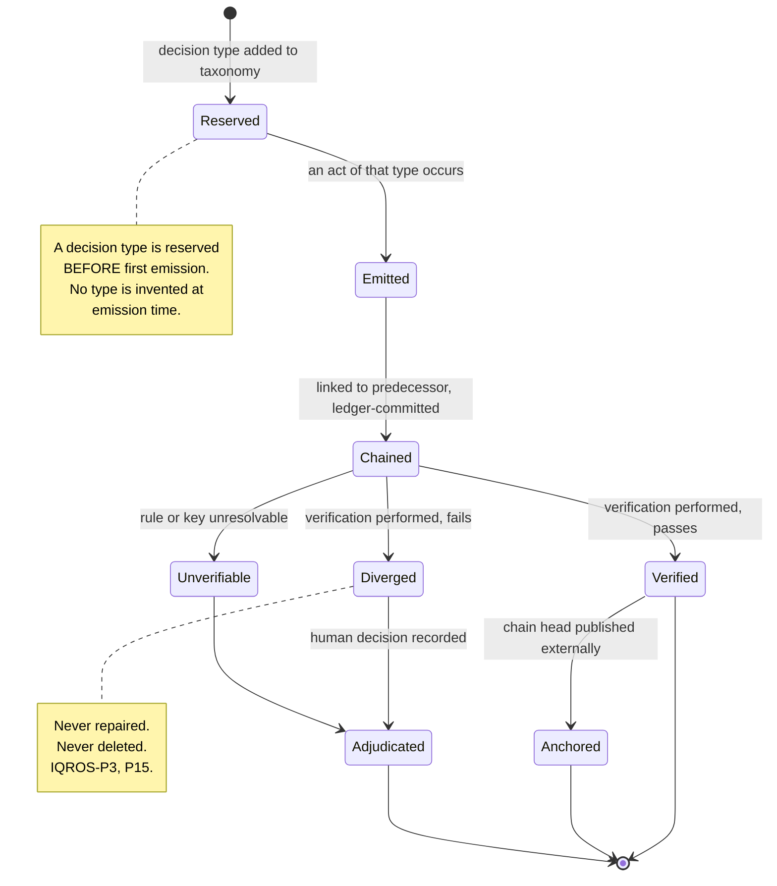
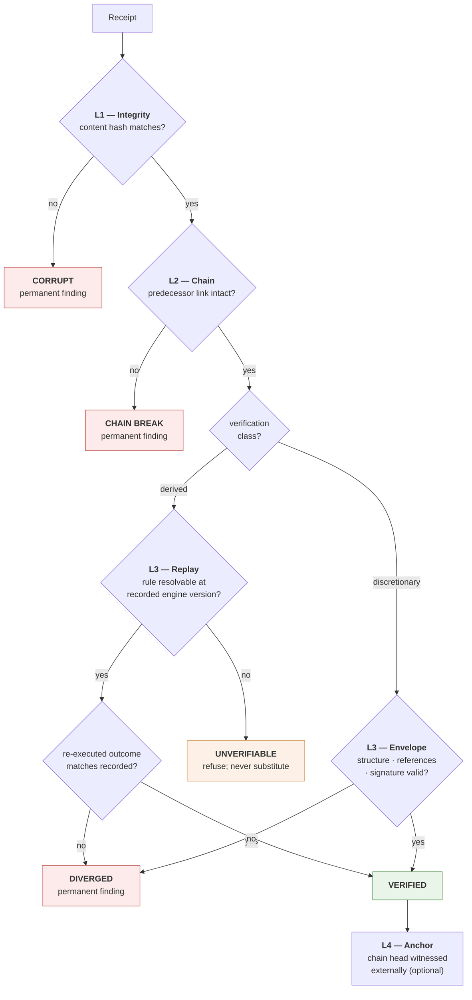
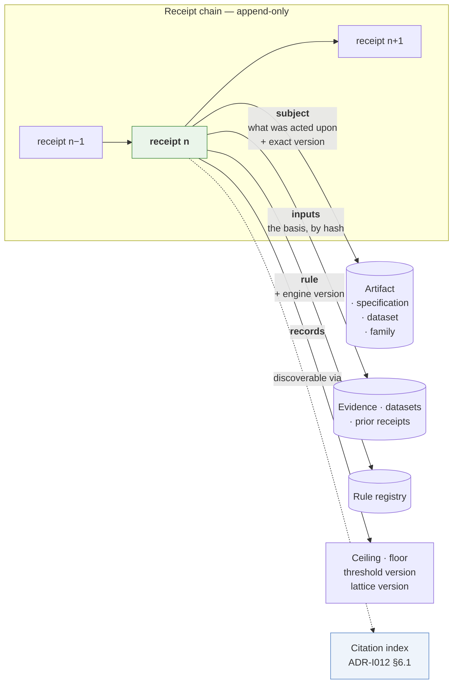

# ADR-I015: Receipt Contract

| Field | Value |
|---|---|
| **Title** | ADR-I015 — Receipt Contract |
| **Status** | **Draft** |
| **Version** | 0.1.0 |
| **Document Type** | Architecture Decision Record (IQROS series) — **Constitutional Governance** |
| **Extends** | [IQROS Master Architecture](../iqros_master_architecture.md) v0.1.0 — `IQROS-P10`, `IQROS-P5`, `IQROS-P15`, `Ph3` |
| **Depends On** | IQROS v0.1.0 · [ADR-I014 Admissibility Framework](ADR-I014-admissibility-framework.md) v0.1.0 |
| **Consumed By** | `ADR-I010`, `ADR-I011`, `ADR-I012`, `ADR-I013`, `ADR-I014` — 26 receipt references across the five |
| **Supersedes** | None |
| **Resolves** | Research Platform Review v1 finding **`M3`** (receipt contract undefined) |
| **Authors** | Rohith Suresh — Owner / Architect · Drafted with Claude Opus 5 |
| **Last Updated** | 2026-08-04 |

> **Numbering note.** "Receipt Contract" was **not** on the IQROS anticipated-subject list — the review recorded `M3` as *untracked*. It is a new subject under rule **NS6**. `ADR-I015` was reserved for cross-platform read-only aggregation; allocated here by owner direction under **NS8**. The index is reconciled: cross-platform aggregation relocates to `ADR-I026`. See [Architecture Documentation Index](../README.md) §9, §13.1.

> **Constitutional status.** This ADR **specifies a term the Constitution already asserts**. `IQROS-P10` states that every irreversible governance act emits a chained, replayable receipt, and that derived acts replay by recomputation while discretionary acts are envelope-verified. It does not define what a receipt contains, how it chains, or how verification is performed. This document supplies that definition. **No Article is amended** (`E1`) — see §13.3 for the one place where amendment was considered and deliberately avoided.

---

## 1. Context

The Research Platform Architecture Review (v1) recorded:

> **`M3`** — *"The receipt contract is referenced by all five documents and defined by none in the IQROS series. Every governance rule across the set emits a receipt. No IQROS document specifies what a receipt contains, what decision types exist, or how chaining and replay work."*

Twenty-six receipt references exist across the written ADRs:

| ADR | References | Acts requiring a receipt |
|---|---|---|
| `ADR-I009` | 0 | *(none — storage emits no governance act)* |
| `ADR-I010` | 4 | Feature specification registration (`FG1`) |
| `ADR-I011` | 3 | Label specification registration (`LG1`), superseded-input adjudication |
| `ADR-I012` | 7 | Dataset sealing (`DG-1`), holdout consumption (`DG-7`) |
| `ADR-I013` | 9 | Hypothesis and experiment registration, lockbox opening, **promotion** (`EG1`, `LB1`) |
| `ADR-I014` | 3 | Refusals that block a governance act (`AG4`) |

**As with `ADR-I013`, this is not a void.** The audited reference platform operates a substantial receipt architecture: content-addressed hashing with a byte-identical serialisation convention, an append-only ledger with database-level triggers blocking update and delete, chain verification, a reserved decision taxonomy, a derived/discretionary replay split, and rule resolution that refuses an unknown historical rule rather than silently substituting a current one. Its real ledger holds 26 receipts across three decision types with a valid chain.

**This ADR writes down the contract those references already assume**, and closes the gaps the platform's own record identifies as deferred: signing, chain-verification operationalisation, and anchoring.

---

## 2. Receipt Purpose

### 2.1 What a Receipt Is

> **A receipt is the durable, verifiable record that an irreversible act occurred — by whom, on what basis, under which rules.**

It is not a log entry. A log may be rotated, truncated, or rewritten; a receipt may not. It is the act's permanent existence proof.

### 2.2 The Distinction That Defines the Contract

> **A receipt is evidence of *occurrence*, not evidence of *correctness*.**

A promotion receipt does not prove the promotion was right. It proves the promotion happened, records who granted it and on what basis, and permits a later reader to re-derive whether it was *permissible under the rules then in force*.

This distinction is why `IQROS-P10`'s two verification classes exist, and why `G1` — *promotion is verified, never derived* — is coherent rather than contradictory. A promotion granted under thresholds later tightened remains a valid **occurrence** even though today's rules would refuse it.

### 2.3 What Receipts Are Not

| Not a | Because |
|---|---|
| Log | Logs are rotatable and lossy; receipts are permanent |
| Audit trail *summary* | A receipt is the record itself, not a description of one |
| Approval | A receipt records that an act occurred; permission was established before it (`ADR-I014`) |
| Correctness proof | §2.2 |
| Substitute for the artifact | A receipt references its subject; it does not contain it |

---

## 3. Receipt Lifecycle

| Phase | Meaning | Terminal? |
|---|---|---|
| **Reserved** | The decision type exists in the taxonomy; nothing has been emitted | No |
| **Emitted** | A receipt exists for a specific act, not yet committed to the chain | No |
| **Chained** | Linked to its predecessor and committed atomically with the act it records | No |
| **Verified** | Verification performed and passed (§9) | Yes |
| **Diverged** | Verification performed and **failed** — a permanent finding | Requires adjudication |
| **Unverifiable** | The historical rule or key cannot be resolved — **refused, never substituted** | Requires adjudication |
| **Anchored** | The chain head containing it has been published to an external witness (§9.2) | Yes |
| **Adjudicated** | A human decision has been recorded against a divergence or unverifiability | Yes |

### 3.1 Lifecycle Rules

| ID | Rule |
|---|---|
| **RL1** | **A decision type is reserved before it is emitted.** No act may invent a type at emission time |
| **RL2** | **A receipt is committed atomically with the act it records.** Either both persist or neither does |
| **RL3** | **A receipt is never deleted, amended, or superseded.** A correction is a new receipt referencing the original |
| **RL4** | **Divergence and unverifiability are permanent findings** (`IQROS-P15`), never repaired (`IQROS-P3`) |
| **RL5** | **Anchoring is additive.** An unanchored receipt is valid; anchoring strengthens it |

> **RL1 matches audited practice and is worth preserving deliberately.** The reference platform reserved several decision types at the foundation stage and left them unused for months until the corresponding acts were built. Reserving in advance prevents a type from being shaped by the convenience of one emission site.

> **RL2 is the property that makes a receipt trustworthy.** A receipt written after its act can be omitted when the act is embarrassing. The reference platform enforces this by sharing a single transaction between the act and its receipt.

---

## 4. Receipt Ownership

| ID | Rule |
|---|---|
| **RO1** | **The receipt ledger has exactly one writer** (`IQROS-P2`) |
| **RO2** | **Emission is owned by the component performing the act**, never by a separate observer. An observer could miss an act; the actor cannot |
| **RO3** | **No component may emit a receipt for an act it did not perform**, except a migration performing a declared backfill (§4.1) |
| **RO4** | **The ledger never adjudicates.** It records and verifies; it does not decide whether a recorded act was correct |
| **RO5** | **Verification is owned separately from emission.** The emitter cannot certify its own receipt |

### 4.1 Backfill Ownership

A receipt recording an act that occurred **before** the receipt system existed is **bootstrap-attested** (§5.3) and must:

- declare that it is a backfill,
- name the migration that produced it,
- and **never be presented as an organic emission**.

> This is `G5` — *bootstrap honesty* — applied to receipts, and it matches audited practice exactly: the reference platform's backfilled receipts each carry their own attestation marker and note, so the record itself discloses its origin rather than relying on a companion document.

---

## 5. Receipt Identity

### 5.1 Content Addressing

> **A receipt's identity is the hash of its content** (`IQROS-P5`). Identity is derived, never assigned.

| ID | Rule |
|---|---|
| **RI1** | Identity is a content hash over a **canonical serialisation** |
| **RI2** | The serialisation must be **deterministic** — stable ordering, stable encoding, no ambient values |
| **RI3** | **Numeric values serialise exactly**, without floating-point ambiguity, so a hash is reproducible across platforms |
| **RI4** | Two receipts with identical content **are** the same receipt — duplicate emission is detectable, not silently doubled |
| **RI5** | The **chain link** is part of the content, so identity depends on position in the chain |

> **RI3 is not pedantry.** A receipt whose hash depends on floating-point formatting is unverifiable on a different platform, and a governance record that cannot be verified elsewhere is not a governance record. The reference platform already uses decimal-string serialisation for exactly this reason.

### 5.2 Verification Class

`IQROS-P10` defines two, and this ADR preserves them **exactly as written**:

| Class | Verification | Applies to |
|---|---|---|
| **Derived** | The recorded rule is **re-executed** and the outcome compared bit-for-bit | Acts that are computations |
| **Discretionary** | The **envelope** is verified — structure, chain, signature, references — but the judgment is not recomputed | Acts that are judgments |

This is `Ph3` — *judgments and computations differ in kind* — made operational.

### 5.3 Attestation Basis — Orthogonal to Verification Class

Some acts are neither recomputable nor purely a judgment: they are **observations of an external fact** the platform cannot reproduce. A venue fill, a host-side execution, a pre-existing historical act.

> **Attestation basis is a separate metadata dimension, not a third verification class.**

| Basis | Meaning |
|---|---|
| **platform-observed** | The platform directly observed the fact it records |
| **operator-attested** | A human asserts the fact; the platform did not observe it |
| **external-venue** | An external system reported the fact; the platform recorded the report |
| **bootstrap** | Backfilled for an act predating the receipt system (§4.1) |

**Why a dimension and not a class.** `IQROS-P10`'s split concerns *how verification is performed*: recompute, or check the envelope. Attestation concerns *where the recorded fact came from*. They are independent — an operator-attested act is still envelope-verified. Adding a third verification class would amend `IQROS-P10`, which `E1` forbids an ADR from doing. **This construction gives execution receipts what they need without amendment** — see §13.3.

---

## 6. Receipt Metadata

Every receipt carries the following classes. **No field is defaultable** (`Ph6`).

| Field class | Purpose |
|---|---|
| **Schema version** | The receipt contract version this receipt conforms to (§13.1) |
| **Decision type** | The reserved type from the taxonomy (§12.2) |
| **Verification class** | Derived or discretionary (§5.2) |
| **Attestation basis** | Where the recorded fact came from (§5.3) |
| **Subject** | *What was acted upon* — kind, identity, and the exact version or hash governed |
| **Actor** | Who performed the act, and in what capacity |
| **Instant** | When the act occurred |
| **Inputs** | The basis — every artifact the act depended on, by hash |
| **Rule reference** | For derived receipts: the rule identity **and its engine version** |
| **Recorded admissibility** | The ceiling and floor that obtained at the moment of the act (§10.2) |
| **Governing versions** | Threshold-set version and lattice version in force |
| **Chain link** | The predecessor receipt's hash |
| **Outcome** | What the act produced or changed |

### 6.1 Subject Precision

> **A subject reference names not just *what* was acted upon, but *which version* of it.**

A receipt governing "this family" is ambiguous; a receipt governing "this family at this exact transition" is not. The reference platform already does this and it is preserved here as a rule.

### 6.2 Rule Reference Precision

For derived receipts, the rule reference must resolve to **the rule as it was**, not as it is now.

| ID | Rule |
|---|---|
| **RM1** | A derived receipt records **rule identity plus engine version** |
| **RM2** | Replay resolves that exact pair. If it cannot, the receipt is **Unverifiable** |
| **RM3** | **Substituting a current rule for an unresolvable historical one is prohibited** |

> **RM3 exists because its absence is silently catastrophic.** If replay used whatever rule is current, an in-place edit to a rule would change what every historical receipt replays to, while replay continued reporting success. The reference platform found and corrected exactly this defect during implementation, demonstrating it with a case where the substituted rule produced the *opposite* verdict from the one recorded.

---

## 7. Receipt Immutability

| ID | Rule |
|---|---|
| **RIM1** | **Enforced at the storage layer**, not by application discipline (`IQROS-S6`) |
| **RIM2** | **No update path exists.** Not for corrections, not for annotations, not for migrations |
| **RIM3** | **No delete path exists**, including for receipts recording refused or reversed acts |
| **RIM4** | A **correction is a new receipt** referencing the original, never a modification |
| **RIM5** | Immutability is **verifiable independently** of the code that wrote the receipt |

> **RIM2's absoluteness is deliberate.** A system with an update path "only for corrections" has an update path. The reference platform enforces this with database-level abort triggers on both update and delete, so no application defect can bypass it.

---

## 8. Receipt Provenance

Receipt provenance is **the closure that makes a receipt independently interpretable**. It is distinct from metadata (§6, *what fields exist*) and from relationships (§11, *how receipts link*): provenance is *what a reader must be able to reach in order to understand what this receipt asserts*.

### 8.1 The Closure

| Element | Answers |
|---|---|
| Subject at its exact version | *What was acted upon* |
| Every input, by hash | *On what basis* |
| Rule identity + engine version *(derived only)* | *Under what computation* |
| Threshold-set version | *Against which merit bar* |
| Lattice version | *Under which admissibility definition* |
| Recorded ceiling and floor | *What was permissible then* |
| Contract version | *Under which receipt rules* |
| Actor and capacity | *By whose authority* |
| Predecessor hash | *At what point in the record* |

### 8.2 The Completeness Rule

> **A receipt plus its provenance closure must be sufficient to reconstruct the act's basis with no other lookup.**

This is the same obligation `ADR-I009` places on export artifacts, `ADR-I010` on value sets, `ADR-I012` on sealed datasets, and `ADR-I013` on Statistical Results. It is stated here for receipts because a receipt that requires ambient context to interpret becomes meaningless as soon as that context changes.

### 8.3 Provenance Rules

| ID | Rule |
|---|---|
| **RP1** | **Provenance is recorded at emission**, never reconstructed later. A reconstruction is an inference, not a record |
| **RP2** | **Every provenance element is a hash or a version**, never a mutable name or a path |
| **RP3** | **Provenance is closed at the instant of the act.** Nothing that did not exist then may appear in it |
| **RP4** | **A receipt's provenance is not its subject's provenance.** A dataset-seal receipt records *that the seal happened and on what basis*; the dataset's own closure lives with the dataset (`ADR-I012` §14) |
| **RP5** | **Provenance survives retirement.** Every element a receipt references remains resolvable forever (`RR3`) |

> **RP4 is the distinction most easily lost.** Receipt provenance answers *how did this act come about*; artifact provenance answers *how was this thing built*. A receipt duplicating its subject's full closure would grow without bound and would drift from the subject's own record. It references instead.

---

## 9. Receipt Verification

Four layers, each independently meaningful.

| Layer | Verifies | Failure means |
|---|---|---|
| **L1 Integrity** | The receipt's content matches its hash | Corruption or tampering |
| **L2 Chain** | The predecessor link is intact across the ledger | Insertion, deletion, or reordering |
| **L3 Semantic** | Derived: recomputation matches. Discretionary: envelope is well-formed | Divergence, or unverifiability |
| **L4 Anchor** | The chain head was witnessed externally at a known time | Cannot prove the chain predates a given moment |

### 9.1 Verification Rules

| ID | Rule |
|---|---|
| **RV1** | **Verification never repairs** (`IQROS-P3`). It reports by name and stops |
| **RV2** | **A failure at any layer is a permanent finding** (`IQROS-P15`) |
| **RV3** | **Unverifiable is distinct from Diverged.** *Cannot check* is not *checked and failed* |
| **RV4** | Verification is **independently runnable** by a party holding only the ledger and the rule registry |
| **RV5** | **L1 and L2 require no rules** — they are checkable by anyone, forever, with no platform knowledge |

> **RV5 is what makes the ledger outlive the platform.** Integrity and chain verification depend only on hashing. A reader in ten years, without any of this codebase, can still establish that the chain was not altered.

### 9.2 What Anchoring Adds

A hash chain proves **internal consistency** — that no entry was altered relative to others. It does not prove **when** the chain existed. A holder of the whole ledger could, in principle, rebuild it entirely.

> **Anchoring publishes the chain head to a witness outside the platform's control**, converting "the chain is self-consistent" into "the chain existed in this state at this time."

| ID | Rule |
|---|---|
| **RA1** | Anchoring is **additive** — an unanchored chain is valid |
| **RA2** | An anchor records **the head hash and the instant**, nothing about content |
| **RA3** | **Multiple independent witnesses** are permitted; more witnesses strengthen the claim |
| **RA4** | An anchor is **never retroactive.** It attests only from its own instant forward |

### 9.3 Signing

| ID | Rule |
|---|---|
| **RS1** | Signing binds a receipt to an **actor identity**, answering *who* rather than *what* |
| **RS2** | A signing key is **registered before use** and never retired while receipts signed by it remain |
| **RS3** | An **unsigned receipt is valid but weaker** — it establishes occurrence, not authorship |
| **RS4** | **Signature failure is a permanent finding**, not a reason to reject the receipt's existence |

> **RS3 is a deliberate ordering choice.** Requiring signatures before any receipt could be emitted would have blocked receipt adoption on key infrastructure. The reference platform emitted valid receipts for months without signing, and deferred it explicitly. This contract preserves that: signing strengthens a receipt; its absence does not invalidate one.

---

## 10. Receipt Admissibility

This section resolves how `ADR-I014` applies to receipts. **It does not extend the lattice.**

### 10.1 Receipts Do Not Carry Admissibility

> **A receipt has no admissibility ceiling of its own. It *records* the ceiling that obtained at the moment of the act.**

A receipt is not research evidence. It is not an input to a meet. Asking whether a receipt is "admissible" confuses the record with the thing recorded.

| ID | Rule |
|---|---|
| **RD1** | A receipt is **outside** the admissibility lattice — it is a record, not an artifact composed from inputs |
| **RD2** | A receipt **records** the ceiling and floor that obtained at its instant (§6), immutably |
| **RD3** | Recorded admissibility is **never recomputed on read.** It is read as it was — the basis for `ADR-I014` `PM5` and `AG2` |

### 10.2 Receipts Are How `PM5` Works

`ADR-I014` `PM5` states that a promotion granted under a satisfied floor **remains valid if the floor is later raised**. That guarantee needs somewhere for the historical ceiling and floor to live. **This is that place.**

Without a receipt recording them, "the floor was satisfied at the time" would be an assertion. With one, it is a verifiable record.

### 10.3 Verification State Feeds the Integrity Dimension

There is one connection to the lattice, and it runs in the expected direction:

> **A receipt in `Diverged` or `Unverifiable` state caps the Integrity dimension (`I`) of any artifact that depends on the act it records.**

| Receipt state | Effect on citing artifacts' `I` |
|---|---|
| Verified / Anchored | No cap |
| Diverged / Corrupt / Chain break | `I = flagged` until adjudicated |
| Unverifiable | `I = flagged` until adjudicated |
| Adjudicated | `I = adjudicated` — permitted, not restored to clean |

This uses `ADR-I014`'s existing Integrity dimension exactly as `ADR-I011` §11.3 uses it for superseded inputs. **No dimension is added and no ordering changes.**

---

## 11. Receipt Relationships

| Relationship | Direction | Purpose |
|---|---|---|
| **Chain** | Receipt → predecessor | Tamper evidence; ordering |
| **Subject** | Receipt → artifact version | *What* was acted upon (§6.1) |
| **Inputs** | Receipt → artifacts by hash | *On what basis* |
| **Rule** | Receipt → rule + engine version | *Under what computation* (derived only) |
| **Prior receipts** | Receipt → receipt | A promotion cites the admissions it rests on |
| **Citation index** | Reverse lookup | *What depends on this act?* |

### 11.1 Relationship Rules

| ID | Rule |
|---|---|
| **RR1** | **Every reference is by hash**, never by mutable name |
| **RR2** | **A receipt may reference other receipts**, forming a lineage distinct from the chain. The chain is *temporal*; references are *logical* |
| **RR3** | **References are resolvable forever.** A referenced artifact can never be retired while a receipt references it (`ADR-I012` §6.1) |
| **RR4** | **The chain is total; references are partial.** Every receipt has exactly one predecessor; not every receipt references another |

---

## 12. Governance

### 12.1 Receipt Classes

The five classes the contract must support. **No class introduces a new mechanism** — each is a decision type with a verification class and an attestation basis.

| Class | Decision types | Verification | Typical attestation | Required by |
|---|---|---|---|---|
| **Evidence** | admit · reject | **Derived** — the gate recomputes | platform-observed | `ADR-I013` §11 |
| **Dataset** | seal · retire | **Discretionary** — sealing is a human act | platform-observed | `ADR-I012` `DG-1` |
| **Experiment** | register · adjudicate · open-lockbox | register **discretionary**; adjudicate **derived** | platform-observed | `ADR-I013` `EG1`, `LB1` |
| **Promotion** | promote · demote · transition | **Discretionary** — `G1`, verified never derived | platform-observed | `ADR-I013` `EG3` |
| **Execution** *(future)* | order · fill · reconcile | **Discretionary** | **external-venue** | Trading Platform series |

> **Execution receipts are why §5.3 exists.** A venue fill is not recomputable — the platform cannot re-execute a trade to check it happened. It is also not a judgment. It is an external fact the platform recorded. Attestation basis `external-venue` expresses this without amending `IQROS-P10`.

### 12.2 The Taxonomy Is Reserved, Not Open

| ID | Rule |
|---|---|
| **RG1** | **A decision type is reserved by constitutional act**, then emitted later when the corresponding capability exists (`RL1`) |
| **RG2** | **A component may not invent a decision type.** An unreserved type is a refused emission |
| **RG3** | **Reserved-but-unemitted types are normal**, not defects |
| **RG4** | A type is **never removed or repurposed.** Retirement marks it closed; the identifier is never reused |

### 12.3 Separated Authorities

| Concern | Authority | Contract role |
|---|---|---|
| Decision-type taxonomy | Constitutional session | Consume; never extend |
| Emission | The acting component (`RO2`) | Emit atomically with the act |
| Verification | A separate party (`RO5`) | Report; never repair |
| Divergence adjudication | Human (`IQROS-P8`) | Refuse silent resolution |
| Key registry | Human | Register before use |
| Anchoring | Operator | Publish head; never alter content |

### 12.4 Governance Rules

| ID | Rule |
|---|---|
| **RGV1** | **Every irreversible governance act emits a receipt** (`IQROS-P10`). An act without one is a defect, not an exception |
| **RGV2** | **The absence of a receipt is not evidence the act did not occur** — it is evidence the ledger is incomplete, which is a finding |
| **RGV3** | **A receipt never confers permission.** Permission is established beforehand by `ADR-I014` |
| **RGV4** | **The ledger is a platform-sovereign asset** (`IQROS-P1`). Receipts are never shared across platforms except as published artifacts consumed as shadow (`IQROS-P11`) |
| **RGV5** | **Chain verification runs on a schedule**, not only on demand. An unverified chain is an unmonitored control (`IQROS-S5`) |

> **RGV5 closes a gap the reference platform's own record names as deferred.** Its chain-verification capability exists and passes; operationalising it as a scheduled control does not. `IQROS-S5` states that a control with no independent failure signal is not a completed control — which applies to the receipt chain as much as to a backup.

---

## 13. Future Extensibility

### 13.1 Versioning

| ID | Rule |
|---|---|
| **RVX1** | Every receipt records the **contract version** it conforms to |
| **RVX2** | **Adding an optional field** is a minor version. Existing receipts remain valid and verifiable |
| **RVX3** | **Adding a required field, changing serialisation, or changing hashing** is a **major** version and requires a constitutional session |
| **RVX4** | **Verification is version-aware.** A receipt is verified under the contract version it was written against, never a later one |
| **RVX5** | A contract version is **never retired** while receipts cite it |

> **`RVX4` is the receipt-level analogue of `RM2`.** Verifying an old receipt under a new contract would produce false divergences and would silently rewrite what history means.

### 13.2 Adding a Decision Type

A proposed type is admissible only if it satisfies all four:

| # | Requirement |
|---|---|
| **X1** | It records an **irreversible act**. Reversible acts do not need receipts |
| **X2** | Its **verification class** is stated at reservation, not chosen at emission |
| **X3** | Its **subject kind** is an existing artifact class, or one introduced by the same act |
| **X4** | It is **reserved before emission** (`RG1`) |

### 13.3 The Amendment That Was Considered and Declined

A third verification class — *attested* — was considered for execution receipts, whose facts are neither recomputable nor purely judgments.

**It was declined.** `IQROS-P10` names exactly two classes; adding a third would amend an Article, which `E1` forbids an ADR from doing. Instead, §5.3 introduces attestation basis as an **orthogonal metadata dimension**, which is sufficient for execution receipts and requires no amendment.

> Recorded here so a future session inherits the reasoning rather than rediscovering it. If a constitutional session later concludes that attestation warrants first-class verification status, that is an amendment to `IQROS-P10` — and it should be made deliberately, not arrived at incidentally through a Trading Platform ADR.

### 13.4 Candidate Extensions — Named, Not Adopted

| Candidate | Would provide | Assessment |
|---|---|---|
| **Threshold-authority receipts** | A record of threshold-set freezing and revision | Likely required by `ADR-I024`; satisfies X1–X4 |
| **Lattice-version receipts** | A record of admissibility-lattice changes | `ADR-I014` `AG1` makes lattice change constitutional; a receipt would record it |
| **Cross-platform anchor exchange** | Platforms witnessing each other's chain heads | Attractive, but constrained by `IQROS-P11` — must remain shadow, never canonical |
| **Read receipts** | A record of who read what | **Fails X1** — reading is not irreversible. Not recommended |

---

## 14. IQROS Conformance

### 14.1 Conformance Checklist

| Article | Requirement | Conformance | Where |
|---|---|---|---|
| **IQROS-P1** | Platform sovereignty | ✅ | `RGV4` |
| **IQROS-P2** | Single writer | ✅ | `RO1` |
| **IQROS-P3** | Assert, never repair | ✅ | `RV1`, `RL4` |
| **IQROS-P4** | Admissibility lattice | ✅ | §10 — receipts record ceilings; `RD1`–`RD3` |
| **IQROS-P5** | Content addressing | ✅ | §5.1 — **this ADR specifies receipt identity** |
| **IQROS-P8** | Human-gated irreversibility | ✅ | §12.3 — adjudication and key registry are human |
| **IQROS-P10** | Receipt completeness | ✅ | **This ADR is P10's specification.** Two classes preserved exactly (§5.2, §13.3) |
| **IQROS-P11** | Shadow, never canonical | ✅ | `RGV4` |
| **IQROS-P15** | Negative records persist | ✅ | `RL4`, `RV2`, `RIM3` |
| **IQROS-S5** | Controls need failure signals | ✅ | `RGV5` — scheduled chain verification |
| **IQROS-S6** | Tamper-evident by construction | ✅ | `RIM1` — storage-layer enforcement |
| **`Ph3`** | Judgments vs computations | ✅ | §5.2 — the derived/discretionary split |
| **`Ph6`** | Absence is not permission | ✅ | §6 — no field defaultable; `RGV2` |
| **`G5`** | Bootstrap honesty | ✅ | §4.1 |
| **`G1`** | Promotion verified, never derived | ✅ | §12.1 — promotion is discretionary; §10.2 supplies `PM5`'s record |
| **`E1`** | No Article amended | ✅ | §13.3 — amendment considered and declined |
| **`E8`** | Choices marked as choices | ✅ | §5.3, §9.3, §13.3 |
| **`ADR-I014`** | Admissibility framework | ✅ | §10 — uses Integrity dimension; adds none |

### 14.2 Review Findings Addressed

| Finding | Status |
|---|---|
| **`M3`** — receipt contract undefined | **Resolved** — this ADR |
| `M4` — holdout vs lockbox unreconciled | Not addressed; remains open |
| `M5` — undeclared upward delegation | Not addressed; remains open |
| `m1`–`m4`, `O1`–`O4` | Not addressed; remain open |

> The review is a **dated record and is not amended** (Index rule `RV1`). Resolution is recorded here and in the index.

---

## 15. Decision Summary

### 15.1 Decisions

1. **A receipt is evidence of occurrence, not correctness** — the distinction that makes `G1` coherent.
2. **Identity is a content hash over a deterministic, exactly-serialised canonical form**, including the chain link.
3. **`IQROS-P10`'s two verification classes are preserved exactly.** Attestation basis is an orthogonal metadata dimension, not a third class (§5.3, §13.3).
4. **Verification has four layers** — integrity, chain, semantic, anchor — and the first two require no rules, so the ledger outlives the platform.
5. **Unverifiable is distinct from Diverged.** *Cannot check* is never *checked and passed*, and a current rule is never substituted for an unresolvable historical one.
6. **Receipts are outside the admissibility lattice.** They *record* ceilings rather than carrying them — which is where `ADR-I014` `PM5` lives.
7. **A failed or unverifiable receipt caps the Integrity dimension** of artifacts depending on it, using `ADR-I014`'s existing dimension and adding none.
8. **The taxonomy is reserved, never open.** Types are reserved by constitutional act and emitted later; reserved-but-unemitted is normal.
9. **Immutability is storage-enforced and absolute** — no update path, no delete path, corrections are new receipts.
10. **Signing and anchoring strengthen a receipt; their absence does not invalidate one.**

### 15.2 Future ADR Dependencies

**Requires from unwritten ADRs:**

| Needed from | For |
|---|---|
| `ADR-I001` — IQROS adoption | Force (`E1`) |
| `ADR-I024` — Threshold governance | The threshold-set version every receipt records (§6) |

**Required by:**

| Will require | For |
|---|---|
| `ADR-I010`–`ADR-I014` | The receipt contract all five already assume — **retroactively satisfied** |
| `ADR-I017` — Agent consumer contract | `AI6` — agent output is a proposal; only a human act emits a receipt |
| `ADR-I018` — Execution authorisation | Execution receipts (§12.1), `external-venue` attestation |
| `ADR-I022` — Model registry | Model-artifact receipts |
| **Trading Platform series** | Execution receipt class in full |

---

## Standing Note

**Status is Draft.** This ADR extends a Draft constitution and has no force until IQROS is adopted (`E1`, Index rule `ST1`).

Like `ADR-I014`, this document is **retroactively satisfying**: `ADR-I010` through `ADR-I014` were written against a contract that did not exist, and each stated its dependency honestly. Supplying it required no change to any of them — which was the constraint, and the test of whether their assumptions were genuinely consistent. They were.

One property is worth stating plainly because it is the reason receipts exist at all: **a governance record that can be rewritten is not a governance record.** Every rule in §7 follows from that, and none of them is negotiable in the way an ordinary architectural preference is.

No code, schema, file layout, or migration plan is specified in this document.
