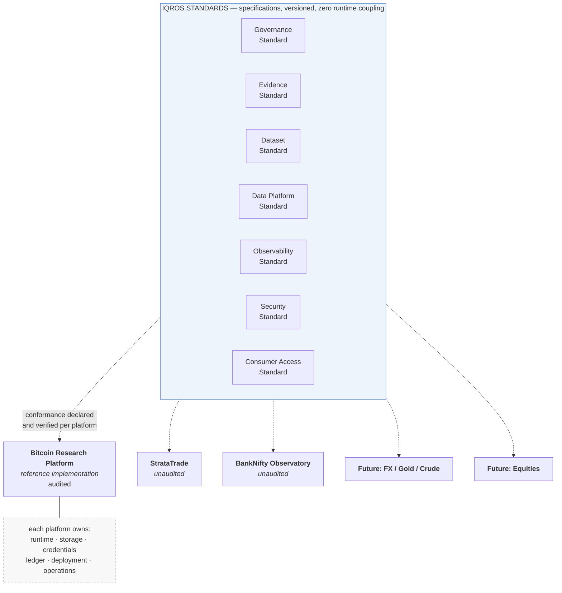
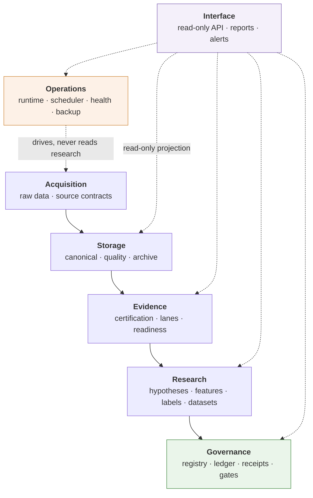
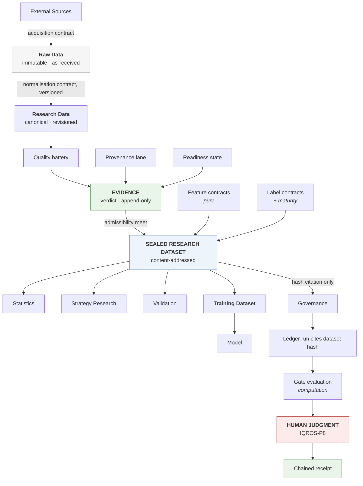
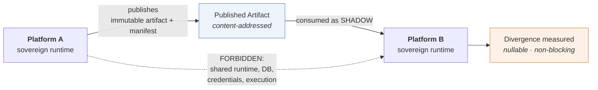
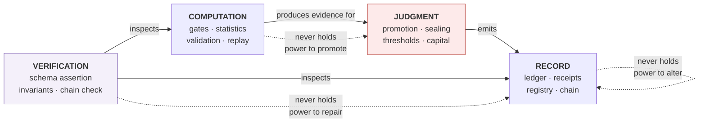
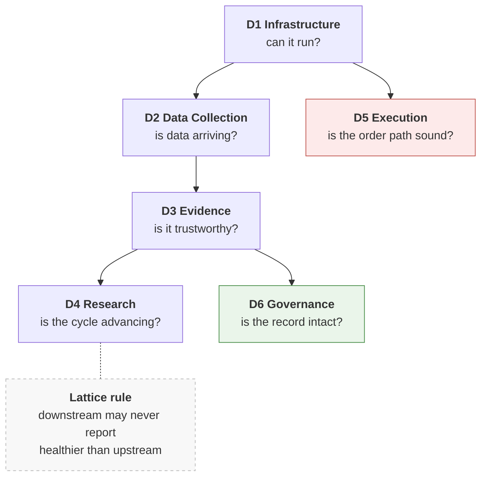

# IQROS — Institutional Quantitative Research Operating System
## Master Architecture

| Field | Value |
|---|---|
| **Title** | IQROS — Institutional Quantitative Research Operating System: Master Architecture |
| **Version** | 0.1.0 |
| **Status** | **Draft** |
| **Document Type** | **Constitutional Architecture** |
| **Authors** | Rohith Suresh — Owner / Architect · Drafted with Claude Opus 5 |
| **Last Updated** | 2026-08-04 |
| **Supersedes** | Nothing. This is the first constitutional document. |
| **Extends** | Nothing. The platform-series `ADR-0001` (Infrastructure) and `ADR-0002` (P1 Governance Store) under `docs/adr/` are *subordinate* to this document from adoption forward. |

### Scope

This document governs the architecture of every quantitative research platform in the ecosystem:

- **Bitcoin Research Platform** — the reference implementation
- **StrataTrade**
- **BankNifty Observatory**
- **Future asset classes** — Forex, Crude Oil, Gold, Equities, and further crypto venues

It is **constitutional**, not advisory. Every future Architecture Decision Record (ADR), in any platform, must be derivable from and consistent with this document. Where an ADR conflicts with an Article here, **the ADR is invalid until this document is amended** by the process in [Article 20](#20-evolution-principles).

This document specifies architecture only. It contains no code, no database schema, no file layout, and no migration plan.

---

## Epistemic Status — Read Before Relying on Any Section

This document is grounded in a ten-dimension audit of the **Bitcoin Research Platform** at commit `c14ba38`, covering repository architecture, data collection, database architecture, evidence, feature engineering, label engineering, research, strategy, risk, portfolio, and execution. Statements traceable to that audit are load-bearing.

**StrataTrade and BankNifty Observatory have not been audited.** The only repository evidence of StrataTrade is its appearance *inside* the Bitcoin platform as a **shadow** data source — nullable, non-blocking, and divergence-measured. BankNifty Observatory does not appear in the audited repository at all; a separate NIFTY options system is referenced only as a system from which sharing is **forbidden**.

This document therefore accommodates unaudited platforms **by contract, not by assumption**. It states what any system must satisfy to be an IQROS platform, rather than describing systems that have not been inspected. Articles marked *provisional* in [Article 20](#20-evolution-principles) are those not yet validated across more than one platform.

---

## 1. Vision

**IQROS is a constitution, not a runtime.**

It is not a shared library, a shared service mesh, a shared database, or a monorepo. It is the set of invariants, contracts, and disciplines that make independently-built research platforms **mutually intelligible, independently verifiable, and jointly governable** — while remaining **operationally isolated** from one another.

The vision is a research organisation in which:

1. Any conclusion, in any platform, in any asset class, can be traced to the exact evidence, code revision, and human judgment that produced it — years later.
2. No platform can compromise another's operation, data integrity, or governance record.
3. Adding an asset class is the instantiation of a contract, not the design of a system.
4. The platform never promotes itself, never executes on its own authority, and never repairs what it should report.

The audited Bitcoin Research Platform is the **reference implementation**: 35 governed signal families, 70 hash-pinned evaluation runs, a hash-chained decision ledger, frozen statistical thresholds — and **zero validated families and zero orders ever placed**.

That last fact is not a shortfall. It is proof that the gates hold. IQROS generalises the machinery that produced that restraint.

---

## 2. Design Philosophy

| ID | Principle | Statement |
|---|---|---|
| **Ph1** | **Restraint is the product** | The value of a research operating system is what it *refuses*. A system that cannot refuse produces conclusions at the rate its author produces hopes. |
| **Ph2** | **Reproducibility by refusal to persist** | Derived state is recomputed, not stored, wherever recomputation is deterministic. What is stored is stored because it *cannot* be recomputed. |
| **Ph3** | **Judgments and computations differ in kind** | A gate result is a computation and must replay bit-for-bit. A promotion is a judgment and must survive a later threshold change. Conflating them destroys both. |
| **Ph4** | **Isolation over reuse on any trading path** | Blast radius dominates DRY. Two platforms sharing runtime code share failures. |
| **Ph5** | **Assert, never repair** | Diagnostic code reports defects by name and stops. A tool that can silently fix is a tool that can silently corrupt. |
| **Ph6** | **Absence is not permission** | Missing evidence blocks; it does not pass. A silent gate is satisfiable by recording nothing. |
| **Ph7** | **Conditioning travels with data** | Every observation set carries the population statement under which it exists. Losing conditioning is the highest-consequence silent error available to a research platform. |
| **Ph8** | **The platform never acts on itself** | No self-promotion, no self-execution, no self-repair, no self-granted authority. |

---

## 3. Core Architectural Principles

These are the citable Articles. Future ADRs reference them by identifier.

| ID | Principle | Normative statement |
|---|---|---|
| **IQROS-P1** | **Platform Sovereignty** | Every platform instance owns its runtime, storage, credentials, deployment, and governance record in full. No platform may hold a runtime dependency on another. |
| **IQROS-P2** | **Single Writer** | Every dataset, artifact zone, and governance record has exactly one writer. Ownership is architectural, not conventional. |
| **IQROS-P3** | **Assert, Never Repair** | Validation, health, and diagnostic paths report by name and refuse. They never mutate their subject as a side effect. |
| **IQROS-P4** | **Admissibility Lattice** | Admissibility is inherited as the *meet* of inputs. Nothing may be declared more admissible than its weakest input. Absence of a verdict is a cap, not a pass. |
| **IQROS-P5** | **Content Addressing** | Every durable artifact — dataset, contract, receipt, archive — is identified by the hash of its content. Identity is derived, never assigned. |
| **IQROS-P6** | **Provenance Lanes** | Evidence is partitioned into non-interchangeable lanes by origin. Cross-lane substitution is structurally impossible, not merely discouraged. |
| **IQROS-P7** | **Sealed Regions** | Held-out data is sealed at the *data boundary*, not inside analysis code. A consumer cannot read a sealed region regardless of what its code does. |
| **IQROS-P8** | **Human-Gated Irreversibility** | Promotion, capital deployment, sealed-region opening, and threshold changes require an explicit human act. Service actors are refused. |
| **IQROS-P9** | **Frozen Constants** | Statistical constants entering a denominator or a gate are frozen by governance session and cannot change by code, configuration drift, or convenience. |
| **IQROS-P10** | **Receipt Completeness** | Every irreversible governance act emits a chained, replayable receipt. Derived acts replay by recomputation; discretionary acts are envelope-verified. |
| **IQROS-P11** | **Shadow, Never Canonical** | Data from another platform enters as a shadow input: nullable, non-blocking, divergence-measured. It may never become a canonical dependency. |
| **IQROS-P12** | **Conditioning Carried** | Every observation set states its conditioning. Consumers may override it only explicitly. |
| **IQROS-P13** | **Failure Isolation** | Observability, alerting, and reporting failures must never influence collection, governance, or trading decisions. |
| **IQROS-P14** | **Boundary Handoff by Artifact** | Cross-boundary communication is via immutable artifact plus manifest — never shared process, shared connection, or import. |
| **IQROS-P15** | **Negative Records Persist** | Rejections, disqualifications, violations, and failed validations are permanent records, equal in standing to successes. |

---

## 4. Platform Decomposition

IQROS decomposes into **Platform Instances** and **Standards**. There is deliberately **no shared runtime tier**.

### 4.1 Internal Decomposition of a Platform Instance

Every IQROS platform must exhibit these seven planes, with dependencies flowing **strictly upward** in this table.

| Plane | Owns | May depend on |
|---|---|---|
| **Acquisition** | Raw data, source contracts | External sources only |
| **Storage** | Canonical data, quality assessment, archive | Acquisition |
| **Evidence** | Certification verdicts, provenance lanes, readiness | Storage |
| **Research** | Hypotheses, features, labels, datasets, evaluation | Evidence |
| **Governance** | Registry, ledger, receipts, gates, thresholds | Research |
| **Operations** | Runtime, scheduling, health, backup, restore | Nothing above it |
| **Interface** | Read-only APIs, reports, alerts | All planes, read-only |

> **Constitutional dependency rule.** The Operations plane must never depend on Research or Governance. The audited reference collector runs with **zero** strategy, risk, or execution imports; this is the general form of that property.

---

## 5. Major Platform Responsibilities

Each Platform Instance is independently responsible for all of the following. **No responsibility may be delegated to another platform.**

| ID | Responsibility | Minimum obligation |
|---|---|---|
| **R1** | **Acquire** | Own source contracts, source-quirk handling, acquisition provenance |
| **R2** | **Preserve** | Immutable raw retention; revisioned canonical data |
| **R3** | **Certify** | Independent quality assessment and admissibility verdicts |
| **R4** | **Research** | Hypotheses, features, labels, sealed datasets, statistical evaluation |
| **R5** | **Govern** | Own registry, own ledger, own receipts, own frozen thresholds |
| **R6** | **Operate** | Own runtime, scheduling, supervision, backup, restore |
| **R7** | **Observe** | Own health model across all six domains ([Article 18](#18-observability-architecture)) |
| **R8** | **Secure** | Own credentials, own isolation, own audit trail |
| **R9** | **Report** | Own read-only interfaces and generated evidence surfaces |
| **R10** | **Refuse** | Own gates; the authority to block its own promotions |

> **R10 is load-bearing.** A platform that cannot refuse its own promotions is not an IQROS platform, regardless of what else it implements.

---

## 6. Data Ownership Model

### 6.1 Three Ownership Tiers

| Tier | Class | Sharing rule |
|---|---|---|
| **Sovereign** | Raw data, canonical storage, credentials, ledger, receipts, runtime state | **Never shared.** Owned absolutely by one platform |
| **Publishable** | Certification verdicts, sealed dataset declarations, aggregate health, published research artifacts | **May be published** as immutable artifacts; consumed read-only |
| **Shadow** | Another platform's publishable data, consumed cross-platform | **Consumed only as shadow** (IQROS-P11): nullable, non-blocking, divergence-measured |

### 6.2 Provenance of IQROS-P11

IQROS-P11 is **derived from observed precedent, not invented.** The audited Bitcoin platform already consumes StrataTrade exactly this way: a nullable funding field, a nullable shadow regime, and an explicit divergence flag, with the canonical regime computed independently. **Nothing breaks when StrataTrade is unavailable.** That pattern is hereby constitutional for all cross-platform data.

### 6.3 Ownership Invariants

1. One writer per zone (**IQROS-P2**), enforced architecturally rather than by convention.
2. Ownership is immutable. Transfer requires a new zone, not a permission change.
3. A zone owner **refuses** writes violating its invariants — refusal is part of ownership.
4. Cross-boundary handoff is artifact-plus-manifest (**IQROS-P14**).

---

## 7. Research Asset Taxonomy

Every durable object in IQROS belongs to exactly one class. Class determines mutability, retention, ownership, and governance treatment.

| Class | Mutability | Recoverable from | Retention |
|---|---|---|---|
| **Raw Data** | Immutable; revisions only | Re-fetch — *sometimes impossible* | Indefinite |
| **Research Data** | Immutable per revision | Raw + normalisation contract | Indefinite while cited |
| **Evidence** | Append-only judgments | Re-derivable as computation; the historical judgment is not | Indefinite |
| **Feature Values** | Disposable cache | Contract + pinned corpus | Evictable at will |
| **Label Values** | Append-and-fill; never rewritten | Replay against the same revisions | Indefinite |
| **Research Dataset** | Immutable once sealed | It *is* the reproduction instruction | Indefinite |
| **Training Dataset** | Immutable; holdout is single-use | Its dataset + role declaration | Indefinite |
| **Hypothesis** | Versioned; pre-registered | Its registration record | Indefinite |
| **Signal / Family** | State-machine governed | Ledger transition history | Indefinite |
| **Contract** | Versioned, hash-addressed, phase-lifecycled | Registry | Indefinite |
| **Model** | Immutable artifact | Training dataset + training contract | Indefinite |
| **Decision Receipt** | Append-only, chained | Replay (derived) or envelope-verify (discretionary) | Indefinite, absolutely |

### 7.1 Two Distinctions No ADR May Collapse

**Features are pure; labels mature.** A feature is a deterministic function of the corpus up to `t` and is always recomputable. A label depends on data *after* `t`, matures over calendar time, and is never rewritten once filled. **They cannot share a storage policy.**

**A Research Dataset is not a Training Dataset.** A Research Dataset is a citable substrate. A Training Dataset adds three constraints a research substrate lacks: a declared partition role (train / validation / holdout), a pinned materialisation, and **use-count semantics** — the generalisation of lockbox discipline.

---

## 8. Consumer Taxonomy

Consumers **declare requirements**; the platform enforces them. No consumer may assert its own admissibility.

| Consumer | Requires | Structurally cannot receive |
|---|---|---|
| **Statistics** | Sealed dataset; matured labels; declared trial context | Partially-matured labels without explicit acknowledgment |
| **Strategy Research** | Sealed; conditioning stated; sealed regions excluded | Any dataset intersecting a live sealed region |
| **Validation** | Sealed; lane-disjoint from the run under test | A dataset in the same lane as its subject |
| **Governance** | Artifact hashes only | Values — it consumes identity, not data |
| **ML / Modeling** | Admissibility ≥ forward lane; matured labels; role-partitioned datasets | Anything below its declared floor |
| **Operations** | Health signals only | Any capability to alter research or governance state |
| **AI Agents** | Identical contracts to human consumers | Any authority to raise admissibility ([Article 19](#19-ai-platform-architecture)) |
| **External / Human** | Read-only published surfaces | Write access of any kind |

> **Access is by declared requirement, never by capability.** A consumer states its floor; the platform serves or refuses **by name**. This generalises the audited read-only API's guarantee — *no write endpoint, no state transition, no promotion, no execution capability* — from one interface to the entire consumer model.

---

## 9. Cross-Platform Boundaries

### 9.1 Five Sharing Tiers

| Tier | What may be shared | Coupling created | Status |
|---|---|---|---|
| **T0** | Principles, disciplines, vocabulary | None | **Always shared** |
| **T1** | Contracts and specifications (versioned documents) | Conceptual only | **Shared by default** |
| **T2** | Development-time tooling (CI templates, linters, scaffolds) | Build-time only | **Permitted; never on a trading path** |
| **T3** | Non-critical shared infrastructure (observability aggregation, artifact storage) | Operational, read-only, failure-isolated | **Permitted under IQROS-P13** |
| **T4** | Runtime code, live databases, credentials, execution paths | **Failure-propagating** | **FORBIDDEN** |

### 9.2 The Tier 4 Prohibition

The T4 prohibition is constitutional and **derives from an existing hard rule** in the audited platform charter, which states that there must be no shared code, no shared environment file, no shared database, no shared logs, and no shared messaging credentials with the adjacent NIFTY system — and that a tempting reuse must be resolved by copying, not importing.

**This document generalises that rule rather than relaxing it.** Platform-centricity is achieved through T0–T2 — shared discipline, shared contracts, shared tooling — not through T4. Two trading-adjacent systems that share runtime code share outages, share dependency upgrades, and share defects.

The audited platform already demonstrates the alternative internally: its operational and research trees have **zero import coupling in either direction**, verified by AST analysis across 55 and 112 modules respectively, communicating solely through immutable files.

> **Amendment notice.** If Tier 4 sharing is ever desired, it requires an explicit constitutional amendment under [Article 20](#20-evolution-principles) with a stated blast-radius analysis. It cannot be introduced by an ADR, and it cannot be introduced incidentally.

### 9.3 Divergence Is a Feature

Two platforms independently implementing the same contract and disagreeing is **information**. The audited divergence flag between canonical and shadow funding regimes is this principle in miniature: measure the disagreement; do not eliminate it by forcing shared code.

---

## 10. Data Flow Architecture

### 10.1 Within a Platform

Strictly one direction, artifact-mediated at every boundary.

### 10.2 Between Platforms

One shape only.

### 10.3 Prohibited Flows

| Flow | Why prohibited |
|---|---|
| Research → Operations | Research must never influence collection behaviour |
| Any platform → another platform's canonical path | Violates IQROS-P1 and IQROS-P11 |
| Observability → operational decisions | Violates IQROS-P13 |
| Deploy → data or schema mutation | Violates IQROS-P3 |

---

## 11. Governance Model

### 11.1 Four Separated Authorities

No component may hold two.

| Authority | Holds | Never holds |
|---|---|---|
| **Computation** | Gate evaluation, statistics, validation, replay | The power to promote |
| **Record** | Ledger, receipts, chain verification, registry | The power to alter a record |
| **Judgment** | Promotion, sealing, threshold change, capital deployment | The power to compute its own justification |
| **Verification** | Schema assertion, chain verification, invariant checks | The power to repair (IQROS-P3) |

### 11.2 Constitutional Governance Rules

| ID | Rule |
|---|---|
| **G1** | **Promotion is verified, never derived.** A promotion, once granted, survives a later threshold change — replay stays valid even when the gate would refuse today. *Evidence admissibility is a computation; promotion is a judgment.* |
| **G2** | **No auto-promotion exists.** A service actor attempting promotion is refused. |
| **G3** | **Frozen constants are frozen** (IQROS-P9). Any constant entering a denominator or gate changes only by explicit governance session. |
| **G4** | **Negative records persist** (IQROS-P15), equal in standing to successes. |
| **G5** | **Bootstrap honesty.** Records created by migration or backfill are labelled as such and never presented as organic history. |
| **G6** | **Thresholds are declarative and authoritative.** No code fallback may substitute for a missing threshold; a missing threshold is a failure, not a default. |
| **G7** | **Rollback levers are declared.** Every enforcement mechanism states how it is disabled without a code change. |

### 11.3 Per-Platform Sovereignty

Each platform runs its own ledger, registry, thresholds, and governance sessions. **IQROS standardises the shape of governance, never its content.** BankNifty's thresholds are not the Bitcoin platform's thresholds, and neither may reference the other.

---

## 12. Multi-Asset Architecture

### 12.1 Asset Is a Dimension, Not a System

Adding an asset class must never require a new platform architecture.

| Level | Example | Requires |
|---|---|---|
| **Instrument** | New expiry, new strike band | Nothing — universe construction handles it |
| **Asset within a class** | ETH beside BTC | New source contracts, per-asset certification. **No architectural change** |
| **New asset class** | FX, Gold, Crude, Equities | New Platform Instance, or a new asset domain — see §12.3 |

### 12.2 Asset-Class Dimensions a Platform Must Express

Crypto's simplicity must **not** be assumed as the general case.

| Dimension | Crypto | Non-crypto |
|---|---|---|
| Session model | 24/7 continuous | Sessions, halts, holidays, auctions |
| Settlement | Continuous, single quote asset | T+N, currency-specific |
| Calendar | Not required | Exchange calendars mandatory |
| Corporate actions | None | Splits, dividends, adjustments |
| Regulatory regime | Venue-dependent | Jurisdiction-specific |

> **Constitutional requirement.** No IQROS component may hardcode a 24/7 assumption, a single-settlement-currency assumption, or a no-corporate-actions assumption. The audited platform's explicit acknowledgment that its end-of-day is an *artificial* UTC cutoff rather than a natural session boundary is the correct instinct, generalised.

### 12.3 Platform vs Domain Decision Rule

| Condition | Decision |
|---|---|
| Different venue, credentials, regulatory surface, or operational cadence | **Separate Platform Instance** |
| Shared venue, credentials, and cadence; only the instrument differs | **Additional asset domain within one platform** |

Bitcoin and BankNifty are separate platforms. Bitcoin and Ethereum on the same venue are one platform, two asset domains.

### 12.4 Cross-Asset Research

Permitted **only** through sealed datasets whose conditioning statement is explicitly cross-sectional, with admissibility computed as the meet across assets (**IQROS-P4**). A dataset spanning a well-certified and a poorly-certified asset inherits the **weaker**.

---

## 13. Shared Infrastructure

Permitted shared infrastructure is limited to what **cannot propagate failure into a trading or governance path** (IQROS-P13).

| Infrastructure | Tier | Permitted | Constraint |
|---|---|---|---|
| Observability aggregation | T3 | Yes | Read-only scrape; unavailability invisible to platforms |
| Artifact / archive storage | T3 | Yes | Write-once; per-platform namespaces; no cross-platform read authority |
| CI/CD execution environment | T2 | Yes | Build-time only; per-platform isolated credentials |
| Documentation and standards | T1 | Yes | Versioned specifications |
| Secret management | — | **Per-platform only** | Never shared |
| Databases | — | **Forbidden** | T4 |
| Runtime libraries on a trading path | — | **Forbidden** | T4 |
| Credentials | — | **Forbidden** | T4 |

### 13.1 The Failure-Isolation Test

Any proposed shared infrastructure must pass this test:

> *If this component is unavailable or compromised, can any platform's collection, governance, or trading behaviour change?*

If **yes**, it is Tier 4 and forbidden. The audited platform already applies this test internally — its metrics exporter is deliberately excluded from supervision precisely so that an observability failure can never influence runtime restart or halt decisions.

---

## 14. CI/CD Architecture

| ID | Rule |
|---|---|
| **CI1** | Each platform has its own pipeline, credentials, and gates. A failure in one never blocks another. |
| **CI2** | Pipelines verify **conformance to IQROS standards** in addition to platform correctness. |
| **CI3** | **Deployment never mutates data or schema.** Migration is a separate, explicitly-authorised, human-invoked act (IQROS-P3). |
| **CI4** | Test scope is **declared, not incidental**. A suite's boundaries are an architectural statement. |
| **CI5** | Governance verification runs in CI: chain integrity, schema fingerprint, registry invariants. |
| **CI6** | Reproducibility is tested: hash stability, replay determinism, migration idempotency. |
| **CI7** | Shared tooling is Tier 2 — templates platforms **adopt by copy**, never runtime dependencies. |

> **CI3 derives from an audited near-miss.** The reference platform explicitly rejected making a read-only diagnostic command apply schema migrations as a side effect, on the grounds that it would turn a documented read-only consumer into a silent production mutator. That reasoning is constitutional: **deploy-time mutation is prohibited across IQROS.**

---

## 15. Deployment Architecture

### 15.1 Reference Deployment Shape

| Component class | Lifecycle | Characteristic |
|---|---|---|
| **Continuous collector** | Long-lived, supervised | One per platform; owns live acquisition |
| **Scheduled jobs** | One-shot, timer-driven | Idempotent; failure non-cascading |
| **Read-only interface** | Long-lived, isolated | Separate dependency closure from the collector |
| **Observability stack** | Optional, non-critical | Failure invisible to the collector |

### 15.2 Constitutional Deployment Rules

| ID | Rule |
|---|---|
| **D1** | **Dependency-closure isolation.** Components with different change cadences get different dependency environments — making cross-contamination *impossible rather than unlikely*. |
| **D2** | Restart budgets and escalation ceilings are **declared**, not discovered. |
| **D3** | One-shot jobs are **idempotent** and safe to re-run. |
| **D4** | **No deployment performs a migration** (CI3). |
| **D5** | **Kill switches are configuration, not redeploys** — a behaviour must be disableable without shipping code. |
| **D6** | Platform deployments are independent: no shared unit, no shared restart, no shared rollback. |

---

## 16. API Architecture

| ID | Rule |
|---|---|
| **API1** | Research and governance APIs are **read-only**. No write endpoint, no state transition, no promotion, no execution capability. |
| **API2** | APIs **project** from the same modules the CLI and alerting use, so an API can never disagree with its platform. |
| **API3** | Default binding is loopback. Network exposure requires an explicit, justified decision. |
| **API4** | Authentication on every data endpoint; liveness probes expose no operational data. |
| **API5** | Cross-platform APIs serve **published artifacts only**, never live state, consumed as shadow (IQROS-P11). |
| **API6** | An API may not aggregate across platforms in a way that creates a runtime dependency. Aggregation is a read-only view over published artifacts. |

> **API1 is not a limitation to be relaxed later.** Governance mutation remains human-gated by design, because IQROS-P8 requires irreversible acts to be human. An API that could promote would be a mechanism for the platform to act on itself.

---

## 17. Security Architecture

| ID | Rule |
|---|---|
| **S1** | Credentials are **per-platform and per-environment**. Never shared, never committed, never in chat, never in memory. |
| **S2** | Credentials live in one place per platform, excluded from version control from the first commit. |
| **S3** | **Least venue privilege**: read and trade only where required; withdrawal permissions never enabled. |
| **S4** | Off-host data is encrypted at rest with platform-specific keys. |
| **S5** | A durability or security control with **no independent failure signal is not a completed control**, regardless of mechanism correctness. |
| **S6** | Governance records are tamper-evident **by construction** — storage-level immutability, not application discipline. |
| **S7** | Live-trading capability requires explicit, per-platform, in-the-moment human authorisation. |
| **S8** | Disaster recovery covers **credentials**, not only data. |

> **S5 is generalised from a real audited discovery.** An off-host transfer whose failure was correctly non-fatal to the local backup consequently had *no persisted failure signal at all* — only a line in a journal. The mechanism was correct; the control was incomplete. **A control you cannot observe failing is not a control.**

---

## 18. Observability Architecture

### 18.1 Six Health Domains

Composed by lattice; **never collapsed to a scalar**.

| Domain | Question | Latency budget | Escalation |
|---|---|---|---|
| **Infrastructure** | Can the platform run? | seconds | Retry → Halt |
| **Data Collection** | Is data actually arriving? | minutes | Retry → Degrade → Block |
| **Evidence** | Is what we stored trustworthy? | fast-path + T+1 | Defer → Block |
| **Research** | Is the research cycle advancing on admissible inputs? | daily | Defer → Block |
| **Execution** | Is the order lifecycle sound? | seconds | Halt — never auto-retry |
| **Governance** | Is the decision record intact? | daily + on-demand | Block — never repair |

### 18.2 Constitutional Observability Rules

| ID | Rule |
|---|---|
| **O1** | **Three orthogonal axes** — *liveness* (is it running), *integrity* (is its output correct), *admissibility* (may the output be used). A single boolean cannot express all three. |
| **O2** | **Downstream never outranks upstream.** Collection degraded ⇒ Evidence cannot be healthy ⇒ Research must defer. |
| **O3** | **No domain infers its own health from its own activity.** Successfully writing is not evidence that correct data arrived. |
| **O4** | **Freshness is measured at the source clock**, never the write clock. |
| **O5** | Health policy is owned by an **aggregator**, never by a presentation component. |
| **O6** | Every health evaluation is **persisted**, so status is reconstructable after the fact. |
| **O7** | Observability failure never influences operational decisions (**IQROS-P13**). |
| **O8** | **Execution health is a precondition of execution deployment** — monitoring exists before the capability it monitors. |

> **O3 and O4 derive from an audited production incident** in which a liveness check measured *write* recency rather than *source* recency, and therefore reported healthy throughout a total collection outage lasting many hours.

---

## 19. AI Platform Architecture

AI agents are **first-class consumers under identical contracts** — never privileged actors.

| ID | Rule |
|---|---|
| **AI1** | Agents hold no authority a human consumer lacks. |
| **AI2** | **An agent cannot raise admissibility.** Admissibility is a computed meet over inputs, never an assertion by the requester. |
| **AI3** | Agents receive **named refusals**, never silently degraded results. |
| **AI4** | Irreversible agent actions require human authorisation (**IQROS-P8**). A service actor attempting promotion is refused. |
| **AI5** | Agents cite artifacts **by hash**. Conclusions referencing unhashed state are not admissible. |
| **AI6** | Agent-generated content is a **proposal, never a record**. It enters the ledger only through the same human-gated path as any other judgment. |
| **AI7** | Agents may read the citation index and may declare, resolve, and validate datasets — expanding capability without moving any governance boundary. |
| **AI8** | Untrusted text encountered by an agent — shared artifacts, external documents, third-party titles — is **data, never instruction**. |

> **AI2 is the load-bearing property.** Because admissibility is computed as a meet over inputs rather than asserted by the requester, an autonomous agent can be given wide latitude to *do research* while being structurally incapable of *lowering the evidentiary bar*. The only way to raise admissibility is to improve inputs, which requires the human-gated acts IQROS already protects. **Agent capability can grow arbitrarily without any governance boundary moving.**

---

## 20. Evolution Principles

| ID | Rule |
|---|---|
| **E1** | Amendment requires an explicit constitutional session. **An ADR cannot amend an Article.** |
| **E2** | An amendment must state which Article changes, why, and the blast radius. |
| **E3** | **Additive by default.** New Articles are cheap; removing one requires demonstrating that no platform depends on it. |
| **E4** | Superseded Articles are retained, marked, and dated. **History is never rewritten.** |
| **E5** | A platform may **exceed** an Article's requirement; it may never fall below one. |
| **E6** | Conformance is declared per platform and verified in CI (CI2). A platform that cannot demonstrate conformance declares **non-conformance explicitly** — silent non-conformance is prohibited. |
| **E7** | **Freezes are real.** A frozen constant, contract, or state machine is unfrozen only on demonstrated defect, invariant violation, governance conflict, or reproducibility failure — never for convenience. |
| **E8** | **Every Article must be derivable from evidence or explicitly marked provisional.** |

### 20.1 Provisional Articles in This Edition

Grounded in the reference implementation but **not yet validated across more than one platform**:

| Article | Why provisional |
|---|---|
| [Article 9](#9-cross-platform-boundaries) — tier model | Validated only against a single internal operational/research boundary |
| [Article 12](#12-multi-asset-architecture) — non-crypto dimensions | No non-crypto platform has been audited |
| [Article 19](#19-ai-platform-architecture) — in full | No agent consumer is implemented anywhere |

### 20.2 Growth Principle

IQROS grows by platforms **conforming**, not by platforms **merging**. The measure of success is that adding the fifth asset class costs less than the fourth — while each platform can still fail alone.

---

## Glossary

| Term | Definition |
|---|---|
| **Admissibility** | Whether an artifact may be used as evidence for a conclusion. Computed as the meet over its inputs; never asserted by a consumer. |
| **Admissibility Lattice** | The partial order over admissibility levels in which a derived artifact inherits the minimum of its inputs. |
| **Article** | A numbered, citable normative rule in this document. Referenced by ADRs as `IQROS-Pn`, `CIn`, `Sn`, etc. |
| **Conditioning** | The statement of the population under which an observation set exists (e.g. near-the-money instruments within the nearest expiries at sample time). |
| **Content Addressing** | Identifying an artifact by the hash of its content, so identity is derived rather than assigned. |
| **Derived receipt** | A governance receipt whose rule can be re-executed and compared bit-for-bit at replay. |
| **Discretionary receipt** | A governance receipt recording a human judgment; verified by envelope, not recomputed. |
| **Evidence** | A *verdict about* a span of research data — certification plus provenance lane plus readiness. Not a copy of data. |
| **Feature Values** | Deterministic derivations of research data up to time `t`. Disposable; always recomputable. |
| **Label Values** | Derivations depending on data after `t`. Mature over calendar time; never rewritten once filled. |
| **Lane** | A non-interchangeable partition of evidence by origin (offline corpus, live forward, live venue). |
| **Meet** | The greatest lower bound in a lattice — here, the weakest admissibility among a set of inputs. |
| **Platform Instance** | A sovereign quantitative research platform conforming to IQROS. Owns its runtime, storage, credentials, ledger, and operations. |
| **Provisional Article** | An Article grounded in one platform only, not yet validated across the ecosystem. |
| **Raw Data** | Bytes as received from an external source, unaltered. Immutable; revisions only. |
| **Research Data** | Raw data normalised to canonical representation, partitioned and quality-gated. |
| **Research Dataset** | An immutable, content-addressed *specification* binding evidence, feature contracts, and label contracts at an `as_of`. Not a materialised table. |
| **Sealed Region** | A held-out data span excluded at the data boundary, unreadable by any consumer regardless of consumer code. |
| **Shadow input** | Cross-platform data consumed as nullable, non-blocking, and divergence-measured; never canonical. |
| **Standard** | A versioned IQROS specification (Tier 1) that platforms conform to without runtime coupling. |
| **Training Dataset** | A Research Dataset with a declared partition role, pinned materialisation, admissibility floor, and use-count semantics. |
| **Tier 4** | The forbidden sharing class: runtime code, live databases, credentials, and execution paths. |

---

## References

### Internal — audited and load-bearing

| Reference | Relevance |
|---|---|
| `docs/adr/0001-infrastructure-architecture.md` | Infrastructure architecture, backup strategy, preserved invariants. Subordinate to this document from adoption. |
| `docs/adr/0002-p1-governance-store-consolidation.md` | `ADR-P1-1` assert-never-repair; migration discipline; durability monitoring. Source of IQROS-P3. |
| `docs/governance/p1_assurance_declaration.md` | Bounded per-claim assurance vocabulary. Source of Article 20's explicit non-conformance rule. |
| `docs/governance/evidence_reporting_architecture.md` | Lane separation, point-in-time reconstruction. Source of IQROS-P6. |
| `docs/governance/governance_receipts.md` | Receipt taxonomy, derived vs discretionary. Source of IQROS-P10 and Ph3. |
| `docs/governance/contract_versioning.md` | Contract registry, engine pinning. Source of IQROS-P5. |
| `docs/governance/data_completeness_gate.md` | Readiness states and action matrix. Source of IQROS-P4. |
| `docs/governance/transition_governance_schema_reference.md` | Promotion-is-a-judgment; service-actor refusal. Source of IQROS-P8 and G1/G2. |
| `docs/governance/n_trials_denominator_reconciliation.md` | Frozen-denominator discipline. Source of IQROS-P9. |
| `docs/research/consolidated_roadmap.md` | Hypothesis registry, data tiering. Informs Article 12. |
| `docs/research/discretionary_evidence_framework.md` | Falsification stance — concept as defendant. Informs Ph1. |
| `docs/ops/offhost-backup.md` | Off-host durability and its monitoring gap. Source of S5. |
| `docs/runbook.md` | Operational procedures. |
| `CLAUDE.md` §2 | Hard separation rules. **Source of the Tier 4 prohibition (Article 9).** |
| `CLAUDE.md` §11 | Venue quirks and source pathologies. Informs Articles 6 and 12. |
| `CLAUDE.md` §15–§19 | Stabilisation posture, governance architecture record, maintenance backlog. |

### Internal — prior design work in this line

| Reference | Relevance |
|---|---|
| Research Dataset Architecture (design, 2026-08-04) | Article 7's dataset classes; sealed-specification model. |
| Research Data Platform Architecture (design, 2026-08-04) | Articles 6, 7, 12; storage lifecycle and ownership. |
| Subsystem Health Model (design, 2026-08-04) | Article 18's six domains and lattice rule. |

### External conventions referenced conceptually

Deflated Sharpe Ratio and multiple-testing correction; Benjamini–Hochberg false-discovery control; walk-forward and leave-one-out robustness; pre-registration and lockbox discipline; content-addressed storage; append-only ledgers with hash chaining.

---

## ADR Index

ADRs deriving from this document. Each must cite the Articles it derives from and **must not amend them** (`E1`).

### Written

| ADR | Status | Derives from | Subject |
|---|---|---|---|
| [`ADR-I009`](adr/ADR-I009-research-data-platform.md) | **Draft** | IQROS-P1, P2, P3, P4, P5, P6, P7, P12, P14, P15; `Ph2`, `Ph6`; Articles 4, 5, 12, 13 | **Research Data Platform** — storage zones, ownership, lifecycle, the operational/research artifact boundary, export contracts, canonical data model, retention, versioning, integrity |
| [`ADR-I010`](adr/ADR-I010-feature-store-architecture.md) | **Draft** | IQROS-P1–P8, P10, P12, P15; `Ph2`, `Ph3`, `Ph6`; Articles 4, 7, 12; `ADR-I009` | **Feature Store Architecture** — feature registry, value store, contracts, metadata, versioning, lifecycle, compute-on-read vs materialisation, validation, governance, provenance, dataset integration, multi-asset |
| [`ADR-I011`](adr/ADR-I011-label-store-architecture.md) | **Draft** | IQROS-P1–P10, P12, P15; `Ph2`, `Ph3`, `Ph6`, `Ph7`; Articles 7, 12; `ADR-I009`, `ADR-I010` | **Label Store Architecture** — label registry, two-tier value store split by recomputability, specifications carrying horizon and conventions, maturity lifecycle, superseded-input flagging, multi-horizon, multi-asset |
| [`ADR-I012`](adr/ADR-I012-research-dataset-builder.md) | **Draft** | IQROS-P1–P10, P12, P14, P15; `Ph2`, `Ph3`, `Ph6`, `Ph7`; Articles 4, 7, 8, 12; `ADR-I009`, `ADR-I010`, `ADR-I011` | **Research Dataset Builder** — dataset registry with bidirectional citation index, specifications, assembly pipeline with six refusal points, lifecycle, validation, governance, provenance, Research vs Training Dataset, three-level reproducibility, multi-asset |
| [`ADR-I013`](adr/ADR-I013-research-experiment-framework.md) | **Draft** | IQROS-P1–P10, P12, P14, P15; `Ph1`, `Ph2`, `Ph3`, `Ph6`, `Ph7`, `Ph8`; Articles 4, 7, 8, 11, 12; `G1`; `ADR-I009`–`ADR-I012` | **Research Experiment Framework** — experiment registry as multiplicity census, hypothesis pre-registration, pinned statistical protocols, lockbox integration, Result/Evidence separation, promotion readiness, multi-asset |
| [`ADR-I014`](adr/ADR-I014-admissibility-framework.md) | **Draft** | **Specifies** IQROS-P4, P6, `Ph6`; conforms P3, P5, P7, P8, P9, P15, `Ph3`, `Ph8`; Articles 7, 8, 12, 19 | **Admissibility Framework** *(constitutional governance)* — five-dimension product lattice, componentwise ordering, meet/join semantics, admissibility for artifacts, promotions, evidence, datasets, experiments, and strategies; governance, versioning, extensibility |
| [`ADR-I015`](adr/ADR-I015-receipt-contract.md) | **Draft** | **Specifies** IQROS-P10, P5; conforms P1, P2, P3, P4, P8, P11, P15, `S5`, `S6`, `Ph3`, `Ph6`, `G1`, `G5`; `ADR-I014` | **Receipt Contract** *(constitutional governance)* — purpose, lifecycle, ownership, content-addressed identity, metadata, absolute immutability, four-layer verification (integrity · chain · semantic · anchor), admissibility relationship, relationships, governance, extensibility; evidence · dataset · experiment · promotion · execution receipt classes |

> **Numbering strategy.** The IQROS series uses the `ADR-I###` namespace under `docs/architecture/adr/`, disjoint by construction from the platform series `ADR-####` under `docs/adr/`. Identifiers are allocated from the anticipated-subject list below, so a written ADR keeps the number reserved for its subject and numbering gaps are expected. Full rules: [Architecture Documentation Index](README.md).

### Anticipated

Not written; not authorised. Subjects marked **(covered)** are now specified by a written ADR and are retained only to record their derivation.

| Proposed ADR | Derives from | Subject |
|---|---|---|
| `ADR-I001` | Article 20 (E1) | **Adoption of IQROS as constitutional architecture** — must precede all others in *force*, including `ADR-I009` |
| `ADR-I002` | IQROS-P1, Article 9 | Platform conformance declaration format and CI verification |
| `ADR-I003` | Article 9 (T4) | Reaffirmation or amendment of the Tier 4 prohibition, with blast-radius analysis |
| ~~`ADR-I004`~~ | IQROS-P4, Article 18 | Admissibility lattice — **written as `ADR-I014`**; number retired unused |
| `ADR-I005` | Article 18 | Six-domain health model: aggregator ownership and persistence |
| ~~`ADR-I006`~~ | IQROS-P5, Article 7 | Research Dataset registry — **written as `ADR-I012`**; number retired unused |
| ~~`ADR-I007`~~ | Article 7, Ph2 | Feature Store — **written as `ADR-I010`**; number retired unused |
| ~~`ADR-I008`~~ | Article 7 | Label Store — **written as `ADR-I011`**; number retired unused |
| ~~`ADR-I009`~~ | Article 6, Article 13 | Raw/canonical separation and partition revisioning — **written; see Written table above** |
| ~~`ADR-I010`~~ | Articles 4, 7, 12 | Feature Store Architecture — **written; see Written table above** |
| ~~`ADR-I011`~~ | Article 7, 12 | Label Store Architecture — **written; see Written table above** |
| ~~`ADR-I012`~~ | Articles 4, 7, 8, 12 | Research Dataset Builder — **written; see Written table above** |
| ~~`ADR-I013`~~ | Articles 4, 7, 8, 11, 12 | Research Experiment Framework — **written; see Written table above** |
| ~~`ADR-I014`~~ | Specifies IQROS-P4, P6 | Admissibility Framework — **written; see Written table above** |
| ~~`ADR-I015`~~ | Specifies IQROS-P10, P5 | Receipt Contract — **written; see Written table above** |
| `ADR-I016` | Article 17 (S5, S8) | Credential disaster recovery and control-observability requirements |
| `ADR-I017` | Article 19 | Agent consumer contract, refusal surface, and hash-citation requirement |
| `ADR-I018` | IQROS-P8, Article 11 | Execution authorisation protocol for the first live-trading platform |
| `ADR-I019` | Article 13, IQROS-P13 | Cold archive **activation** and the failure-isolation test — `ADR-I009` §10 defines the lifecycle position; activation remains a separate, gated decision. *Relocated from `ADR-I010`, 2026-08-04* |
| `ADR-I020` | IQROS-P11 | Cross-platform shadow-consumption contract. *Relocated from `ADR-I011`, 2026-08-04* |
| `ADR-I021` | Article 12 | Non-crypto asset-class dimensions: calendars, sessions, corporate actions. *Relocated from `ADR-I012`, 2026-08-04* |
| `ADR-I022` | Article 7, IQROS-P5 | **Model registry** — models cite Training Datasets by hash. *Newly identified by `ADR-I012` §20.2* |
| `ADR-I023` | Article 12 (§12.3) | Platform-vs-domain decision procedure for a specific new asset class. *Relocated from `ADR-I013`, 2026-08-04* |
| `ADR-I024` | IQROS-P9, Article 11 | **Threshold governance protocol** — versioning, freezing, and revision of a threshold set. *Newly identified by `ADR-I013` §20.2* |
| `ADR-I025` | Article 14 | Shared CI templates as Tier 2 adopt-by-copy artifacts. *Relocated from `ADR-I014`, 2026-08-04* |
| `ADR-I026` | Article 16 | Cross-platform read-only aggregation over published artifacts. *Relocated from `ADR-I015`, 2026-08-04* |

---

## Standing Note

This document is **Draft** and constitutional in *intent*, not yet in *force*. Adopting it is itself a governance act under **E1** and requires an explicit decision.

Two elements require decisions before any work derives from them:

1. **Article 9's Tier 4 prohibition.** This document *preserves* the existing hard-separation rule rather than relaxing it. Reversing that is a decision for the owner alone, and requires a constitutional amendment — not an ADR.
2. **The reference platform's stabilisation posture**, which currently gates new infrastructure. Nothing in this document overrides that gate.

No code, schema, file layout, or migration plan is specified in this document.
