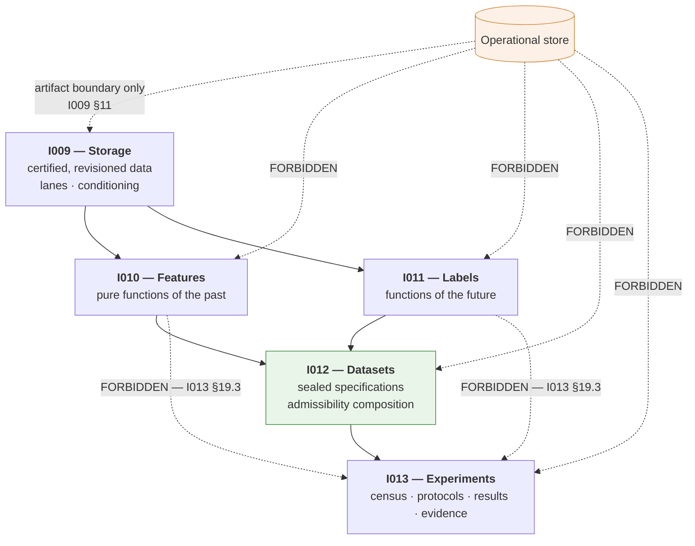

# Research Platform Architecture Review — v1

| Field | Value |
|---|---|
| **Title** | Research Platform Architecture Review — v1 |
| **Document Type** | Architecture Review |
| **Status** | Complete |
| **Version** | 1.0.0 |
| **Reviewed** | 2026-08-04 |
| **Reviewer** | Rohith Suresh — Owner / Architect · Conducted with Claude Opus 5 |
| **Scope** | IQROS Master Architecture v0.1.0 · `ADR-I009` · `ADR-I010` · `ADR-I011` · `ADR-I012` · `ADR-I013` — reviewed as one integrated system |

> **This is a review, not an audit and not a redesign.** No architecture is created here. Findings are classified and reported; none is resolved in this document. Where a finding names a gap, the gap is described, never filled.

> **Reviewer independence caveat.** The six documents under review were drafted in the same working session as this review. That is a real limitation on independence, and it is stated rather than hidden. To compensate, every finding below is derived from mechanical cross-document extraction — identifier namespaces, citation direction, vocabulary usage versus definition — rather than from recollection of intent.

---

## 1. Executive Assessment

**The Research Platform is architecturally coherent.** No contradiction was found between any two documents. The layering is clean, ownership is unambiguous, the declared dependency graph is acyclic, and multi-asset treatment is consistent across all five ADRs.

**No Critical findings.**

Five **Major** findings were identified. **All five are completeness gaps — missing shared contracts — not internal contradictions.** Four of the five (`M1`, `M2`, `M3`, `M5`) concern vocabulary or enforcement that sits at the IQROS constitutional level and is *consumed* by the Research Platform rather than owned by it. One (`M4`) is a genuine unreconciled concept within the reviewed set.

| Severity | Count | Character |
|---|---|---|
| **Critical** | **0** | — |
| **Major** | **5** | Missing shared contracts; one unreconciled concept |
| **Minor** | **4** | Identifier hygiene and structural asymmetry |
| **Observation** | **4** | Noted properties, no action implied |

**Verdict on readiness:** see §14.

---

## 2. Architectural Consistency

**Assessment: Consistent. No contradictions found.**

The five ADRs were cross-checked on every mechanism where two documents could disagree.

| Mechanism | I009 | I010 | I011 | I012 | I013 | Consistent? |
|---|---|---|---|---|---|---|
| Compute-on-read as default | ✅ stated | ✅ default, exception justified | ✅ split by recomputability | ✅ dataset is a specification | ✅ results from pinned inputs | **Yes** |
| Materialisation permitted when | — | 2 declared cases | forward labels by necessity | Training Datasets only | — | **Yes** — different stores, non-overlapping rules |
| Content addressing | partitions | specifications, value sets | specifications, value sets | declarations, snapshots | experiments, protocols, results | **Yes** |
| Single writer | 7 zones | registry + tiers | registry + tiers | registry + snapshot store | registries | **Yes** |
| Assert, never repair | integrity | validation | flagging | validation | validation | **Yes** |
| Admissibility as a meet | ceiling on artifacts | inherited | inherited | **composed** | inherited | **Yes** — single composition point |
| Negative records persist | rejected exports | rejected specs | void labels | rejected datasets | refused registrations | **Yes** |
| Human-gated irreversibility | — | registration | registration, adjudication | sealing, holdout | registration, lockbox, promotion | **Yes** |

**A notable consistency, verified rather than assumed:** the materialisation rules across I010, I011, and I012 are non-overlapping by construction. I010 permits materialisation in two named cases; I011 mandates it for forward labels *as a different kind of object*; I012 requires it only for Training Datasets. Read together they compose without conflict, and I011 §1.1 explicitly frames its divergence as a type distinction rather than an exception to I010.

---

## 3. Layering

**Assessment: Clean. No layering violations found.**

Two boundary rules were verified as stated and mutually reinforcing:

| Rule | Source | Effect |
|---|---|---|
| Research never reads the operational store | `I009` §11.1 | Only the artifact boundary crosses planes |
| Experiments read sealed datasets only — never Feature or Label Stores directly | `I013` §19.3 | An experiment cannot assemble an uncited input set |

**The second rule is the stronger one and is correctly placed.** A framework able to reach into the Feature Store directly could produce a Statistical Result indistinguishable from a governed one. I013 states this rationale explicitly rather than asserting the restriction bare.

**No layer-skipping was found.** I013 declares its dependency on I009/I010/I011 as *transitive, via dataset provenance* (§19.2), which is the correct characterisation given §19.3.

---

## 4. Ownership

**Assessment: Unambiguous. Every artifact class has exactly one owner.**

| Artifact class | Owner | Declared in |
|---|---|---|
| Raw acquisitions, canonical partitions, quality, certification, export | 7 named zone owners | `I009` §8 |
| Feature definitions and specifications | Feature Registry | `I010` §6 |
| Feature values (cache, materialisation) | Materialiser | `I010` §7 |
| Label definitions and specifications | Label Registry | `I011` §7 |
| Label values (research, forward tiers) | Label maturation owner | `I011` §9 |
| Dataset specifications | Dataset Registry | `I012` §6 |
| Dataset snapshots and manifests | Snapshot store | `I012` §8.2 |
| Experiments and hypotheses | Experiment Registry | `I013` §6 |
| Statistical Results | Result Registry | `I013` §11 |
| Evidence records | Evidence record | `I013` §11 |

**A consistent and correct separation appears in all four upper ADRs:** *the registry never holds values; the value store never issues judgments* (I010 FG6, I011 LG6, I012 DG-6, I013 EG7). This is the same rule stated four times under four different identifiers — see finding `m2`.

---

## 5. Dependency Graph

**Assessment: The declared graph is acyclic. An undeclared back-edge exists — see `M5`.**

**Declared dependencies** (from each document's `Depends On` header):

| Document | Depends on |
|---|---|
| `I009` | IQROS |
| `I010` | IQROS, `I009` |
| `I011` | IQROS, `I009`, `I010` |
| `I012` | IQROS, `I009`, `I010`, `I011` |
| `I013` | IQROS, `I009`–`I012` |

Strictly increasing. **Acyclic as declared.**

**Actual citation direction**, extracted mechanically:

| Direction | Count | Character |
|---|---|---|
| `I012` → `I009`/`I010`/`I011` | 34 citations | Consumes their specifications — expected |
| `I009`/`I010`/`I011` → `I012` | 10 citations | **Delegates enforcement upward** — see `M5` |

The upward citations are not incidental. Three are load-bearing obligations:

| Lower-layer obligation | Delegated to |
|---|---|
| `I009` §15.1 — retention bounded by citations | `I012` citation index |
| `I010` §11 — retirement requires zero citations | `I012` citation index |
| `I011` §10.3 — superseded-input flag propagation | `I012` reverse index |

---

## 6. Cross-Document Consistency

**Assessment: Consistent in substance. Inconsistent in identifier convention and document structure.**

| Dimension | Result |
|---|---|
| Substantive contradictions | **None found** |
| Shared concepts used identically | ✅ conditioning, meet, seal, lane, warm-up, maturity |
| Identifier namespaces | ❌ inconsistent — `m1`, `m2` |
| Document structure | ❌ asymmetric — `m3` |
| Cross-references resolve | ✅ 38/38 links verified |
| Terminology drift | None found — each ADR defines its own object classes and does not redefine another's |

---

## 7. Governance Completeness

**Assessment: Complete within the reviewed set. Depends on two undefined external contracts.**

Every irreversible act in the Research Platform is human-gated and receipt-emitting:

| Act | Gated in | Human? | Receipt? |
|---|---|---|---|
| Feature specification registration | `I010` FG1 | ✅ | ✅ |
| Label specification registration | `I011` LG1 | ✅ | ✅ |
| Superseded-input adjudication | `I011` §10.3 | ✅ | ✅ |
| Dataset sealing | `I012` DG-1 | ✅ | ✅ |
| Holdout consumption | `I012` DG-7 | ✅ | recorded |
| Hypothesis and experiment registration | `I013` EG1 | ✅ | ✅ |
| Lockbox opening | `I013` LB1 | ✅ | ✅ |
| **Promotion** | `I013` EG3, EG4 | ✅ | ✅ |

**Two properties were verified as correctly preserved from the audited platform:**

- **Promotion is verified, never derived** (`I013` EG3) — a granted promotion survives a later threshold change.
- **A service actor is refused promotion** (`I013` EG4) — the platform cannot promote itself.

**Gaps are external, not internal:** the receipt contract itself (`M3`) and the threshold-set governance protocol (already identified as `ADR-I024` by `I013` §20.2) are consumed by these rules and defined nowhere in the IQROS series.

---

## 8. Interface Completeness

**Assessment: Adequate per-document. No consolidated interface statement exists — see `O1`.**

Each ADR states what it consumes and what it refuses. What no document states is the **full provides/requires contract of the stack as a whole** — a reader must assemble it from five Non-Goals tables and two boundary sections.

| Layer | Provides upward | Requires downward | Stated where |
|---|---|---|---|
| `I009` | Certified revisioned partitions, verdicts, lanes, conditioning | External sources; export artifacts | §7, §13 |
| `I010` | Feature Specification hashes; resolved values | Corpus revisions, verdicts | §6, §16 |
| `I011` | Label Specification hashes; values with maturity | Corpus revisions, verdicts | §7, §15 |
| `I012` | Sealed Research / Training / Experiment Datasets; citation index | Feature and Label specifications, evidence | §7, §16 |
| `I013` | Statistical Results, Evidence, readiness statements | Sealed datasets **only** | §11, §19.3 |

The information is present and consistent. It is simply not collected.

---

## 9. Missing Architectural Contracts

**Assessment: Five contracts are referenced but undefined. Three are already tracked; two are not.**

| Contract | Referenced by | Defined by | Tracked as |
|---|---|---|---|
| **Admissibility lattice** — elements, ordering, meet | All five ADRs | **Nothing** | `ADR-I004` (anticipated) → `M1` |
| **Provenance lane vocabulary** | `I012`, `I013` as literals | **Nothing** | *Untracked* → `M2` |
| **Receipt contract** — content, types, chaining | All five ADRs | **Nothing** in IQROS series | *Untracked* → `M3` |
| **Threshold-set governance** | `I013` §11, SP4 | **Nothing** | `ADR-I024` (anticipated) ✅ |
| **Model registry** | `I012` §15 | **Nothing** | `ADR-I022` (anticipated) ✅ |

---

## 10. Circular Dependencies

**Assessment: No cycle in the declared graph. One undeclared back-edge — `M5`.**

The back-edge is a **dependency inversion**, which is a legitimate pattern: a lower layer declares an obligation whose enforcement mechanism lives above it. The finding is not that the pattern is wrong. The finding is that **it is undeclared** — see `M5`.

---

## 11. Multi-Asset Readiness

**Assessment: Ready. The most consistently handled dimension in the reviewed set.**

All five ADRs treat asset as a **dimension, not a system**, and all five converge on the same rules without contradiction:

| Rule | I009 | I010 | I011 | I012 | I013 |
|---|---|---|---|---|---|
| Asset is a resolution/declaration parameter, not a specification property | ✅ | ✅ | ✅ | ✅ | ✅ |
| Admissibility inherits the **weakest** across assets | ✅ | ✅ | ✅ | ✅ | ✅ |
| No 24/7 or session-model assumption permitted | ✅ | — | ✅ | ✅ | — |
| Cross-sectional conditioning expressible | ✅ | ✅ | ✅ | ✅ | ✅ |
| Explicit "what must be resisted" warning | ✅ | ✅ | ✅ | ✅ | ✅ |

Three distinct traps are named across the set, and none contradicts another: the **calendar trap** (`I011` §17 — maturity is elapsed *market* time), the **alignment trap** (`I012` §17 — cross-asset windows must be declared, never inferred), and the **multiplicity trap** (`I013` §17 — one hypothesis across five assets is five trials).

**No finding.** This dimension is noted as a strength.

---

## 12. ML Readiness

**Assessment: Specified up to the dataset boundary, and correctly stops there.**

| Requirement | Status | Where |
|---|---|---|
| Point-in-time feature resolution | ✅ | `I010` §13 Tier C |
| Label maturity as a queryable, refusable property | ✅ | `I011` §16.3 |
| Train/validation/holdout as separate sealed datasets | ✅ | `I012` §15.1 |
| Leakage structurally impossible | ✅ | `I012` §15.1 — non-overlap verified at seal |
| Exact-bytes recoverability for training data | ✅ | `I012` §16 L1 |
| Single-use holdout | ✅ | `I012` DG-7 — but see `M4` |
| Model registry | ❌ | Not specified — `ADR-I022` anticipated |
| Training/serving skew defence | ➖ | Out of scope until a serving path exists |

**The stopping point is correct.** `I012` §15 defines Training Datasets and identifies `ADR-I022` as the consumer that gives them purpose. Specifying a model registry inside a dataset ADR would have been scope creep.

**One gap is inherited, not introduced:** the platform's own ML gate stands at zero validated families, and `I013` §1 records this as the framework working rather than failing. Nothing in the reviewed set changes that.

---

## 13. AI Readiness

**Assessment: Structurally ready by construction. No ADR mentions agents — see `O2`.**

IQROS Article 19's agent rules were checked against the reviewed set:

| Article 19 rule | Supported? | Mechanism |
|---|---|---|
| `AI1` — no authority a human lacks | ✅ | Consumers declare; registries enforce |
| `AI2` — **cannot raise admissibility** | ✅ | Meet is computed, never asserted (`I012` §8 stage 3) |
| `AI3` — named refusals, never degraded results | ✅ | `I012` RF1–RF6; registry refusals in all four upper ADRs |
| `AI4` — irreversible acts human-gated | ✅ | `I013` EG1, EG4 |
| `AI5` — cite artifacts by hash | ✅ | Everything is content-addressed |
| `AI6` — agent output is proposal, never record | ✅ | Registration is a human act everywhere |
| `AI7` — may declare, resolve, validate | ✅ | These are computations (`I012` DG-2, `I013` EG2) |
| `AI8` — untrusted text is data | ➖ | Not applicable to these layers |

**`AI2` is the load-bearing property and it holds.** Because admissibility is a computed meet over inputs and never a requester assertion, an agent operating across the entire Research Platform is structurally incapable of lowering the evidentiary bar. This was verified, not assumed: no ADR provides any path by which a consumer's declared floor raises a computed ceiling — `I012` RF4 refuses in exactly that case.

---

## 14. Findings

### Major

---

**`M1` — The admissibility lattice is used by all five documents and defined by none.**

Every ADR composes admissibility as "the meet over inputs." No document in the IQROS series defines the lattice's elements, their ordering, or how a meet is computed. `ADR-I004` is anticipated and unwritten.

*Why Major, not Critical:* the mechanism is consistently *described* across all five documents, and none contradicts another. The architecture is coherent; it names a mechanism it does not define. Implementation is blocked; architectural review is not.

*Affects:* `I009` §18, `I010` §9.2, `I011` §10.2, `I012` §8/§9.1, `I013` §11.2.

---

**`M2` — The provenance lane vocabulary is used as literals but never enumerated.**

`offline-corpus`, `live-forward`, and `mainnet` appear as concrete values in `I012` §9.1/§15.2 and `I013` §1. IQROS-P6 establishes that lanes exist and are non-interchangeable but does not name them. No IQROS document enumerates the set or defines its ordering — yet `I012` §15.2 requires a Training Dataset floor "≥ forward lane," which presupposes an ordering.

*Why Major:* an ordering is relied upon that is defined nowhere. *Untracked* — no anticipated ADR covers it.

---

**`M3` — The receipt contract is referenced by all five documents and defined by none in the IQROS series.**

Every governance rule across the set emits a receipt. No IQROS document specifies what a receipt contains, what decision types exist, or how chaining and replay work. A rich receipt architecture exists in the platform's own governance documentation, but the IQROS series does not reference it as a binding contract.

*Why Major:* IQROS-P10 is asserted by every ADR and dischargeable by none of them alone. *Untracked.*

---

**`M4` — "Holdout" and "lockbox" are two single-use sealed-data mechanisms with no stated relationship.**

`I012` §15.1 defines single-use **holdout partitions** (DG-7). `I013` §10 defines single-use **lockboxes** (LB1–LB6). Neither document states whether these are the same mechanism at different layers, nested, or orthogonal.

The conflation is visible in prose: `I012` R5 argues *"a re-used holdout is not a holdout"* and immediately cites the audited platform having *"spent one lockbox exactly once"* — treating them as analogous without defining the relationship. `I013` never uses the word "holdout" except when citing `I012`'s rule; `I012` never uses "lockbox" outside that one risk note.

*Why Major:* a reader cannot determine whether opening a lockbox consumes a holdout, whether a Training Dataset holdout is a lockbox, or whether both use-counts must be checked. This is the only finding that is **internal to the reviewed set** rather than an inherited gap.

---

**`M5` — Three lower-layer obligations are delegated upward to `ADR-I012`, undeclared in their own dependency headers.**

`I009` §15.1, `I010` §11, and `I011` §10.3 each assert an obligation whose enforcement authority is `I012`'s citation index. None of the three lists `I012` in its `Depends On` header, so the declared dependency graph shows a clean downward chain while the actual obligation graph has a back-edge.

*Why Major, not Critical:* dependency inversion is a legitimate pattern and the delegation is stated in each document's body. The defect is that it is **invisible in the declared graph** — a reader of `I009` alone would not know that its retention rule cannot be enforced without a document two layers above it.

---

### Minor

**`m1` — `ADR-I012` contains an internal identifier collision.** `DG1`–`DG9` are Design Goals (§3) and `DG-1`–`DG-8` are Governance rules (§13.2), distinguished only by a hyphen. `I011` §15 DI7 and DI8 cite *into* this namespace (`ADR-I012` DG-7, DG-8), so the collision has crossed a document boundary.

**`m2` — Governance-rule prefixes are inconsistent across the series.** `I009` uses `GV`, `I010` uses `FG`, `I011` uses `LG`, `I012` uses `DG-`, `I013` uses `EG`. Five documents, five conventions, for the same category of rule.

**`m3` — Document structure is asymmetric.** `I009` has an "Architectural Principles" mapping table but no IQROS Conformance Checklist; `I010` and `I011` have Conformance sections but no Future ADR Dependencies section; only `I012` and `I013` have both. A reader cannot rely on a consistent structure across the series.

**`m4` — `I013`'s `EG1`/`EG2` collide with existing platform identifiers.** The audited platform's governance report already uses `EG1`/`EG2` for its evidence-governance checks. The two namespaces are unrelated but identically named.

---

### Observations

**`O1` — No consolidated provides/requires statement exists for the stack.** The information is complete and consistent across five Non-Goals tables and two boundary sections, but a reader must assemble it. Noted, not a defect.

**`O2` — No ADR in the reviewed set mentions agents.** AI readiness (§13) is achieved by construction rather than by contract. `ADR-I017` is anticipated. This is arguably the correct order — build the constraints, then the agent contract — but it means agent conformance is currently inferred rather than declared.

**`O3` — Multi-asset treatment is the most consistent dimension reviewed.** All five ADRs converge on identical rules, each names a distinct trap, and none contradicts another.

**`O4` — Three "cannot be retrofitted" constraints are stated separately and never consolidated.** `I011` (forward labels), `I012` (trial context), and `I013` (trial census) each close with an ordering constraint that time can foreclose. No document collects them, though each states its own clearly.

---

## 15. Readiness Verdict

> **The Research Platform is architecturally coherent.**

No contradiction exists between any two documents. Layering is clean, ownership is unambiguous, the declared dependency graph is acyclic, governance is complete within the reviewed scope, and multi-asset and AI readiness hold by construction.

**On readiness to found the Trading Platform ADR series — a qualified yes.**

The Research Platform is a sound foundation. The qualification is precise and worth stating plainly: **four of the five Major findings are gaps in *shared* contracts, not defects in the Research layer.** `M1` (admissibility lattice), `M2` (lane vocabulary), and `M3` (receipt contract) sit at IQROS constitutional level and are consumed by every layer. **A Trading Platform series would inherit all three unchanged** — it will compute admissibility meets, carry lanes, and emit receipts exactly as the Research series does.

That makes them **more** urgent for the Trading series, not less, because a trading layer's irreversible acts carry capital consequences. `M5` is a documentation-integrity issue whose cost has already been demonstrated once in this repository's history. `M4` is the only finding internal to the reviewed set, and it is a definitional gap between two documents rather than a structural flaw in either.

**None of the five findings requires redesign.** All five are resolvable by writing contracts already anticipated, or by a definitional statement reconciling two existing concepts.

---

## 16. Review Method

| Check | Method |
|---|---|
| Identifier namespaces | Mechanical extraction of bolded rule IDs per document |
| Dependency direction | Citation counting in both directions across all five ADRs |
| Vocabulary definition | Usage-versus-definition search for every shared term |
| Structural symmetry | Section-header extraction across the series |
| Link integrity | Relative-link resolution across all seven architecture documents — **38/38 resolve** |
| Contradiction search | Pairwise comparison on eight shared mechanisms (§2) |
| Constitutional conformance | Article-by-article check against IQROS Articles 4, 7, 8, 11, 12, 19 |

**Not performed:** implementation feasibility, performance, cost, or schedule assessment. None is in scope for an architecture review.

---

*This review creates no architecture and resolves no finding. It records the state of the reviewed set as of 2026-08-04.*
