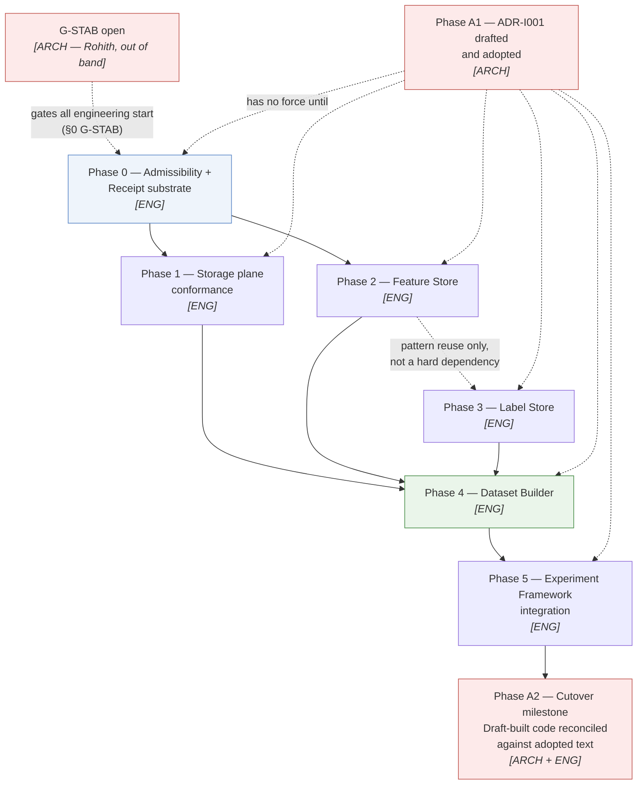
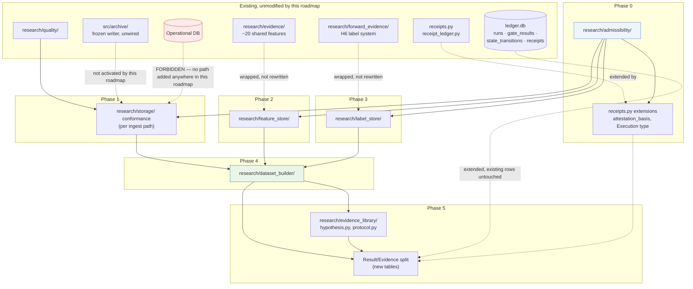

# Engineering Implementation Roadmap v1

| Field | Value |
|---|---|
| **Title** | Engineering Implementation Roadmap — Research Platform (IQROS-Conforming) |
| **Status** | **Draft — Planning artifact, not authorised for execution** |
| **Version** | 1.0.1 |
| **Document Type** | Engineering Implementation Plan (not an ADR, not an architecture document) |
| **Depends On** | [IQROS Master Architecture](../architecture/iqros_master_architecture.md) v0.1.0 · [ADR-I009](../architecture/adr/ADR-I009-research-data-platform.md) v0.1.0 · [ADR-I010](../architecture/adr/ADR-I010-feature-store-architecture.md) v0.1.0 · [ADR-I011](../architecture/adr/ADR-I011-label-store-architecture.md) v0.1.0 · [ADR-I012](../architecture/adr/ADR-I012-research-dataset-builder.md) v0.1.0 · [ADR-I013](../architecture/adr/ADR-I013-research-experiment-framework.md) v0.1.0 · [ADR-I014](../architecture/adr/ADR-I014-admissibility-framework.md) v0.1.0 · [ADR-I015](../architecture/adr/ADR-I015-receipt-contract.md) v0.1.0 |
| **Authors** | Rohith Suresh — Owner / Architect · Drafted with Claude Sonnet 5 |
| **Last Updated** | 2026-08-05 |
| **Changelog** | 1.0.1 (2026-08-05): terminology reconciliation only — no scope, dependency, or sizing change. Sprint Plan increment IDs renamed `P2-N` → `Sprint N` (collided visually with "Phase 2"); §6 gained a note distinguishing "Phase 1 DoD-satisfied" from "Phase 1 WBS-complete" after an engineering report conflated them. See §6 and §7. |

> **What this document is not.** It designs no architecture, defines no new object, changes no field, and resolves no open finding (`M4`, `M5a`, `M5b`). Every object named below (Feature Specification, Label Value Store, Experiment Dataset, Admissibility tuple, Receipt classes, etc.) is a mechanical reference to a field or rule already written in the eight source documents above. Where this document proposes a file path, a table name, or a function signature, that is **engineering planning**, not architecture — it is offered as one conforming realisation of an already-decided contract, not a new decision.

---

## 0. Two Standing Gates This Roadmap Does Not Open

Both are stated in the source documents' own Standing Notes. This roadmap plans *what would happen once they open*. It does not open them, recommend a date, or assume they are open.

| Gate | Source | Current state | Who opens it |
|---|---|---|---|
| **G-CONST** — IQROS constitutional adoption | IQROS `E1`; every ADR's Standing Note: *"has no force until IQROS is adopted"* | `ADR-I001` (adoption) is **anticipated, not written**. All eight source documents are **Draft** | Rohith — a constitutional session (`E1`), not an engineering act |
| **G-STAB** — Stabilisation posture | `CLAUDE.md` §15: *"do not propose or implement new infrastructure... Phase 3b... held at Rohith's gate"* | **Active.** Every ADR's Standing Note repeats: *"the reference platform's stabilisation posture... currently gates new infrastructure, and this ADR does not override that gate"* | Rohith, explicitly, in a future conversation |

**Working assumption made explicit (Assumption A1, §16).** This roadmap plans engineering work as if both gates will eventually open, in the order presented. It recommends a middle path rather than an all-or-nothing wait: see §1.2.

---

## 1. Reading Instructions

### 1.1 Scope of "Research Platform" in this roadmap

The eight source documents cover the Storage, Feature, Label, Dataset, Experiment, Admissibility, and Receipt layers of the Research plane (IQROS Article 4). They do **not** cover: Strategy, Risk, Portfolio, Execution, the Model Registry (`ADR-I022`, unwritten), Threshold Governance (`ADR-I024`, unwritten), the Agent Consumer Contract (`ADR-I017`, unwritten), or Execution Authorisation (`ADR-I018`, unwritten). This roadmap is scoped identically — it stops where the source documents stop. Any future work on those subjects requires their own ADRs first (per `E1`) and its own roadmap.

### 1.2 The "build under Draft" decision, stated as a risk rather than assumed

Two paths exist for starting engineering work while `ADR-I001` remains unwritten:

| Path | Description | Cost if the ADRs change before adoption |
|---|---|---|
| **Wait** | No engineering work begins until `ADR-I001` is written and adopted | Zero rework risk. Indefinite delay — `ADR-I001` has no scheduled owner action |
| **Build under Draft, cut over at adoption** *(this roadmap's default)* | Engineering proceeds against the Draft contracts now; a single terminal milestone (§5, Phase A2) formally cuts over when `ADR-I001` lands | Rework bounded by how much the ADRs change. Two source documents (`ADR-I014`, `ADR-I015`) explicitly describe themselves as *"retroactively satisfying"* — written to fit five prior ADRs **without requiring any of them to change** — which is evidence, not assumption, that this contract set is unusually stable for a Draft |

This roadmap adopts the second path as its working plan, consistent with how Program P1 (`CLAUDE.md` §18) was executed and closed before every one of its own documentation cross-references was finished — engineering proceeded, governance caught up in writing. **This is a recommendation available for Rohith to override**, not a decision this document is entitled to make unilaterally; §16 Risk R1 names the reversal cost if the wait path is preferred instead.

### 1.3 What "preserve existing behaviour" means concretely here

Every phase below is **additive**: a new table, a new module, or a new optional field. No phase in this roadmap:

- deletes or renames an existing table, column, or public function in `research/evidence_library/`, `src/archive/`, `research/storage/`, or `research/forward_evidence/`;
- changes the schema of `ledger.db` in a way that breaks `report.py --check` against the current real ledger;
- changes what any existing scheduled job (`daily_ingest.py`, `run_daily.py`, the operational collector) does today.

Where a phase's *purpose* is to eventually replace an ad hoc mechanism (e.g. the trial-denominator constant with a census, per `ADR-I013` §6.1), the replacement is built **alongside** the existing mechanism and cut over in a dedicated milestone with its own rollback lever (§14), never as a silent substitution mid-phase.

---

## 2. Constraints Carried Forward (non-negotiable during implementation)

These are not re-derived here; they are cited so every milestone below can be checked against them without re-reading eight documents.

| Constraint | Source | Binds |
|---|---|---|
| Compute-on-read is the default; materialisation requires justification (C1 byte-recoverability or C2 demonstrated non-cheap recomputation) | `ADR-I010` §12, `ADR-I011` §1.1 | Feature Store, research-tier Label Store |
| Single writer per zone/registry, architecturally enforced | IQROS-P2 | Every new registry and value store |
| Content addressing; identity is a hash, never assigned | IQROS-P5 | Every new Specification, Dataset, Receipt |
| Assert, never repair; validation refuses, never imputes | IQROS-P3 | Every validation tier in every new module |
| No GPU, no distributed infrastructure, embedded engines only | `ADR-I009` §14; `CLAUDE.md` §4 Phase B stack constraint | All storage technology choices below |
| Research code never imports from, or reads, the operational database | `ADR-I009` §11; audited zero-import-coupling finding | Every new research-plane module |
| No new field is defaultable; a missing declaration is a rejected registration | `Ph6`, repeated in every ADR §"Mandatory ... Content" | Every registration path |
| Deployment never mutates data or schema; migration is a separate, human-invoked act | IQROS `CI3`, `D4`; `ADR-P1-1` assert-never-repair | Every schema-introducing milestone |
| Python 3.10.x for the research environment (`btc_bot` conda env); no code targets 3.11 features in `research/` | `CLAUDE.md` §4 | Every new `research/` module |
| Rollback lever declared for every new enforcement mechanism | IQROS `G7`, `D5` | Every milestone, see §14 |

---

## 3. Traceability — Source Requirement → Implementation Owner

| ADR | Governs | Primary implementation surface |
|---|---|---|
| `ADR-I014` | Admissibility lattice, meet/join, ceilings | New pure module — no storage of its own |
| `ADR-I015` | Receipt contract | **Extension** of existing `research/evidence_library/receipts.py`, `receipt_ledger.py` |
| `ADR-I009` | Storage zones, boundary, conditioning | **Connective work** over existing `research/storage/`, `research/ingest/`, `src/archive/`, `research/quality/` |
| `ADR-I010` | Feature Registry + Value Store | New module, wrapping existing feature computation in `research/evidence/` and the hypothesis packages |
| `ADR-I011` | Label Registry + two-tier Value Store | New module; forward tier formalises the existing `research/forward_evidence/` H6 system |
| `ADR-I012` | Dataset Registry + citation index + assembly pipeline | New module, consuming I009–I011 |
| `ADR-I013` | Experiment Registry, Hypothesis, Result/Evidence split | **Extension** of existing `research/evidence_library/record.py`, `lifecycle.py`, `report.py` |

---

## 4. Gap Ledger — What Exists Today vs What Each ADR Requires

This is the single most load-bearing table in this roadmap. It is why the phases below are ordered the way they are, and why some phases are described as "wrap" rather than "build."

| ADR subject | Exists today | Gap |
|---|---|---|
| **Admissibility lattice** | Nothing — no code computes a meet or join anywhere in the repository | Full new module (small: five bounded chains, componentwise ordering — no storage) |
| **Receipts** | `receipts.py` (canonicalisation, hashing, `DECISION_TAXONOMY`), `receipt_ledger.py` (append-only, chained, `verify_chain()`), 4 receipt-emitting call paths (`contract_receipts.py`, `evidence_governance.py`, `transition_governance.py`), 26 real chained receipts | `attestation_basis` field (§5.3 of `ADR-I015`) does not exist; `Execution` decision type is unreserved; `contract_version` field on receipts does not exist; L4 anchoring and RS1–RS4 signing are unbuilt (both explicitly deferred by the ADR itself) |
| **Raw/canonical separation** | `research/ingest/` performs acquisition **and** normalisation in one pass (PS1, audited) | As-received (Z2) and canonical (Z3) are not separated; no normalisation contract version is recorded |
| **Partition revisioning** | Partitions are overwritten on re-ingest (PS2, audited) | No content-hash partition identity; no revision history |
| **Archive writer wiring** | `src/archive/` — complete, frozen (M1.1 v1.0), self-verifying, **zero consumers** (PS4, audited) | Nothing to build; needs a consumer decision, which is explicitly out of scope for this roadmap's default path (Risk R6, §16) |
| **Certification gating** | `research/quality/` produces verdicts; nothing reads them as a gate (PS5, audited) | Verdicts must become inputs to the admissibility ceiling (§8, Phase 1) |
| **Conditioning metadata** | Not carried on any stored artifact (PS6, audited) | New mandatory field on export/artifact metadata |
| **Feature registry/specifications** | Zero — repo-wide search for `feature_store`/`FeatureStore` returns no matches (audited). ~20 shared derived features exist, process-cached, never persisted; 38 declarative objects across 8 groups carry rationale as prose | Full new registry + value store; existing feature functions become the initial population of Specifications, not rewritten |
| **Label registry/specifications** | Research label: one in-memory scalar, never persisted. H6 forward labels: genuine multi-horizon materialised system (148 labels / 37 trades, fill-once guard). Multi-signal collector: no label table, view-derived returns | Registry + Specification layer wraps both; H6's fill-once guard becomes the audited precedent for `LG2`, not a rewrite |
| **Dataset object** | Zero — no object binds corpus + features + labels + `as_of` into one citable thing (PS1, audited) | Full new module; this is the one genuinely new layer with no existing analogue |
| **Experiment registry / trial census** | `ledger.db`: `runs` (70), `gate_results` (142), `state_transitions` (13), `governance_receipts` (26), frozen `n_trials=34` (a **constant**, not a census) | Hypothesis registry does not exist; Result and Evidence are conflated in one `runs` row (PS4, audited); Protocol is not a pinned, versioned, content-addressed object |
| **Lockbox enforcement** | Enforced inside the one script that reads the sealed span (PS5, audited) | Moves to the dataset boundary once `ADR-I012` RF2 exists — depends on Dataset module shipping first |

**Reading this table correctly.** Three of the seven layers (`I014` Admissibility, `I012` Dataset, and the *registry* half of `I010`/`I011`) are genuinely new code. Two (`I015` Receipts, `I013` Experiment Framework) are **extensions** of a large, working, already-audited system — the majority of the engineering risk there is integration discipline, not new design. `I009` Storage is mostly **connective work**: wiring an already-complete archive writer and an already-produced certification verdict into paths that currently ignore them.

---

## 5. Engineering Phases

Architectural milestones (human acts, governance sessions, no code) are marked **[ARCH]**. Engineering milestones (code, tests, CI) are marked **[ENG]**. Per the task instruction, these are never merged into one sequence step.



| Phase | Kind | Depends on | Can start in parallel with |
|---|---|---|---|
| **A1 — IQROS adoption** | **[ARCH]** | G-STAB open (Rohith) | Nothing — precedes everything else *in force* (§1.2 notwithstanding) |
| **0 — Admissibility + Receipt substrate** | **[ENG]** | G-STAB open | — (first engineering phase) |
| **1 — Storage plane conformance** | **[ENG]** | Phase 0 | Phase 2 |
| **2 — Feature Store** | **[ENG]** | Phase 0 | Phase 1 |
| **3 — Label Store** | **[ENG]** | Phase 0; reuses Phase 2's registry pattern but does not require Phase 2 complete | Phase 1, Phase 2 |
| **4 — Dataset Builder** | **[ENG]** | Phases 1, 2, 3 all complete | — (hard join point) |
| **5 — Experiment Framework integration** | **[ENG]** | Phase 4 | — |
| **A2 — Cutover** | **[ARCH + ENG]** | Phase 5; `ADR-I001` adopted | — (terminal) |

---

## 6. Work Breakdown Structure

Each WBS item is independently mergeable and independently testable. Size is t-shirt (S = one focused session, M = 2–4 sessions, L = 5+ sessions), calibrated against the pace already evidenced by Program P1 (seven increments, each a self-contained PR, `CLAUDE.md` §18).

### Phase 0 — Admissibility + Receipt Substrate

| ID | Item | Size | Depends on | New/Extended |
|---|---|---|---|---|
| **0.1** | `research/admissibility/lattice.py` — the five chains, `⊥`/`⊤`, `Admissibility` tuple type | S | — | New |
| **0.2** | `research/admissibility/composition.py` — `meet()`, `join()`, `satisfies()`, `AdmissionResult` with per-dimension refusal naming (AD4) | S | 0.1 | New |
| **0.3** | `research/admissibility/lattice_version.py` — `AV1`–`AV5` versioning wrapper | S | 0.1 | New |
| **0.4** | Unit tests: lattice laws (idempotent, commutative, associative meet/join), `⊥` absorption, Choice 1/Choice 2 orderings, `⊤ n/a` non-applicability (§5.1 of `ADR-I014`) | S | 0.1–0.3 | New |
| **0.5** | `receipts.py`: add `attestation_basis` field (`platform-observed`/`operator-attested`/`external-venue`/`bootstrap`), `contract_version` field | S | — | Extended |
| **0.6** | `receipts.py` / `receipt_ledger.py`: reserve `Execution` decision type (`order`/`fill`/`reconcile`), unemitted (RG3) | S | 0.5 | Extended |
| **0.7** | `receipt_ledger.py`: `RM3` guard — replay refuses an unresolvable historical rule rather than substituting current (verify existing `verify_admission_receipt()` pattern from PR-6 already does this; extend the same discipline to any new derived receipt type) | S | 0.5 | Extended |
| **0.8** | Migration: idempotent, dry-run/`--commit`-gated, additive-only (matches `migrate_run_kind.py` precedent exactly) | S | 0.5, 0.6 | New (migration script) |
| **0.9** | `governance_verification.py`: extend `SCHEMA_FINGERPRINT` manifest with the two new receipt columns, at warning severity until Phase 0 migration runs on the real ledger (mirrors the `pairwise_r` precedent exactly) | S | 0.8 | Extended |

### Phase 1 — Storage Plane Conformance

| ID | Item | Size | Depends on | New/Extended |
|---|---|---|---|---|
| **1.1** | Define the normalisation-contract-version field on existing `research/ingest/` writers; **no behaviour change**, only a recorded version string | M | 0.1–0.3 | Extended |
| **1.2** | Separate as-received landing from normalisation in **one** ingest path as a pilot (recommend: the smallest-volume path first — see Risk R2, §16) | L | 1.1 | Extended (pilot) |
| **1.3** | Content-hash partition revision identity for the pilot path; revisions alongside, never overwriting | M | 1.2 | New |
| **1.4** | Wire certification verdicts (`research/quality/`) into an admissibility ceiling computation for the pilot path, using 0.2's `meet()` | M | 0.2, 1.3 | New (connective) |
| **1.5** | Mandatory conditioning metadata field on the pilot path's exported artifacts | S | 1.3 | New field |
| **1.6** | Repeat 1.2–1.5 for remaining ingest paths, one at a time, each its own milestone | L (×N paths) | 1.2–1.5 pattern proven | Extended |

> **Phase 1 is deliberately the slowest phase per unit of code.** `ADR-I009` §15.2 states operational growth stays unbounded **until** the archive writer's full lifecycle (PUBLISHED → REPLICATED → PRUNED) completes, and this roadmap does not plan that activation (Risk R6, §16). Phase 1 therefore stops at "revisioned, certified, conditioning-carrying canonical data" and does not attempt to close the retention gap — consistent with `ADR-I009`'s own stated scope.

> **Terminology reconciliation (2026-08-05, added after WBS 1.1–1.5 shipped as one milestone and before WBS 1.6 began).** `1.6` is a **Phase 1** item — it is listed under this heading, numbered `1.x`, and its own dependency ("1.2–1.5 pattern proven") is internal to Phase 1. No renumbering was needed; what needed fixing was a conflation, made explicit here so it is not repeated. Two distinct senses of "Phase 1 done" exist in this document and must not be treated as one:
>
> | Sense | Satisfied by | What it gates |
> |---|---|---|
> | **Phase 1 DoD-satisfied** (§17) | `1.1`–`1.5` alone — "at least one ingest path demonstrates the full... lifecycle... end to end" | Nothing further within this roadmap; this is the bar §17 actually names |
> | **Phase 1 WBS-complete** | `1.1`–`1.6`, for every remaining ingest path | Only this section's own item list being fully shipped — it does **not** gate Phase 2 |
>
> Per §5's dependency table, **Phase 2 depends only on Phase 0** and may run **in parallel with Phase 1**. Phase 1's full WBS-completion (all of `1.6`, across every path) is never a precondition for starting Phase 2. An earlier engineering report stated "Phase 1 is complete" (correct, in the DoD-satisfied sense, true as of `1.1`–`1.5`) and then, in the same report, described Phase 2 as waiting on `1.6` (incorrect — not stated anywhere in this roadmap, and contradicted by §5). Every future report must name which sense it means, explicitly.

### Phase 2 — Feature Store

| ID | Item | Size | Depends on | New/Extended |
|---|---|---|---|---|
| **2.1** | `research/feature_store/registry.py` — `FeatureDefinition`, `FeatureSpecification` tables (SQLite, single-writer, content-addressed) | M | 0.1–0.3 | New |
| **2.2** | `research/feature_store/value_store.py` — cache tier (evictable) and materialisation tier (write-once, obligation-bound), per §7.1 of `ADR-I010` | M | 2.1 | New |
| **2.3** | Registration path: Tier A (completeness), Tier B (binding equivalence) validation per §13 | M | 2.1 | New |
| **2.4** | Migrate the ~20 existing shared derived features into registered Specifications — **the features are not rewritten**, only wrapped: existing function becomes the Specification's executable binding | L | 2.1–2.3 | Extended (wrapping) |
| **2.5** | Equivalence demonstration for the audited dual-implementation risk (PS1): research vs. frozen-live bindings for the 5 hash-pinned decision functions, per §8.3 | M | 2.4 | New (closes an audited gap) |
| **2.6** | Warm-up as a contract term (§8.4) — refuse rather than silently truncate, for the migrated Specifications | M | 2.4 | Extended (behaviour change, gated — see §14 rollback) |
| **2.7** | Conditioning propagation rule (§9.1) declared for each migrated Specification | S | 2.4 | New field |

### Phase 3 — Label Store

| ID | Item | Size | Depends on | New/Extended |
|---|---|---|---|---|
| **3.1** | `research/label_store/registry.py` — `LabelDefinition`, `LabelSpecification` (reuses 2.1's registry pattern) | M | 0.1–0.3 (not 2.1 — pattern reuse, not code reuse across a hard dependency) | New |
| **3.2** | `research/label_store/value_store.py` — research tier (compute-on-read) + forward tier (materialised, fill-once) per §7 | M | 3.1 | New |
| **3.3** | Three audited fill conventions (next-open+slippage, close-to-close+turnover, same-day-close+flat) become three named Specifications (§8.3) | M | 3.1 | New (resolves audited PS1) |
| **3.4** | Wrap the H6 forward-label system as the first forward-tier population; **the fill-once guard is reused, not reimplemented** | M | 3.2, 3.3 | Extended (wrapping) |
| **3.5** | Evidentiary standing field (Context/Forward evidence/Promotion evidence, §10.1) recorded on H6 labels at their existing pre-registration boundary | S | 3.4 | New field |
| **3.6** | Superseded-input flagging (§11.3) — wired to Phase 1's partition revision events once Phase 1 ships for the H6-relevant ingest path | M | 3.4, 1.3 | New |

### Phase 4 — Dataset Builder

| ID | Item | Size | Depends on | New/Extended |
|---|---|---|---|---|
| **4.1** | `research/dataset_builder/registry.py` — Dataset Specification table, content-addressed, append-only | M | 0.1–0.3 | New |
| **4.2** | `research/dataset_builder/citation_index.py` — bidirectional (forward + reverse), per §6.1 | M | 4.1 | New |
| **4.3** | Assembly pipeline stages 1–5 (Declaration → Resolution → Admissibility composition → Validation → Seal), per §8 | L | 4.1, 4.2, Phase 1, Phase 2, Phase 3 | New |
| **4.4** | Six refusal points RF1–RF6 | M | 4.3 | New |
| **4.5** | Snapshot + Manifest materialiser (off-lifecycle, §8.2) | M | 4.3 | New |
| **4.6** | Research vs. Training Dataset distinction; partition-role siblings (§15.1) | M | 4.3 | New |
| **4.7** | Move lockbox exclusion from the existing analysis-script-level enforcement to RF2 at dataset resolution, for the audited spent lockbox as the first proof case | M | 4.4 | Extended (relocates existing discipline) |

### Phase 5 — Experiment Framework Integration

| ID | Item | Size | Depends on | New/Extended |
|---|---|---|---|---|
| **5.1** | `research/evidence_library/hypothesis.py` — Hypothesis registry (claim, null, direction, refutation condition, family), registered before observation | M | 0.1–0.3 | New |
| **5.2** | `research/evidence_library/protocol.py` — pinned Statistical Protocol as a versioned, content-addressed contract (§9) | M | 5.1 | New |
| **5.3** | Split existing `runs` table's conflated row into **Statistical Result** (immutable, no threshold dependence) and **Evidence** (append-only, threshold-versioned) per §11 — additive: new tables populated going forward; existing `runs` rows are **not backfilled or deleted** | L | 5.1, 5.2 | Extended (schema addition, not migration of history) |
| **5.4** | Experiment Registry becomes the trial census (§6.1) for **new** experiments; the frozen `n_trials=34` constant is left untouched and is checked against the census going forward, never silently replaced | M | 5.1–5.3 | Extended |
| **5.5** | Bind new experiments to a sealed Experiment Dataset (Phase 4) by hash | M | Phase 4, 5.4 | New |
| **5.6** | `report.py`: additive `DS`/`FS`/`LS`/`EX`-prefixed check hooks, appended after existing `C`/`EG`/`TG` hooks, never renumbering, matching the exact precedent of PR-6/PR-8 (`CLAUDE.md` §17) | M | 4.x, 5.x as each ships | Extended |

---

## 7. Sprint Plan

This repository's own operating cadence (`CLAUDE.md` §18, Program P1: seven increments, each a self-contained reviewed PR, executed at whatever pace Rohith set — not a fixed two-week cadence) is the better-fitting unit than a corporate sprint. This plan uses **Increments**, numbered **Sprint 1, Sprint 2, …** to avoid two collisions at once: `CLAUDE.md` §18's existing `Increment 1`–`7` (Program P1), and — the naming this roadmap originally chose, `P2-1`, `P2-2`, … for "Program 2" — this document's own §5/§6 "Phase 2." The original `P2-` prefix is retired here (2026-08-05 terminology reconciliation, see §6); no WBS item, dependency, or exit criterion changed.

| Sprint | WBS items | Exit criterion |
|---|---|---|
| **Sprint 1** | 0.1–0.4 | Lattice module merged; property tests green; zero storage, zero migration |
| **Sprint 2** | 0.5–0.9 | Receipt extension merged; real ledger migration dry-run clean; `GV-SCHEMA` extended at warning severity |
| **Sprint 3** | 1.1 | Normalisation-contract-version field recorded, zero behaviour change, on all ingest paths |
| **Sprint 4** | 1.2–1.5 (pilot path) | One ingest path demonstrates raw/canonical separation, revisioning, certification gating, and conditioning metadata end to end |
| **Sprint 5…Sprint N** | 1.6, one path per increment | Every ingest path conforms |
| **Sprint N+1** | 2.1–2.3 | Feature registry accepts a hand-written test Specification; Tier A/B validation refuses a malformed one |
| **Sprint N+2** | 2.4–2.5 | All ~20 shared features wrapped as Specifications; the 5 frozen decision functions pass equivalence demonstration |
| **Sprint N+3** | 2.6–2.7 | Warm-up refusal and conditioning propagation live, **behind a feature flag** (§14) |
| **Sprint N+4** | 3.1–3.3 | Label registry accepts a test Specification; three fill conventions registered as distinct Specifications |
| **Sprint N+5** | 3.4–3.6 | H6 forward labels wrapped; standing recorded; superseded-input flagging wired |
| **Sprint N+6** | 4.1–4.2 | Dataset registry + citation index merged, no assembly pipeline yet |
| **Sprint N+7** | 4.3–4.4 | Assembly pipeline with all six refusal points; can seal a trivial single-feature, single-label dataset |
| **Sprint N+8** | 4.5–4.7 | Snapshot/Manifest materialiser; Training Dataset partition roles; lockbox relocated to RF2 |
| **Sprint N+9** | 5.1–5.2 | Hypothesis + Protocol registries merged; no existing behaviour touched |
| **Sprint N+10** | 5.3 | Result/Evidence tables populated for **new** runs only; existing `runs` rows untouched; `report.py --check` still clean on the real ledger |
| **Sprint N+11** | 5.4–5.6 | Trial census live for new experiments; new experiments cite a sealed Experiment Dataset; `report.py` gains `DS`/`FS`/`LS`/`EX` hooks |
| **Sprint Final** | Phase A2 (cutover) | `ADR-I001` adopted; every Draft citation across the eight source documents and this roadmap updated to reflect adopted status; one full-suite regression run confirms zero behaviour change |

**Note on Sprint 5…Sprint N and Sprint N+1.** Every `1.6` increment (Sprint 5…Sprint N, one per remaining ingest path) is Phase 1 work; `Sprint N+1` is the first Phase 2 item. This numbering does **not** imply Phase 2 waits for Sprint N to finish — per §5 and §6's reconciliation note, Phase 2 depends only on Phase 0 and may be started, staffed, and executed in parallel with any of Sprint 4 through Sprint N. The sequential listing above reflects one plausible solo-paced execution order (§15's own "practical recommendation"), not a dependency.

Each increment is independently deployable and independently revertible (§14). None requires a subsequent increment to be safe to ship alone.

---

## 8. Module Dependency Graph



---

## 9. Repository Impact

### 9.1 New directories

| Path | Owner (single writer) | Purpose |
|---|---|---|
| `research/admissibility/` | N/A — pure computation, no storage | Lattice, meet/join, composition |
| `research/feature_store/` | Feature Registry writer | Registry + value store |
| `research/label_store/` | Label Registry writer | Registry + two-tier value store |
| `research/dataset_builder/` | Dataset Registry writer | Registry + citation index + assembly |
| `tests/test_admissibility.py`, `tests/test_feature_store.py`, `tests/test_label_store.py`, `tests/test_dataset_builder.py` | — | Mirrors existing `tests/` flat structure (38 files today) |

### 9.2 Modified files

| File | Nature of change |
|---|---|
| `research/evidence_library/receipts.py` | Additive fields (`attestation_basis`, `contract_version`); additive reserved decision type (`Execution`, unemitted) |
| `research/evidence_library/receipt_ledger.py` | No schema change beyond 9.1's fields; RM3 discipline extended to any new derived receipt path |
| `research/evidence_library/governance_verification.py` | `SCHEMA_FINGERPRINT` manifest gains entries for new tables, at warning severity until each migration runs |
| `research/evidence_library/report.py` | Additive `DS`/`FS`/`LS`/`EX`-prefixed hooks, appended, never renumbering `C1`–`C9`/`EG1`–`EG2`/`TG1`–`TG6` |
| `research/ingest/*.py` (per path, one increment each) | Normalisation-contract-version field; eventual raw/canonical split, per Phase 1 |
| `.github/workflows/ci.yml` | New steps per §13 |
| `thresholds.yaml` | New keys only, additive (e.g. warm-up refusal toggle, §14) — no existing key changes value |

### 9.3 Explicitly untouched (stated per §1.3)

`src/exchange/`, `src/state/`, `src/scheduler/`, `src/execution/` *(does not exist yet — Layer 6 gated)*, `src/alerts/`, the operational collector's runtime path, `research/hypotheses/h1`–`h6` package internals (wrapped, not rewritten), `docs/adr/0001-*`, `docs/adr/0002-*`, and every file under `docs/architecture/` (this roadmap consumes them; it does not edit them).

---

## 10. Public Interfaces

Signatures only — mechanical translations of already-specified contract fields, not new design. No implementation bodies.

```python
# research/admissibility/lattice.py
class Dimension(Enum):
    PROVENANCE = "P"
    CERTIFICATION = "C"
    READINESS = "R"
    MATURITY = "M"
    INTEGRITY = "I"

@dataclass(frozen=True)
class Admissibility:
    provenance: ProvenanceLevel   # ⊥ · offline-corpus · live-forward · mainnet
    certification: CertLevel      # ⊥ · RED · AMBER · GREEN
    readiness: ReadinessLevel     # ⊥ · not-ready · partial · READY
    maturity: MaturityLevel       # ⊥ · declared · partial · full
    integrity: IntegrityLevel     # ⊥ · flagged · adjudicated · clean
    lattice_version: str

# research/admissibility/composition.py
def meet(*ceilings: Admissibility) -> Admissibility: ...
def join(*floors: Admissibility) -> Admissibility: ...

@dataclass(frozen=True)
class AdmissionResult:
    admitted: bool
    unmet_dimensions: tuple[Dimension, ...]   # AD4 — every unmet dimension, never just the first

def satisfies(ceiling: Admissibility, floor: Admissibility) -> AdmissionResult: ...
```

```python
# research/feature_store/registry.py
def register_definition(name: str, rationale: str, ...) -> FeatureDefinitionHandle: ...
def register_specification(
    definition_version: FeatureDefinitionHandle,
    parameters: Mapping[str, Any],
    input_requirements: InputRequirements,
    warmup: WarmupRequirement,
    conditioning_rule: ConditioningPropagationRule,
    binding: ExecutableBinding,
    sensitivity_variants: Sequence[SensitivityVariant],
) -> FeatureSpecificationHash: ...      # refuses per §8.2 if any field is absent

def resolve(
    spec_hash: FeatureSpecificationHash,
    corpus_version: CorpusVersion,
    as_of: datetime,
) -> FeatureValueSet | Refusal: ...      # Refusal names the failing check (admissibility floor / warm-up)
```

```python
# research/label_store/registry.py
def register_specification(
    definition_version: LabelDefinitionHandle,
    horizon: Horizon,
    fill_convention: FillConvention,
    cost_convention: CostConvention,
    direction_convention: DirectionConvention,
    maturity_rule: MaturityRule,
    conditioning_rule: ConditioningPropagationRule,
    binding: ExecutableBinding,
) -> LabelSpecificationHash: ...

def declare(spec_hash: LabelSpecificationHash, subject: SubjectIdentity, at: datetime) -> ForwardLabelHandle: ...
def fill(handle: ForwardLabelHandle, ...) -> None: ...   # fill-once; raises on re-fill attempt
def resolve(spec_hash, corpus_version, as_of, min_maturity: MaturityLevel) -> LabelValueSet | Refusal: ...
```

```python
# research/dataset_builder/registry.py
def declare(
    intent: str,
    window: TemporalWindow,
    conditioning: ConditioningStatement,
    evidence_refs: Sequence[EvidenceRef],
    feature_refs: Sequence[FeatureSpecificationHash],
    label_refs: Sequence[tuple[LabelSpecificationHash, MaturityRequirement]],
    sealed_region_exclusions: Sequence[SealedRegion],
    admissibility_floor: Admissibility,
    lane: ProvenanceLane,
    as_of: datetime,
) -> DatasetDeclarationHash: ...

def resolve_and_seal(declaration: DatasetDeclarationHash) -> ResearchDatasetHandle | Rejection: ...
    # runs stages 2-5 of ADR-I012 §8; Rejection names the failing RF1-RF6

def cites(dataset: ResearchDatasetHandle) -> CitationClosure: ...        # forward citation
def cited_by(input_ref: Hash) -> Sequence[ResearchDatasetHandle]: ...    # reverse citation — PS7 resolution
```

```python
# research/evidence_library/hypothesis.py
def register(claim: str, null: str, direction: Direction, population: str,
             refutation_condition: str, family: str) -> HypothesisHandle: ...

# research/evidence_library/protocol.py
def register_protocol(test_family: ..., multiplicity_source: RegistryQuery,
                       robustness_battery: ..., sensitivity_grid: ...,
                       binding: ExecutableBinding) -> ProtocolHash: ...

# extends research/evidence_library/record.py
def register_experiment(hypothesis: HypothesisHandle, dataset: ExperimentDatasetHandle,
                         protocol: ProtocolHash) -> ExperimentHandle: ...   # counts in the census on registration
def record_result(experiment: ExperimentHandle, ...) -> ResultHash: ...     # immutable, no threshold dependence
def adjudicate(result: ResultHash, threshold_set_version: str) -> EvidenceHandle: ...
```

---

## 11. Testing Strategy

| Layer | Test class | Example |
|---|---|---|
| **Admissibility lattice** | Property-based (algebraic laws) | Meet is idempotent, commutative, associative; `⊥` absorbs; `⊤ n/a` never contaminates a meet (§5.1) |
| **Receipts** | Regression + adversarial | Replay refuses an unresolvable historical rule rather than substituting current (RM3) — same adversarial pattern already proven in `test_evidence_governance.py`'s PR-6 correction |
| **Feature Store** | Equivalence + golden-file | The 5 frozen decision functions demonstrate bit-identical output between research and forward bindings across declared sensitivity variants |
| **Label Store** | Fill-once invariant + convention distinctness | Re-filling a matured label raises; three fill conventions produce three distinct Specification hashes for otherwise-identical inputs |
| **Dataset Builder** | Refusal-point coverage | One test per RF1–RF6, each proving the refusal fires and names the correct failing check |
| **Dataset Builder** | Reproducibility | L1 (byte-identical re-materialisation of a Training Dataset), L2 (semantic re-materialisation after a simulated input correction yields *different, correctly-different* content), L3 (`as_of` reconstruction of a dataset's historical state) |
| **Experiment Framework** | Census integrity | An abandoned experiment still counts (`EG5`); a re-adjudication appends new Evidence and leaves the original Result byte-identical |
| **Cross-cutting** | Migration idempotency | Every new migration script re-run twice produces zero new writes on the second run (matches `test_migration_harness.py`'s existing 12-test pattern exactly) |
| **Cross-cutting** | Real-ledger non-regression | `report.py --check` against the real local ledger stays clean before and after every Phase 5 increment (mirrors the Increment 3 verification discipline in `CLAUDE.md` §18) |
| **Cross-cutting** | Operational/research boundary | AST-based structural test (already precedented for `research/dq/`) asserting zero imports from any new `research/` module into `src/` operational code |

---

## 12. Verification Gates

Per-milestone gates, using the exact `GV-SCHEMA` / `EG`/`TG`-hook precedent already established in this repository (`CLAUDE.md` §18, PR-6/PR-8/Increment 3) rather than inventing a new verification mechanism.

| Gate | Fires at | Mechanism | Severity |
|---|---|---|---|
| **GV-ADM** | Any commit touching `research/admissibility/` | Property-test suite (§11) must pass; no storage side effects | Hard — CI blocking |
| **GV-RCPT** | Any commit touching `receipts.py`/`receipt_ledger.py` | Full existing 63-test PR-1 suite + new attestation-basis tests; `verify_chain()` against real ledger stays clean | Hard — CI blocking |
| **GV-SCHEMA (extended)** | Every `report.py --check` run | New table/column entries added to `SCHEMA_FINGERPRINT`, initially at **warning** severity per table until its migration has run on the real ledger, then promoted to **error** in a dedicated follow-up commit — exact precedent of the `pairwise_r` entry | Warning → Hard, staged |
| **GV-FSTORE** | Any Feature Specification registration | Tier A/B validation (§13 of `ADR-I010`) | Hard — refuses registration |
| **GV-LSTORE** | Any Label Specification registration | Tier A/B validation (§12 of `ADR-I011`) | Hard — refuses registration |
| **GV-DSBUILD** | Any dataset resolution | RF1–RF6 | Hard — refuses sealing |
| **GV-CENSUS** | Any `report.py --check` run, once Phase 5 ships | New `EX`-prefixed hook comparing the Experiment Registry census against the frozen `n_trials=34` constant; **a mismatch is reported, never auto-corrected** (mirrors §6.1's own stated reconciliation precedent) | Warning — governance finding, human-adjudicated |

---

## 13. CI/CD Integration Plan

Extends `.github/workflows/ci.yml` — does not replace or restructure it. Every new step is additive to the existing single `test` job or a new sibling job, consistent with IQROS `CI1` (per-platform pipeline) and `CI3` (deployment never mutates schema).

| Step | Added to | Trigger | What it runs |
|---|---|---|---|
| New unit test discovery | Existing `test` job | Automatic — new `tests/test_*.py` files are already collected by `pytest tests/ -v` | No workflow change needed for Phases 0–3, 5 (flat `tests/` layout already covered) |
| Migration idempotency check | New step in `test` job, after existing test run | Any PR touching `research/*/registry.py` schema-ensure code | Runs each new migration script twice against a throwaway copy; asserts zero diff on the second run (extends `test_migration_harness.py`'s existing pattern, not a new job) |
| Real-ledger `report.py --check` | New step, informational only (never blocking, since CI has no access to the real local ledger — gitignored, absent in CI per `test_migration_harness.py`'s own documented skip behaviour) | N/A in CI — remains a local, pre-merge manual step exactly as Program P1 already treats it | Unchanged from current practice |
| Operational/research boundary AST guard | New step in `test` job | Every PR | Fails if any new `research/` module imports from `src/exchange`, `src/state`, `src/scheduler`, or any operational-plane package |
| Docker research image data-leak check | Existing `docker-research-image` job's existing `find` check | Every PR | Extended in-place: `-path` exclusions gain the four new `research/*_store/` and `research/dataset_builder/` directories so their registry `.db` files are also caught by the existing INV-1 check, not exempted from it |

No new job touches Docker Compose, Prometheus, Grafana, or any external service — consistent with the existing workflow's explicit non-goals (`ci.yml` header comment) and with IQROS Article 13's failure-isolation test.

---

## 14. Rollback Strategy

Per IQROS `D5`/`G7`: every new enforcement mechanism must be disableable by configuration, not by a redeploy or a code revert. Named per mechanism, mirroring the existing `max_pairwise_r` precedent (`CLAUDE.md` §16 Proposal 1) exactly.

| Mechanism | Lever | Effect when disabled |
|---|---|---|
| Warm-up refusal (2.6) | Remove/comment the Specification's `warmup` requirement in `thresholds.yaml`-style config | Resolution falls back to best-effort truncation (today's silent behaviour) — a deliberate, logged regression, never the default |
| Admissibility floor enforcement on dataset sealing (4.4 RF4) | New `thresholds.yaml` key `dataset_floor_enforcement: false` | Datasets seal regardless of floor mismatch; `DA2`'s refusal becomes a warning-only log line |
| Trial census cross-check (`GV-CENSUS`) | Remove the `EX`-prefixed hook's threshold key | Check becomes a no-op; frozen `n_trials=34` continues to govern unaudited, exactly as today |
| Lockbox relocation to RF2 (4.7) | Feature flag `lockbox_enforcement_at_dataset_boundary: false` | Falls back to the existing script-level exclusion (today's mechanism); **never** silently disables both |
| Schema fingerprint entries at hard severity (`GV-SCHEMA` promotions) | Revert the specific manifest entry's severity from `error` to `warning` (one-line change, no code path removed) | `report.py --check` stops hard-failing on that table's absence; matches the exact staged-severity precedent already used for `pairwise_r` |
| Every new migration script | None needed — migrations are additive-only and were never destructive by design (§8.8, §1.3); rollback is `cp ledger.pre-<name>-migration.<ts>.db ledger.db`, same as every existing migration in `research/evidence_library/MIGRATIONS.md` |
| Any new CI step | Standard `git revert` of the workflow-file commit; no other system depends on the new step existing | Full reversibility, no data implication (CI steps are stateless) |

**No mechanism in this roadmap has a rollback lever that requires touching production data.** This mirrors the constraint already stated in `ADR-P1-1` (assert, never repair) and was a hard requirement of this planning exercise, not an afterthought.

---

## 15. Parallelization Map

| Can run fully in parallel | Cannot start until |
|---|---|
| Phase 1 (Storage) ∥ Phase 2 (Feature Store) | Both require Phase 0 complete |
| Phase 2 (Feature Store) ∥ Phase 3 (Label Store) | Both require Phase 0; Phase 3 reuses Phase 2's *pattern*, not its code — a second engineer (or a second Claude session) could build Phase 3 without waiting on Phase 2's PR to merge, at the cost of some registry-pattern drift risk (Risk R4, §16) |
| Individual ingest-path conformance items (1.6, per path) | Each other — they are independent once the pilot (1.2–1.5) proves the pattern |
| Phase 0 sub-items 0.1–0.4 (lattice) ∥ 0.5–0.9 (receipts) | Nothing — both only require the phase to have started; they touch disjoint files |

| Must be strictly sequential | Reason |
|---|---|
| Phase 0 → everything else | Every later phase's admissibility composition and receipt emission depends on 0.1–0.9 existing |
| Phase 1, 2, 3 → Phase 4 | The Dataset Builder is a hard join point — it consumes all three (§8 dependency graph) |
| Phase 4 → Phase 5 | Experiments bind to sealed Experiment Datasets, which do not exist before Phase 4 ships |
| Within Phase 1 | Each ingest path's 1.2 → 1.3 → 1.4 → 1.5 sub-sequence is strictly ordered (revisioning needs separation first; certification-gating needs revisioning first) |
| Within Phase 4 | 4.1 → 4.2 → 4.3 → {4.4, 4.5, 4.6 in parallel} → 4.7 |

**Practical recommendation for a solo dev + AI pairing workflow:** run Phase 1 and Phase 2 as alternating increments (as Program P1 alternated Increments 1–4 across two workstreams before consolidating), rather than literally simultaneously — this repository's own history shows that pattern working well and is the closer fit to how this project is actually staffed.

---

## 16. Risks

| ID | Risk | Assessment | Mitigation |
|---|---|---|---|
| **R1** | The "build under Draft" path (§1.2) is overridden later — Rohith prefers to wait for `ADR-I001` | Real, and entirely Rohith's call | Every phase in this roadmap is additive and mergeable independently; nothing here blocks reverting to the "wait" path at any milestone boundary — work already merged is not wasted, only its *force* is deferred |
| **R2** | Phase 1's pilot ingest path is chosen poorly (too central, too much blast radius) | Real | §6 explicitly recommends the smallest-volume path first; the pilot's own exit criterion (Sprint 4, §7) is scoped to prove the pattern, not to migrate volume |
| **R3** | Feature/Label binding-equivalence demonstrations (2.5) surface real historical drift between research and forward implementations | **Expected, per `ADR-I010` R2 — not a defect in this roadmap, a defect the roadmap is designed to surface** | Treated as a named finding, not a blocker; the two implementations become two Specifications if equivalence cannot be shown, exactly as `ADR-I010` §8.3 anticipates |
| **R4** | Phase 2 ∥ Phase 3 parallelism (§15) produces registry-pattern drift between the two new modules | Moderate | Recommend Phase 2 ships first if solo-paced; only parallelize if two independent workstreams are actually staffed |
| **R5** | Warm-up refusal (2.6) and floor enforcement (4.4) surface currently-hidden inadmissibility across the real research corpus, disrupting in-flight research | **Expected, stated identically in `ADR-I010` R8 and `ADR-I012` R3 — the architecture's own stated goal, not an implementation risk** | Rollback levers (§14) exist precisely for this; recommend running both in "warn, don't refuse" mode for one full increment before flipping to hard refusal |
| **R6** | This roadmap does not activate the archive writer or close the unbounded operational-growth gap | **Deliberate, matches `ADR-I009`'s own stated scope boundary (§15.2)** | Not mitigated — explicitly out of scope. Archive activation is `ADR-I019`, unwritten, and gated separately per the Index |
| **R7** | Result/Evidence split (5.3) is additive-only and does not backfill the 70 existing `runs` rows | Real — historical runs remain in the old conflated shape indefinitely | Accepted by design (§1.3); a future, separately-scoped and separately-authorised backfill (mirroring `migrate_bootstrap_transitions.py`'s honesty precedent) could close this later, but is not part of this roadmap |
| **R8** | The trial census (5.4) disagreeing with the frozen `n_trials=34` constant is treated as routine rather than escalated | Low, if `GV-CENSUS` (§12) is implemented as specified | `GV-CENSUS` is warning-severity and human-adjudicated by construction — it cannot silently pass or silently correct |

---

## 17. Definition of Done — Per Milestone

Applies uniformly to every WBS item in §6 unless a row states an exception.

| # | Criterion |
|---|---|
| **D1** | Compiles / imports cleanly under the `btc_bot` conda env (Python 3.10.x) for `research/` items, or the runtime venv (3.11+) for anything touching `src/` (none in this roadmap) |
| **D2** | Full existing test suite (currently ~1330 passed, 18 skipped, one known pre-existing unrelated flake per `CLAUDE.md` §18 Increment 4/6) still passes with **zero new failures** |
| **D3** | New tests for the milestone's own behaviour are present and pass (§11) |
| **D4** | `report.py --check` against the real local ledger (where applicable) remains clean, or its **known, named, and expected** deviation is documented in the PR description (mirrors the Increment 3/5 precedent of stating expected vs. surprising deviations explicitly) |
| **D5** | Zero new imports from any `research/` module into any operational-plane (`src/exchange`, `src/state`, `src/scheduler`) module — verified by the AST guard (§13) |
| **D6** | A rollback lever is named in the PR description, per §14, before merge — not added retroactively |
| **D7** | No existing table, column, or public function signature is renamed, removed, or has its return type changed |
| **D8** | No `.env`, credential, or secret is touched, referenced, or required by the new code (this roadmap's scope never reaches the operational/exchange boundary) |
| **D9** | The milestone is independently deployable — i.e., merging it alone, with no later milestone, leaves the repository in a working, fully-tested state |
| **D10** | Any new mandatory field follows `Ph6` — a missing declaration is a **rejected** registration, verified by a dedicated negative test, not merely asserted in a docstring |

**Phase-level additional DoD** (beyond the per-milestone criteria above):

| Phase | Additional criterion |
|---|---|
| Phase 0 | `GV-RCPT` and `GV-ADM` gates (§12) are wired into CI and demonstrated to fail on an intentionally-broken PR before being merged as passing |
| Phase 1 | At least one ingest path demonstrates the full Acquired → Normalised → Assessed → Certified lifecycle (`ADR-I009` §10) end to end, observable via a query, not merely asserted by test |
| Phase 2 | All 5 frozen decision functions pass binding-equivalence demonstration, or are explicitly registered as two distinct Specifications with the divergence named (R3, §16) |
| Phase 3 | The H6 fill-once guard is proven reused (not reimplemented) via a shared-code-path test, not merely visual inspection |
| Phase 4 | At least one real Research Dataset and one real Training Dataset (with three sibling partitions) seal successfully against real Phase 1–3 data |
| Phase 5 | At least one full Hypothesis → Experiment → Result → Evidence chain completes end to end against a real sealed Experiment Dataset, and appears correctly in an extended `report.py` output |
| Phase A2 (Cutover) | Every "Draft" status reference in the eight source documents and this roadmap is reconciled against the adopted `ADR-I001` text in a single dedicated commit; a full regression run confirms zero behavioural change from the cutover itself |

---

## 18. Self-Review

| Check | Result |
|---|---|
| Any architecture redesigned, amended, or newly decided? | **No.** Every object, field, and rule cited traces to an exact section of one of the eight source documents. Where this roadmap makes a planning choice (file paths, table names, increment sizing, the Draft-vs-wait recommendation in §1.2), it is explicitly labelled as engineering planning, not architecture, and in §1.2's case explicitly offered as reversible by Rohith. |
| Are architectural and engineering milestones kept separate? | **Yes** — §0 and §5's Phase A1/A2 are marked **[ARCH]** throughout and never merged into the WBS's engineering task numbering; the phase diagram visually separates them. |
| Does every milestone preserve existing behaviour? | **Yes**, per the explicit constraint in §1.3 and the D7/D9 Definition-of-Done criteria; every schema change identified in §9.2/§6 is additive; the two "extension" phases (0, 5) are the ones most at risk of behaviour change and both carry explicit "existing rows untouched" language (5.3) or staged severity (§12 `GV-SCHEMA`). |
| Is incremental implementation preferred over big-bang? | **Yes** — §7's Increment table, §15's parallelization map, and the WBS's per-path/per-milestone granularity (e.g., 1.6 repeating per ingest path, Sprint 5…Sprint N) are structured so no milestone requires a large simultaneous cutover except the terminal Phase A2, which is explicitly the one point where reconciliation *must* happen atomically. |
| Does every milestone compile, test, and stay deployable? | **Yes**, per D1/D2/D3/D9 applied uniformly, not per-phase. |
| Are parallelizable milestones identified? | **Yes** — §15, with an explicit table of what can and cannot run concurrently, and a practical recommendation grounded in this repository's own demonstrated solo-dev-plus-AI pacing (Program P1). |
| Does the roadmap respect the two standing gates (§0)? | **Yes** — both are stated up front as gates this document does not open; §1.2 names the one place this roadmap takes a position (build-under-Draft) and marks it explicitly as a recommendation, not a decision. |
| Does the roadmap avoid scope creep into Strategy/Risk/Execution/Model Registry/Threshold Governance? | **Yes**, per §1.1 — bounded to exactly the eight source documents' scope; every unwritten ADR referenced (`I001`, `I017`, `I018`, `I019`, `I022`, `I024`) appears only as a cited dependency `NOT` designed here. |
| Are all twelve requested deliverable items present? | **Yes** — §5 (phases), §6 (WBS), §7 (sprint plan), §8 (dependency graph), §9 (repository impact), §10 (public interfaces), §11 (testing strategy), §12 (verification gates), §13 (CI/CD plan), §14 (rollback strategy), §16 (risks), §17 (Definition of Done per milestone). |
| Were any reviewed/architecture documents modified while producing this roadmap? | **No.** This is a new, standalone file at `docs/engineering/implementation_roadmap_v1.md`. Nothing under `docs/architecture/` was opened for writing during this task. |

No code, schema, or migration was executed in the production of this document. It is a plan, pending Rohith's decision on when — or whether — to open the two gates in §0.
